# 參數預算沒算到的事：在單顆 TPU v6e 上以一天訓練一個儲存 9,800 萬、每個 token 讀取 2,000 萬個數字的語言模型，並全程稽核

[TBD: 作者名單與所屬機構，投稿時補上]

**本稿狀態（最後一輪修訂）。** 寫於這次 run 結束之後：2026 年 11 月 24 日 21:10–22:55 UTC
（改動之處：`RESPONSE_3.md`）。依據的紀錄：這次 run 最後一個打包的快照（`N/snap_final`，20:16 UTC；訓練日誌記到
18:33:54 第 51,812 步的結束事件）、階段帳、正式匯出、測試集回覆，以及截至第 7 節與附錄 M
所述時間為止完成的每一次測試配對盲測判讀。每個數字在
`CLAIMS.md` 中都有一筆條目；從紀錄推導出的數字由
`lead5_work/scripts/` 中的腳本重新計算（`numbers.json`、`final_results.json`、`exact_counts.json`、`heldout5.json`），
各圖也由同一批紀錄重建（最後一筆步紀錄為第 51,800 步）。仍為 [TBD] 的項目：MobileLLM-R1.5 的兩個 K = 6
對照組，仍在生成中（22:02 UTC 時已生成 200 題中的 60 題；預計於 11 月 25 日 00:30 UTC 之後完成），以及作者名單。22:25 UTC
的稽核更正（`FACTS_2.md`）、中性標題複核，以及
`REVIEW_3.md` 的更正都已納入。

## 摘要

我們在一個以參數表述的預算下從頭訓練一個語言模型（至多 1 億個儲存的數字、每個 token 至多讀取
2,000 萬個、一顆 TPU v6e 晶片的 24 小時），以盲測將它與
Falcon-H1-Tiny-90M-Instruct 和 MobileLLM-R1.5-140M 比較，並報告這個預算沒算到的事。這次 run 用掉 86,400 TPU 秒中的
86,054 秒，其中 62,893 秒用在訓練步上，共訓練了 1.358 × 10¹⁰ 個 token；正式模型就是這次 run
自己在偏好最佳化之後的匯出（9,800 萬個儲存的數字，每個 token 讀取
1,960 萬個）。在保留集中的 200 題測試題目上，由 Opus 5.5
代理進行左右互換的兩次判讀（這是事先註冊的協定之外追加的，它們與建構者屬於同一家族，看得到一個配對集比較的是哪兩個系統，
也常能從 MobileLLM-R1.5 加框、不斷重複的風格看出哪個回覆是它的；
兩項正式比較的中性標題複核結果一致），在 131 個分出勝負的配對中，它有 116 個比 MobileLLM-R1.5
更受偏好（分數 0.752 [0.688, 0.807]），但不比 Falcon-H1-Tiny 更受偏好：後者在 143 個中有 108
個受偏好（我們的分數 0.318 [0.257, 0.385]）；當 Falcon-H1-Tiny 每個回覆取六個樣本，
並以它自己的對數機率或以我們的選擇器挑選時亦然（147 個中 112 個、145 個中 116 個）；若以一個粒子取代六個，
我們的模型以 22 比 122 落敗，但仍以 99 比 16 勝出（MobileLLM-R1.5 的六樣本組：[TBD]）；事先註冊的評審（它把三分之二的配對判為平手；在每個配對集全部
200 個配對上為 12 比 61 與 59 比 5），以及沒有任何訓練中途樣本碰過的
189 題，都指向同一方向。這項領先所勝過的回覆，
在我們的評測框架中以 MobileLLM-R1.5 建議的預設集生成時有 63% 退化；我們在滿足限制上的優勢（48 題中有
38 題，Falcon-H1-Tiny 為 33 題；一個粒子時為 37 題），在 Falcon-H1-Tiny
取得六個樣本與我們的選擇器時就消失了（42 題）；而且這只是單次 run。偏好最佳化使讀者的偏好轉向它這一方（分出勝負的配對 59 比 34，p = 0.012；
未做中性標題判讀或評審判讀），卻沒有改變它的精確計分。
兩個在讀取數上相差 3.1% 以內、在每個 token 的 FLOP 上相差 3.6% 以內的設定，每步時間相差 1.62×
（調整佈局後為 1.46×）；在六個設定上，編譯器算出的搬移的位元組數能把每步時間預測到
11% 以內（留一法），而 FLOP 與讀取數連其中五個都無法區分。
一次保函數接枝在一半時間時更換了設定，而沒有丟棄已訓練的 7.79 × 10⁹ 個 token；在寬度 128、6 × 10⁶ 個 token 的規模下，
以相同 token 數比較，每一次接枝最後都低於沒有新路徑的組，而在預算一半時接枝，取回了從一開始就有新路徑之增益的
0.69（依種子為 0.62–0.87）；這些幅度不能推及實際的
run。

## 1. 引言

小型語言模型以參數量來描述：它們儲存的數字，以及對稀疏模型而言，每個 token
讀取的數字（「啟用」參數）[32, 33]。我們的任務訂下的就是這類預算：至多 1 億個儲存的數字，每個至多 16
位元，權重、表與書面知識都算在內；產生一個 token 的分布至多讀取 2,000 萬個；一顆 TPU v6e
晶片的 24 小時，從頭開始；之後在保留集題目上與
Falcon-H1-Tiny-90M-Instruct 和 MobileLLM-R1.5-140M 進行兩兩盲測比較 [7, 9, 11]。每個 token
都會讀取的稠密核心就要花掉約 1,900 萬的讀取數，因此其餘 8,000 萬個儲存的數字只能稀疏地讀取。這次 run
在預算的前一半訓練一個設定（`final`：稠密的迴圈核心加上藏書），並應使用者的要求，
在後一半訓練第二個設定（`v9`：同一個核心加上逐詞*頁*，即以 token
編號為索引的查找表的列），接著依照結束前就訂好的規則，花 88
分鐘進行取樣、偏好最佳化、解碼選擇與匯出。在參數帳上，兩個設定幾乎相同（儲存
9,830 萬與 9,800 萬個，每個 token 讀取 1,903 萬與 1,963 萬個）。本文是對那次 run
的一份經稽核的個案研究：帳上沒算到什麼，以及完成的模型比較起來如何。
本文有四項貢獻。

1. **在單顆 TPU v6e 上，訓練時間花在哪裡**（第 5 節）：一系列在算術量與讀取數固定下改變佈局的介入實驗（1.62× 到 1.46×）、
   一項事後檢驗，檢驗哪一種靜態計數能預測每步時間（是搬移的位元組數，而不是 FLOP
   或讀取數），以及這個設計最大的時間成本：每個 token 16
   次區塊套用，而帳上只算一次。
2. **在牆鐘預算內的保函數接枝，在實際的 run 上驗證，並在小寬度下做對照實驗**（第 6 節）。
   使用者在 p = 0.505 時要求改用 `v9`，這次 run 以接枝而非重新開始的方式進行：共用的葉保留其最佳化器狀態、
   步數與排程，新的葉則從其路徑恰好貢獻零之處開始。我們在實際 run
   的檢查點上驗證函數與共用梯度，並在寬度 128 下以三個種子、在對照條件下重複這次接枝：
   這是關於機制的證據，其幅度不能推及實際的
   run。
3. **兩本帳與一次稽核**（第 4 節）：儲存的數字與每個 token 讀取的數字，分標準讀法與嚴格讀法兩種，
   並由一個只接收它所讀取之列的前向傳遞加以稽核。
4. **在事先訂定的協定下的結果，以及限制它的因素**（第 7 節）：正式模型在 200
   題測試題目上對上兩個對手，由 Opus 5.5
   代理判讀（這是協定之外追加的，它們看得到一個配對集比較的是哪兩個系統），
   也由事先註冊的評審判讀（它把三分之二的配對判為平手）；每個模型的精確計分，包括兩個讓 Falcon-H1-Tiny
   取六個樣本的對照組（MobileLLM-R1.5 的：[TBD]）；由同一批讀者比較偏好最佳化前後的權重；
   以及訓練中途檢查點的軌跡。

**我們不主張的事。** 不主張逐詞頁在這個規模下能改善模型：沒有從頭訓練的全規模 `v9`，也沒有訓練到最後的
`final`，而且資料流、它的種子與學習率所處的階段都在接枝時改變了。
不主張實際的接枝比在相同牆鐘時間下重新開始或繼續訓練更好或更差。不主張
1.46–1.62× 是逐詞表的代價，而不是這套實作、編譯器與晶片的代價。不主張我們的模型比
Falcon-H1-Tiny 好：每一個會判出配對勝負的讀者都偏好 Falcon-H1-Tiny。不主張對 MobileLLM-R1.5
的領先反映的是我們的模型，多於反映該對手在我們評測框架中的狀態；在這個框架中，它有 63%
的測試回覆退化。不主張我們的模型比
Falcon-H1-Tiny 更能滿足限制：這只在對上釋出的預設集時成立，而取六個樣本並搭配我們選擇器的 Falcon-H1-Tiny
滿足得更多（第 7.6 節）。這些計帳方法與估計量套用的都是已知結果（一次內部的對抗式審查把它們的新穎性評為 10 分中的 2–3 分，
`docs/MATH.md`）。

## 2. 情境設定

### 2.1 預算

規則在訓練前就已訂定（`docs/PLAN.md` §2、`docs/ACCOUNTING.md`）。
一個**參數**是隨模型一起發布、至多 16 位元的一個儲存的數字；
**儲存總數**計入稠密權重、查找表，
以及連同索引、按壓縮後的位元組數除以二計算的藏書，但不計入分詞器。
**每個 token 讀取的數字**（標準讀法）是在給定快取狀態下，為產生一個位置的下一個 token
分布而讀取的相異數字：一個稠密權重無論套用幾次都只算一次，查找表則計入被讀取的列 [32]。
**嚴格讀法**則是對整個上下文視窗取聯集。限制：至多儲存 1 億個，標準讀法下每個 token 至多讀取 2,000 萬個；
一顆晶片上 24 小時的 TPU v6e 時間，從頭開始，以執行階段被分配的時間計算（這是操作者的解讀，已於
11 月 23 日告知使用者）。

### 2.2 硬體、軟體與術語

一顆 TPU v6e 晶片（JAX 稱之為「TPU v6 lite」；編譯器可用的裝置記憶體為 31.24 GiB），位於一台
44 核心的主機上；JAX 與 jaxlib 0.11.2、libtpu 0.0.50。單獨計時時，一個區塊的兩個前饋乘積在前向傳遞中以 814
TFLOP/s 執行（`docs/TPU_NOTES.md`）；我們把這個實測速率當作上限。
一個**微批次**是 16 列、每列 1,024 個 token（從 p = 0.67 起為 8 列、每列 2,048 個）；一個最佳化器**步**累積 16
個微批次，共 262,144 個 token；在裝置上，每個微批次被切成 4 個**片段**。
**精確**指逐位元相同；**在捨入誤差內相等**指在精確算術下相等，並註明浮點數的差異。
**實際速率**是在一個區段內，對訓練器的步紀錄（每 50 步一筆）所記錄的速率（262,144
個 token ÷ 每步時間的移動平均，不計檢查點寫入；`bes/train/train.py`）取中位數；n
是紀錄的筆數，而在每個區段中，紀錄之間達到的速率與它相差至多 0.13%。
**合成**時間是在閒置的晶片上、以合成批次執行一整步的時間。
時刻一律為 UTC。

### 2.3 對手

Falcon-H1-Tiny-90M-Instruct 以其發布者提供的 Q8_0 檔案 [86] 透過 llama.cpp 執行，採用 llama.cpp
的預設取樣設定（發布者未提供）；MobileLLM-R1.5-140M 則從一個社群提供的 Q8_0
檔案執行，這個檔案在不動任何量化值的情況下改寫成 `qwen3` 模型（相對於原始張量，每個位置的平均 KL 為 0.003 nats），採用其發布者的取樣設定與預算強制 [73]
（推理在 3,072 個 token 後關閉，答案 1,024 個 token），分成兩組（`docs/EVAL_PROTOCOL.md` §2）。
Falcon-H1-Tiny-90M-Instruct 以 8 × 10¹¹ 個 token 訓練 [11]，MobileLLM-R1 的預訓練用了
4.2 × 10¹² 個 [7, 9]；我們的 run 訓練了 1.358 × 10¹⁰ 個（第 6.3 節），
分別少了 59 倍與 309 倍。

### 2.4 這次 run

這 24 小時分散在三個執行階段中（附錄 C、表 C1、圖 C2）；其中第二個在分配後約 2 h 12 min
被提供者收回，原因我們無法查明。訓練於 11 月 23 日 17:46:32 開始（`configs/final.py`），在第 29,722
步（7.79 × 10⁹ 個 token）接枝為 `configs/v9.py`，並在截止時間（11 月 24 日 18:33:49；結束紀錄於 18:33:54）停在第
51,812 步（13,582,204,928 個 token）。從 p = 0.67（第 36,867 步）起，每列長 2,048 個 token，資料流中對話資料的占比從
0.25 線性上升，到 p = 0.92（第 48,190 步）時達到 0.70，從那時起，對話只以其助理 token
訓練（附錄 C.1）。訓練後的各階段從 18:33:55 進行到 20:02:22（附錄 C.4），TPU 在
20:41:04 歸還：86,400 TPU 秒中用掉 86,054 秒，其中
62,893 秒（73.1%）用在訓練步上（表 M9）。

## 3. 相關研究

更完整的說明見附錄 N。**在期限內訓練。** Cramming [1] 與 Izsak 等人 [2] 把學習率衰減綁定在一天的預算上，正如預算式訓練所建議的 [3]；競速訓練則在一個 8 × H100 節點上把達到目標的時間降到最短 [4, 5]。我們的排程屬於這一類，對象是單一晶片上的對話模型，而且必須撐過一次被收回的執行階段與一次設定變更。**小模型與權重共享的深度。** MobileLLM [6–9]、Falcon-H1 [10, 11]、SmolLM2 [12] 與 TinyStories [13] 界定了規模；重複套用的區塊 [14–19]，以及我們核心的來源，即 [21] 的等深度定律加上超連接 [20]；我們採用迴圈，是因為在讀取預算下，重複套用的權重只算一次。**以詞彙索引的參數與兩種計數。** 儲存但稀疏讀取的容量包括雜湊的前饋權重 [23]、鍵值記憶 [24, 25]、更大的輸入詞彙表 [26]、放在加速器之外的 n 元語法嵌入 [27, 28]，以及 L3 的逐詞鍵與值 [29]，`v9` 的 token 神經元與後者最接近；以 token 為鍵的參數在值與輸出上幫助最大 [30, 31]。計算每個 token 讀取的數字是混合專家模型的慣例 [32, 33]；我們沒有找到已發表的讀取集稽核。**在訓練中改變模型。** Net2Net [45]、網路態射 [46]、分階段訓練 [47]、LLaMA Pro [48]、稀疏升級再造 [49] 與 LoRA [50] 都讓新路徑從恆等映射或從零開始；我們的接枝是這一族中保持損失不變的運算子，在牆鐘排程下套用於以詞彙索引的表，在實際運行的檢查點上檢驗過，並在有對照的條件下重現；[47] 另外要求的訓練動態性質則未經檢驗。**核函式與評審。** 我們的核函式依循 [58–62]；已知 transformer 訓練在 GPU 上受限於記憶體存取 [63]。語言模型評審偏好某一個位置、較長的回覆以及自己的風格 [78–81]；我們只在兩種順序一致時才計為勝 [78]，依長度比報告結果 [80]，並把另一家族的註冊評審與我們加入的讀者並列。

## 4. 模型及其兩本帳

### 4.1 模型

圖 1 呈現模型在一個位置上的樣貌；方程式見附錄 B。主機端的一個 NumPy 層只根據 token 本身計算因果特徵：整數*暫存器*（角色、奇偶性、深度、計數、倒數計數）以及一條最多含 16 個候選下一個 token 的*候選帶*（目前各 n 元語法先前出現處的後繼 token，以及它們的計數）。稠密核心（d = 768，6 個寬度 128 的頭，前饋寬度 3,072，ReLU² [84]）在 8 個迴圈的每一個中套用兩個權重共享的區塊，迴圈之間有兩條超連接線道 [20]，每個迴圈各有一個值嵌入。輸出法則以封閉形式結合網路的 softmax q 與候選帶：p(v) = (q(v) + Σ_k m_k [c_k = v]) / (1 + Σ_k m_k)，其中質量 m_k ≥ 0 由各候選的計數特徵學得；當所有質量皆為零時，它與網路的交叉熵逐位元相同。活化值為 bfloat16；正規化統計量、logits 與損失為 float32。

**逐詞頁（`v9`）。** 每個詞彙編號在每個區塊 i 中擁有 ρ = 8 個專屬的 ReLU² 神經元，位於一個所有 token 共用的 192 維空間中，另有一列作用於 768 個注意力輸出通道的增益：

    z_t = RMSNorm(x_t P_in,i)             a_{t,j} = ⟨z_t, RMSNorm(K_i[x_t, j])⟩ / √192
    Π_i = ( Σ_j relu(a_{t,j})² U_i[x_t, j] ) P_out,i        注意力輸出 (y_t ⊙ (1 + G_i[x_t])) W_o,i

K、U 與 G 是查找表；P_in（768 × 192）與 P_out（192 × 768）是稠密的。初始化時 U = 0 且 G = 0，因此 Π_i = 0，而增益恰好乘以 1（第 6.2 節）。

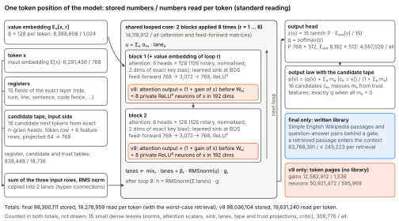

**圖 1：** 模型在一個 token 位置上的樣貌，並標出各部分儲存的數字／每個生成 token 讀取的數字（標準讀法），與表 1 相同（`data/ledger_leaves.csv`、`data/ledger_final_export.csv`）。灰色：兩種設定共用；藍色：僅 `final` 有（藏書）；橘色：僅 `v9` 有（增益與 token 神經元）。15 個小型稠密葉（306,776 個數字）有計入，但沒有畫出。這是示意圖：只有計數是資料。

### 4.2 兩本帳及其稽核

`bes/budget.py` 從實際的參數樹計算兩本帳，並以測試強制落實上限（表 1；完整的帳見附錄 A 的表 A1）。

**表 1：儲存的數字與每個 token 讀取的數字**（標準讀法；`docs/V9.md` §5、`docs/ACCOUNTING.md`、各檢查點的清單檔）。

| 部分 | `final` 儲存 | `final` 讀取 | `v9` 儲存 | `v9` 讀取 |
|---|---|---|---|---|
| 共用：迴圈核心、頭部、正規化層與線道、嵌入、值嵌入、暫存器表與候選帶表 | 34,531,720 | 19,033,736 | 34,531,720 | 19,033,736 |
| 藏書及其索引 | 63,768,391 | 檢索步上為 245,223（最壞情況），否則為 0 | – | – |
| 注意力輸出增益 | – | – | 12,582,912 | 1,536 |
| token 神經元：表 K、U | – | – | 50,331,648 | 6,144 |
| token 神經元：投影 P_in、P_out | – | – | 589,824 | 589,824 |
| **總計** | **98,300,111** | **19,278,959** 最壞情況 | **98,036,104** | **19,631,240** |

兩者的讀取數相差 597,504 個數字（3.1%），其中 589,824 個是兩個稠密投影。這本帳被當作一個關於函數的主張來稽核：`bes/readset.py` 是單一位置的 NumPy 前向傳遞，只接收帳上記為讀取的那些列；它與 JAX 模型吻合到 1e−4，而把沒有提供給它的每一列都毒化之後，它的輸出依然不變。在 40 份至少 2,048 個 token 的真實文件上，`v9` 在標準讀法下讀取 1,943 萬個數字（計入評論頭則為 1,963 萬）；在嚴格讀法下，1,024 個位置時的中位數為 2,380 萬，2,048 個位置時為 2,670 萬：視窗中每一個相異的 token 都會增加 9,536 個數字。因此 `v9` 符合標準讀法，而不符合嚴格讀法（`docs/ACCOUNTING.md`、`docs/V9.md` §10；附錄 A）。

### 4.3 兩本帳沒算到的事

兩本帳都在推論時把每個數字計一次：不計一個數字被套用的次數、它產生的活化值、它的佈局，也不計任何與訓練有關的事。核心的 1,410 萬個權重對每個 token 套用 16 次，只計一次；一個 token 的頁列（3,072 個數字）只計一次，而在訓練中，它被收集出的副本會帶著走過全部 8 個迴圈，它的餘切也在這些迴圈上累加。

## 5. 在單顆 TPU v6e 上，時間花在哪裡

### 5.1 方法

**在晶片上**，我們停下實際運行的訓練，在暖機呼叫之後，於閒置的晶片上以合成批次為各程式計時（五次暫停，共 43 min 04 s 的 TPU 時間；附錄 C）。單一片段的時間是多次重複呼叫的中位數（`final` 30 次，`v9` 6 次）；整步只計時一次，取連續執行數步的平均（預設 2 步；實際使用的步數沒有記錄），因此整步不附離散度。**僅編譯**時，libtpu 0.0.50 在 CPU 主機上（jax 0.11.1）為 `v6e:1x1` 編譯，我們從最佳化後的程式中讀出編譯器估計的週期數，以及每個指令的運算元與輸出在裝置記憶體（HBM）中的邏輯位元組數；Pallas 核函式計為 0 週期；週期數以同一程式家族的兩種形狀校準，為每百萬週期 0.521 ms。第 5.4 節以晶片實測檢驗這些估計。

### 5.2 稠密核心受限於黏合運算，而非其矩陣乘積

晶片上的第一批數字（11 月 23 日）是計畫假設值的三分之一：`final` 以 11.5–11.7 萬 tokens/s 訓練（兩次監控讀數；啟動基準測試為 111,893），而計畫原本假設的是 30–45 萬。在一次區塊套用之內（含重算與反向傳遞共 15.4 ms，32 × 1,024 個 token），矩陣乘積約花 2.4 ms，注意力核函式花 3.4 ms；**其餘 9.6 ms（62%）落在兩者之外**：切片與串接、模型佈局與核函式佈局之間的轉置、最寬張量的 float32 副本，以及逐元素運算（`docs/TPU_NOTES.md`）。一個 768 × 768 乘積的前向花了 0.08 ms：掃過一個活化張量一遍的成本，約與產生它的那個乘積相當。

隨後有三類改動（表 2；附錄 F 的表 F1–F3 與圖 F2）。對黏合運算的五項重寫在捨入範圍內與參考實作相等（28 項測試），另有一處刻意加入的額外捨入（相對誤差 2⁻⁹），它們把一個 32 × 1,024 微批次的一次 `value_and_grad` 從 289.3 降到 162.0 ms。在裝置上把每個微批次切成 4 個片段，所得的更新在捨入範圍內與原本的更新相等。一個單圖塊注意力核函式把一個（列，頭）切片保留在晶片內記憶體中，並且只涵蓋因果三角形；相較於函式庫的 splash 核函式 [61]，它讓單一片段在 1,024 個 token 時快 1.212×，在 2,048 時快 1.219×；它在晶片上的相等性尚未確立（附錄 F.2、圖 F1）。

**表 2：這次訓練的吞吐量，依原因分列**（實際運行：記錄下來的各步速率的中位數，附 n；合成與基準測試數值為整步計時；`lead5_work/numbers.json`、`docs/TPU_NOTES.md`、`docs/CHANGES.md` §19.1–19.7；監控讀數取自操作者在執行階段 1 的記錄）。

| 階段 | 設定 | 實際運行 tokens/s（n） | 合成或基準測試 tokens/s |
|---|---|---|---|
| 參考實作，執行階段 1（11 月 23 日） | `final`，32 列微批次 | 115,394 與 116,718（兩次監控讀數；這些 run 已捨棄） | 111,893（啟動基準測試） |
| 上述重寫，執行階段 1 | 同上 | –（這些 run 已捨棄） | 201,877（啟動基準測試） |
| 16 列微批次，執行階段 2 | `final` | 222,031（101） | 216,681（啟動基準測試） |
| 同一程式在執行階段 3 上 | `final` | 216,548（85）；−2.5%，未能解釋 | – |
| 每個微批次 4 個片段（第 9,332 步） | `final` | 240,131（266） | 246,538 |
| 單圖塊核函式 + ReLU² 反向（第 22,613 步） | `final` | 281,389（142） | 296,371（開啟 `ce` 反向） |
| 接枝（第 29,722 步） | `v9`，`take` 表梯度 | 178,087（44） | 182,919 |
| `flat`、`rows`、`tokn`（第 31,912 步） | `v9` | 196,874（99） | 203,665 |
| 2,048 個 token 的列（p = 0.67，第 36,867 步） | `v9` | 189,067（226） | –（未搭配這些開關計時） |
| 以對話為主的尾段，只在助理 token 上計算損失（p = 0.92，第 48,190 步起至結束） | `v9` | 189,035（73） | – |

從參考實作到單圖塊核函式，`final` 的實際運行速率提升了 2.41–2.44×（第 25,300–29,700 步的 281,399，對比那兩次監控讀數），其中包括一次設定變更（每個微批次從 32 列改為 16 列，單此一項即 +8%）。實際運行速率比合成速率低約 5%。在 2,048 個 token 時，`v9` 的速率比它在 1,024 時低 4.0%。

### 5.3 逐詞頁的代價：一系列介入實驗

表 3 與圖 2 在相同的晶片、核函式、表梯度模式（`take`，一種分散累加）與片段下比較兩種設定，接著為 `v9` 加上三個只改變佈局的開關（提交 `769f240`）：`flat`（token 表作為 `[V, W]` 矩陣的重塑；精確）、`rows`（保留鍵正規化的殘差，頁列以向量通道密集的形式攜帶；精確）以及 `tokn`（token 神經元以 token 排在向量通道上；在捨入範圍內相等）。

**表 3：晶片上的 `final` 對 `v9`**（合成批次上的整步，64 × 4 × 1,024；`wf/chip_kernels_0745.txt`、`S/v9_measA.txt`、`S/v9_measD.txt`；實際運行的中位數取自訓練記錄）。

| 設定 | 每個 token 的解析 GFLOP | 每個 token 的讀取數 | 單一片段（ms） | 整步（ms） | 相對 `final` 的比值 |
|---|---|---|---|---|---|
| `final`（量測該步時開啟 `ce` 反向） | 0.781 | 19,033,736 | 14.639 | 884.5 | 1.000 |
| 接枝後的 `v9` | 0.809 | 19,631,240 | 22.79 | 1,433.1 | 1.620 |
| … + `flat` | 0.809 | 19,631,240 | 22.59 | 1,406.4 | 1.590 |
| … + `rows` | 0.809 | 19,631,240 | 20.44 | 1,295.2 | 1.464 |
| … + `tokn` | 0.809 | 19,631,240 | 20.01 | 1,287.1 | 1.455 |
| 實際運行：`final`（第 25,300–29,700 步）對開關前／後的 `v9` | | | | 281,399 對 178,087 / 196,874 tokens/s | 1.580 / 1.429 |

因此，在切換時，多 3.1% 的讀取數與多 3.6% 的解析算術量讓每步多花了 62% 的時間。這三個開關維持算術量與讀取數不變，去掉了額外 549 毫秒中的 146 毫秒（27%），單是 `rows` 就去掉 111；每步剩下的 403 ms 尚未被任何量測歸因。編譯器的成本模型把 `v9` 多出的週期數主要歸因於 token 神經元的 `[8, 192]` 縮併，晶片的圖塊會把這些縮併補齊到 16 × 256（`wf/v9_speed.md`）；但針對它們的開關 `tokn`，預測可省 64 ms，實際省了 8（圖 3b）。核心變快了，逐詞頁卻沒有：在核心重寫之前，它們讓每步約多花 0.6 s，在切換時則多花 0.55 s。

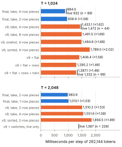

**圖 2：** 在合成批次上、於晶片上計時的一個含 262,144 個 token 的累積步，依設定、表梯度模式與片段大小分列；比值相對於同長度下 `final` 最快的一步。每根長條是一次計時（第 5.1 節）。黑色刻線：262,144 ÷ 實際運行速率，附 n：取表 3 的步數區段，以及在 2,048 個 token 時的第 36,900–48,150 步（n = 226，1,386.5 ms），這一段沒有在合成批次上計時。`final` 計時時開啟了手寫的交叉熵反向（每個片段慢 0.177 ms；這次訓練不使用它）。

### 5.4 哪一種計數能預測每步時間？

有六種設定同時具有編譯後的程式與晶片時間。表 4 與圖 3a 探討，對四種靜態計數各擬合一條直線，在把某個設定排除於擬合之外時，能多準確地預測該設定的實測每步時間：這是一項在量測之後才做的探索性檢驗，共六個點，其中五個是同一模型的佈局變體。

**表 4：靜態計數對實測每步時間**（`lead2_work/predictor_test.py`；編譯後的程式 `wf/v9_*_work/hlo/` 由各自的 `estimate.py` 讀取；晶片時間同表 3）。

| 設定（整步） | 每個 token 的解析 GFLOP | 每個 token 的讀取數（M） | 估計週期數（每步 M） | 估計 HBM 位元組數（每步 GB） | 實測（ms） |
|---|---|---|---|---|---|
| `final`，`take`，64 × 4 × 1,024 | 0.781 | 19.03 | 1,944.7 | 515 | 884.5 |
| `v9`，`take`，64 × 4 × 1,024 | 0.809 | 19.63 | 3,141.8 | 1,277 | 1,433.1 |
| `v9`，`take`，32 × 8 × 1,024 | 0.809 | 19.63 | 3,237.6 | 1,527 | 1,491.5 |
| `v9`，`sorted`，64 × 4 × 1,024 | 0.809 | 19.63 | 3,390.7 | 1,623 | 1,789.0 |
| `v9`，`take` + `flat` | 0.809 | 19.63 | 3,053.6 | 1,237 | 1,406.4 |
| `v9`，`take` + `flat` + `rows` | 0.809 | 19.63 | 2,825.6 | 1,130 | 1,295.2 |
| **留一法誤差，平均（最大）** | 沒有 `final` 時無定義；在五個 `v9` 上為 10%（21%） | 同 FLOP | 12%（40%） | **6%（11%）** | |
| 與實測時間的等級相關 | 0.66（有並列） | 0.66（有並列） | 1.00 | 1.00 | |

編譯器的兩種計數都把六種設定排成與晶片相同的順序。FLOP 與讀取數無法為五個 `v9` 變體排序（1,295–1,789 ms）：在這些變體上，以任一計數擬合的直線預測出的都是其餘四步的平均。位元組數的預測最好；通過全部六點的直線為 492.5 ms 加上每 GB 0.73 ms，殘差從 −110 到 +118 ms：這與「在這個實作中，決定每步時間的是搬移的位元組數而非參數」相符，但這項檢驗太小，不足以確立這一點。差值比總量更難預測：對七項改動，成本模型每次都判對了正負號，大小卻錯了 0.36 到 7.9 倍（圖 3b；附錄 F.7、表 F5）。

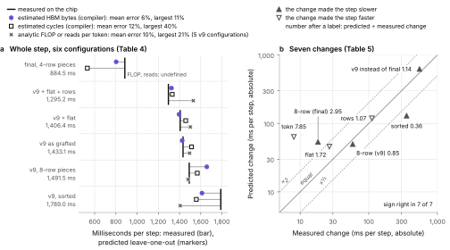

**圖 3：** 編譯器的估計與晶片實測的對照。(a) 表 4 的六種設定，依實測每步時間（長條）排序。標記：各靜態計數的留一法預測，以其誤差連到長條；FLOP 與讀取數給出相同的預測，對 `final` 無定義。(b) 表 F5 的七項改動：每步時間的預測變化對實測變化，以絕對值畫在對數座標軸上；三角形朝上：變慢，朝下：變快；每個標籤之後為預測 ÷ 實測。這六種設定是在量測之後選定的：本圖呈現的是這些計數在此處的表現，並不表示搬移的位元組數一般而言能預測每步時間。

### 5.5 讀取帳在設計本身中隱藏了什麼

在這個模型中，帳與時鐘之間最大的落差不是逐詞頁，而是迴圈：讀取帳把每個 token 的 16 次區塊套用只算一次，時鐘卻每一次都計入（佔參考實作時間的 97%；附錄 F.6）。在相同的牆鐘時間下，4 個迴圈本可訓練約 8 個迴圈 1.6–1.9 倍的 token；在相同 token 數下，在微型消融中，4 個迴圈比 8 個好 0.12%，12 個迴圈差 0.26%，都在其雜訊範圍內（`docs/E2_ABLATIONS.md`）；依 [21] 在兩條線道下的等深度定律，迴圈數減半會使有效遞迴大小除以 2^0.65 = 1.57。這些 token 能否在完整規模下彌補這一點，既沒有預測，也沒有檢驗：迴圈數是依每個讀取數字的計算量決定的，從來沒有問過時鐘（算術效率：附錄 F.6；負面結果：表 H1）。

## 6. 在訓練途中改變設計：保函數接枝

### 6.1 決定

11 月 24 日 09:16 UTC，使用者要求切換到 `configs/v9.py`。當時這次 run 位於 p ≈ 0.50，已訓練 7.79 × 10⁹ 個 token，剩下 30,969 s 的訓練時間；在這段時間內，從頭訓練的 `v9` 依切換時測得的速率約能看到 5.4 × 10⁹ 個 token，若計入第 5.3 節後來的那些切換則為 6.0 × 10⁹（此為推估）：都少於這次 run 已有的量。因此，這次 run 改在新的參數樹中繼續進行。切換是使用者的決定：兩種設定之間並未進行事先註冊的比較（附錄 C.5），而支持逐詞頁的證據規模小且未有定論（附錄 B.4）。

### 6.2 保函數的延續訓練

設目標設定的參數為 θ = (θ_s, θ_n)，其中 θ_s 是來源也有的葉（路徑、形狀與型別皆相同），θ_n 則是新的葉。若對每個 θ_s 都有 f_target( · ; θ_s, θ_n⁰ ) = f_source( · ; θ_s )，則稱初始化 θ_n⁰ 為*中性*。對 `v9` 而言，不論 K、P_in 與 P_out 為何，U = 0 與 G = 0 都使 θ_n⁰ 為中性，在浮點運算下亦然：U = 0 時，token 神經元的輸出是一串精確零值之和；G = 0 時，增益恰好乘以 1。在接枝點：（1）每個損失都等於來源的損失；（2）在精確算術下，對 θ_s 的梯度等於來源的梯度，因此在沿用的最佳化器狀態下，θ_s 的第一次更新與來源相同（沒有梯度裁剪）；（3）新葉之中只有 U 與 G 在第一步得到非零梯度，而 K、P_in 與 P_out 的梯度恰好為零；（4）新葉上的 Adam 以沿用的更新計數執行，因此在梯度固定時，其更新在第一步是全新 run 的 0.894 倍，在第七步是 1.44 倍，為最大值（β = 0.8, 0.95；附錄 G）。

### 6.3 沿用了什麼、新增了什麼

`scripts/graft_run.py`（提交 `9a4d652`；圖 4；附錄 G）沿用了 59 個共有葉的參數與最佳化器槽位（34,531,720 個數字）、更新計數、步數，以及訓練器的時間帳與損失防護；5 個新葉（63,504,384 個數字）則從其初始化值開始，並使用全新的槽位。由於時間帳被沿用，排程得以延續：p 從停止時的 0.5049 變為還原時的 0.5112，學習率係數則沿著 1 − 0.9p 繼續（第 29,750 步時為 0.5394）。資料流無法沿用：資料混合改變了（沒有藏書列），它以另一個種子重新開始，而且載入器的計畫需要兩次修正（附錄 G）。接枝後，`v9` 訓練了 22,090 步、5,790,760,960 個 token（在 2,048 個 token 下為 189,067 tokens/s，n = 226）；這次 run 在第 51,812 步結束，共 13,582,204,928 個 token，依一項推估，比不切換時 `final` 會訓練的量少約 2.33 × 10⁹（14.6%），該推估中 `final` 本身在 2,048 個 token 下的速率是縮放而得的估計值。

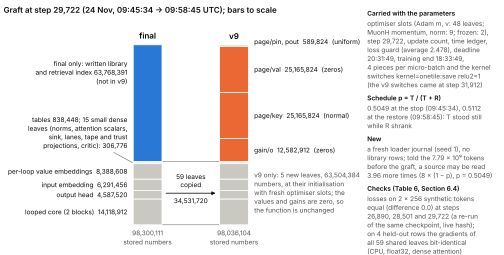

**圖 4**：兩種設定在第 29,722 步時儲存的數字，按比例繪製；顏色同圖 1。灰色：59 個共有葉，連同其最佳化器槽位一併沿用；藍色：`final` 的藏書與索引；橘色：`v9` 的五個新葉，使用全新的槽位。右側：其他沿用的項目、新增的項目，以及第 6.4 節的檢查（`data/graft_facts.csv`、`data/ledger_leaves.csv`）。

### 6.4 驗證

該工具的 `--check` 在一個合成批次上比較來源與接枝後參數樹的損失，除非兩者在相對誤差 1e−6 內一致，否則拒絕執行；在四個來源檢查點上，其中包括切換當下的 29,722（由於實際那次呼叫沒有執行檢查，此點是在實際設定的雜湊下重跑的），損失在印出的每一位數字上都一致（表 G1）。以第 29,722 步的檢查點，在保留集的網頁與對話資料各 2 列上，兩個程式給出：直到最後一個位元都相同的損失；所有 59 個共有葉逐位元相同的梯度；K、P_in 與 P_out 恰為零的梯度；以及 U 與 G 的非零梯度（`lead2_work/graft_grad.py`）。兩項檢查都在 CPU 上以 float32 執行；在晶片上以 bfloat16 執行時，相等只在捨入誤差範圍內成立，且未經量測。

### 6.5 跨越接枝直到結束的保留集損失

執行階段評估了 `final` 的 3 個檢查點與 `v9` 的 22 個檢查點（最後一個在第 51,812 步），評估資料為 64 列網頁資料（一個超出這次 run 下載上限的 ClimbMix 檔案）、64 列對話資料（smol-smoltalk 的測試集），以及 12 列評測題目的使用者輪次，其中包含測試題目，這些列不納入比較（每列 1,024 個 token，float32；圖 5、表 G2）。比較集是這 128 列網頁與對話資料。有五個檢查點在 CPU 上再次評估，也評估了關閉新路徑的情形，並在 51,812 評估了偏好最佳化之後的情形（附錄 G.5）。

**表 5：訓練結束時的保留集損失**（第 51,812 步；網頁 + 對話列；區間以對各列的拔靴法求得；`final` 的趨勢線由 `lead5_work/scripts/heldout5.py` 計算，其中 `final` 在相同時間下的 token 數依第 6.3 節的速率計算；較早的步數見表 G3）。

| 比較（網頁 + 對話） | 差值（nats） | 95% 區間 |
|---|---|---|
| `v9` 51,812 − `final` 29,722（相同的列，多訓練 509.5 分鐘） | −0.1829 | [−0.2002, −0.1663] |
| … 僅網頁列／僅對話列 | −0.1196 / −0.2514 | [−0.1286, −0.1112] / [−0.2759, −0.2274] |
| `v9` − 相同訓練時間下 `final` 的趨勢線（趨勢線以分鐘／以對數 token 數為軸） | −0.076 / −0.117 | ±0.227 / ±0.129（預測區間，1 個自由度）；兩者皆在區間內（對數 token 數：從 41,850 到 48,342 在區間外） |
| `v9` − 相同 token 數下 `final` 的趨勢線（並非預算的軸） | −0.131 | ±0.103；在區間外（從第 34,166 步起） |
| 逐詞頁關閉 − 開啟 | +0.2631 | [0.2442, 0.2829] |
| 關閉逐詞頁的 `v9` − `final` 29,722 | +0.0802 | [0.0674, 0.0938] |
| 偏好最佳化之後 − 訓練所得的權重，於 51,812 | +0.0124 | [0.0112, 0.0136] |

四種解讀，依其所需假設的多寡排序。（i）在相同的列上，損失在接枝後的 129 分鐘訓練中下降了 0.061 nats（表 G3），到訓練結束時共下降 0.183（網頁 0.120，對話 0.251；接枝前則是 44 分鐘內下降 0.009），其中只有 0.015 [0.009, 0.021] 發生在第 46,178 步之後。從 p = 0.67 起，對話列下降得比網頁列快得多（表 G2），而同一時期對話佔比升向 0.70、列變得更長、學習率衰減，且部分對話來源被再次讀取：這些原因是這次 run 無法區分的。
（ii）預算的問題，也就是在相同訓練時間下與一個沒有繼續訓練的 `final` 相比，只有一個估計：`final` 通過跨越 44 分鐘的三個檢查點的趨勢，再加以外推（圖 5）。以訓練分鐘數計，`v9` 在每個檢查點都落在其 95% 預測區間內；以對數 token 數計，它從第 41,850 步到 48,342 步落在區間外，並自 49,424 起回到區間內，因為區間變寬，且比較集上的損失不再下降；以相同 token 數計（並非預算的軸），則從 34,166 起落在區間外（表 5）。這條趨勢線是薄弱的一環：只有一個殘差自由度，以 44 分鐘的資料外推到其後的 510 分鐘，而且沒有對衰減中的學習率、對話佔比的爬升、尾段或資料流的改變建模。相同時間下的差距無法判定。
（iii）在評估時關閉逐詞頁，在 51,812 的代價是 0.263 nats，超過接枝以來的全部改善（此時網路比接枝點時還差 0.080），代價主要落在罕見的輸入 token 上（在最罕見的四分之一位置上為 0.356，在最常見的四分之一上為 0.193；附錄 G.5）：這是對一個已訓練模型的分解，並非反事實。
（iv）最後上升的是什麼。全部列的損失在第 47,260 步達到最小值 2.0840，到 51,812 升至 2.1422，原因是代理列（幾乎全是使用者文字，11,094 個加權 token 中有 10,594 個）從 2.4683 升到 3.2580，而網頁列下降（2.6847 降到 2.6690），對話列整體則維持在 1.36 附近。在對話佔比爬升期間，代理列曾經下降（從 36,422 的 2.5430 降到 46,178 的 2.4614）；從 p = 0.92（第 48,190 步）起，使用者與系統 token 不帶損失權重（附錄 C.1），使用者文字上的損失隨即上升：在之後的第一個檢查點，代理列為 2.6651；對話列的使用者與系統位置從 1.8841 升到 2.1144（46,178 到 51,812），而其助理 token 則從 1.2651 降到 1.1983。模型不再被訓練去預測使用者，這是排程所做的選擇；它對其訓練與評判所依據的助理文字與網頁文字的擬合並沒有變差。

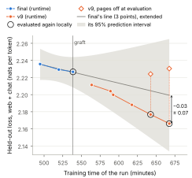

**圖 5**：表 5 比較集上的保留集損失對訓練分鐘數作圖，至第 51,588 步為止（各圖止於最後一筆步數紀錄 51,800；最終檢查點 51,812 的值同為 2.0438，列於表 5）。實心點：執行階段的評估；圓環：CPU 重新評估（29,722、34,166、35,294、46,178）；空心菱形：關閉逐詞頁的 `v9`（34,166、35,294、46,178）。灰色線與色帶：通過 `final` 三個點的最小平方直線，再加以外推，及其 95% 預測區間（一個殘差自由度）；箭頭：`v9` 在 51,588 與該線的距離，−0.077 ± 0.225。每個 `v9` 點都落在色帶內；以對數 token 數或相同 token 數計，較晚的檢查點則落在色帶外（表 5）。本圖並未顯示 `v9` 領先一個繼續訓練的 `final`（解讀 ii）。

### 6.6 受控條件下的接枝：在微型寬度上的重現實驗

單次 run 無法說明接枝與從第一步起就訓練新路徑相比、或與不加入新路徑相比結果如何，因此我們用儲存庫本身的模型與微型測試平台重做了接枝，其他一切保持相同（`docs/MICRO_GRAFT.md`；程式碼位於 `b04478e`，在執行前經過對抗式審查；附錄 G.4）。在寬度 128、預算 6 × 10⁶ 個 token 的條件下，五個組分別以種子 0、1、2 執行：`ref`，即微型參考模型；`v9_pages`，即從第一步起就帶有 `v9` 逐詞頁的參考模型；以及 `graft_25`、`graft_50`、`graft_75`，即先以 `ref` 訓練到預算的 0.25、0.5 或 0.75，再以實際工具本身的函式接枝成 `v9_pages`。在同一個種子內，所有組共用資料順序、排程與初始值，而九次接枝中的每一次都讓保留集損失完全不變（CPU，float32）。

**表 6：微型寬度下的接枝**（保留集損失，網頁與對話混合，單位為每個 token 的 nats，於 5,996,544 個 token 時，重啟組則於其自身終點 2,998,272 時；種子 0、1、2 的平均 ± 標準差；差值按種子配對；回收比例 = (`ref` − 組) / (`ref` − `v9_pages`)，即平均差值之比，各種子的值列於括號內；由 `lead3_work/micrograft.py` 根據 `micro_graft/6M/results_all.jsonl` 與 `micro_graft/3M/results.tar.gz` 計算，並由 `lead4_work/scripts/micro4.py` 核對）。

| 組 | 新路徑起始於 | 損失 | 組 − `ref` | 組 − `v9_pages` | 回收比例 |
|---|---|---|---|---|---|
| `ref` | 從未加入 | 4.1912 ± 0.0076 | – | +0.0519 ± 0.0107 | 0 |
| `v9_pages` | 第 0 步 | 4.1394 ± 0.0083 | −0.0519 ± 0.0107 (−1.24%) | – | 1 |
| `graft_25` | 預算的 0.25 | 4.1363 ± 0.0075 | −0.0550 ± 0.0010 | −0.0031 ± 0.0113 | 1.06 (0.86, 1.33, 1.08) |
| `graft_50` | 0.5 | 4.1555 ± 0.0091 | −0.0358 ± 0.0030 | +0.0161 ± 0.0096 | 0.69 (0.62, 0.87, 0.64) |
| `graft_75` | 0.75 | 4.1789 ± 0.0074 | −0.0123 ± 0.0004 | +0.0396 ± 0.0103 | 0.24 (0.20, 0.29, 0.24) |
| 重啟：以一半預算從頭訓練 `v9_pages`（3 × 10⁶ 個 token，使用自身的排程） | 該半段的第 0 步 | 4.3897 ± 0.0017 | +0.1985 ± 0.0062 | +0.2504 ± 0.0074（相對於 `graft_50`：+0.2342 ± 0.0075） | – |

**解讀**（表 6、圖 6）。從第一步起就加入的逐詞頁，最後比 `ref` 低 0.052 nats（1.24%）。每次接枝在每個種子下最後都低於 `ref`。在預算的四分之一處接枝時，逐詞頁最後與從第一步起就加入的逐詞頁之間未能判定有差異（−0.0031 ± 0.0113，為三個種子的標準差；平均值的 95% t 區間為 ±0.028，約為逐詞頁全部增益的一半）；在一半處接枝時，它收回了該增益的 0.69（依種子為 0.62–0.87）；在四分之三處則為 0.24，這與晚接枝缺少它所沒有的時間相符，且學習率也在下降（附錄 G.4）。若改為在後半段帶著逐詞頁從頭重新開始，最後比 `graft_50` 高 0.234 nats（各種子為 +0.227 至 +0.241），比 `ref` 高 0.199：重啟所捨棄的 token，價值是逐詞頁全部增益的四到五倍（0.199–0.250 對 0.052）。這是在損失仍急遽下降時、在相同 token 數下重啟的代價，而不是在 7.79 × 10⁹ 個 token、相同牆鐘時間下，重啟對實際 run 會造成的代價。

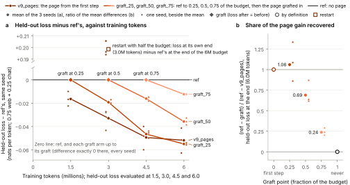

**圖 6**：微型寬度下的接枝（表 6；寬度 128，6 × 10⁶ 個 token，三個種子）。（a）各組的保留集損失（0.75 × 網頁 + 0.25 × 對話）減去相同種子下 `ref` 的損失：大點為各種子的平均；小點為各個種子；接枝組在其菱形處離開零線。方塊，位於座標軸斷開處上方：重啟組在其自身終點（3 × 10⁶ 個 token）的值減去 `ref` 在 6 × 10⁶ 的值，+0.1985，配對的是不相等的 token 數。（b）最後收回的逐詞頁增益比例：大點為平均差值之比（1.06、0.69、0.24）；小點為各個種子。未畫出區間：三個種子太少。

### 6.7 單次 run 無法顯示什麼，以及受控實驗顯示了什麼

在寬度 128 上，受控實驗顯示：接枝在實務上是保函數的（在 CPU 上以 float32；在晶片上以 bfloat16 則未量測）；在接枝後的設定中繼續訓練，最後從未比不接枝差（9 次 run 中 9 次皆然）；接枝所收回的從頭訓練增益比例，隨接枝點後移而下降；以及帶著新路徑在剩下的一半上重啟，最後遠遠落後於接枝。它的侷限：寬度 128 對 768；6 × 10⁶ 個 token 對 1.36 × 10¹⁰，約為在小型資料池上走過一遍；三個種子；排程以 token 而非牆鐘時間計，因此逐詞頁在每步時間上的成本（在晶片上實際為 1.43–1.58×）沒有計入；資料流在接枝前後不變；逐詞頁的價值只佔損失的 1.2%。它是關於接枝機制的證據，而不是關於接枝在實際 run 中效應大小的證據；它也留下以下問題未解：逐詞頁在寬度 768 時是否有幫助；在相同牆鐘時間下，接枝是否勝過重啟或延續訓練；改變後的資料流造成了什麼影響；新葉只在排程中低學習率的那一半訓練時表現如何；以及不同 run 之間的變異。任何拿交付的模型與對手所做的比較，量到的都是這些因素的總和。

## 7. 評估：協定、偏離與結果

### 7.1 協定

協定（`docs/EVAL_PROTOCOL.md`）位於該分支的根提交（`5ff33c5`，11 月 23 日 00:35 UTC），此後未曾更動：它早於每一次 TPU run 與完整規模模型的每一則回覆，但並不早於關卡 E2、E4 與 E5 的微規模 run。**題目**：400 道原創英文題目，分為五類，其中四分之一另有第二輪使用者發言，並依其識別碼的 SHA-256 分為 `dev` 與 `test`（各 200 道；`test`：252 輪，含 30 道數學題與 48 道帶限制的題目）；決策使用 `dev`，`test` 只使用一次。左右位置由種子決定並保持平衡，計分器會拒絕任何對隱藏金鑰之承諾不相符的評分。**讀者**：註冊評審 `qwen3-4b-2507` 以兩種順序判讀，另以 `gemma4-e4b` 作為第二評審；只有兩種順序都選擇同一方時，該方才算勝。**精確計分**優先，且比讀者更受信任。**統計**：分數 (勝 + 平/2)/n 附 Wilson 區間、精確雙尾符號檢定，以及依類別、輪數與長度比所做的切片。**主張必須揭露的內容**（§3）：K = 1 的結果以及使用我們 K 個粒子的結果、藏書開啟與關閉的結果，以及每個對手在相同 K 下的兩個對照組，分別以對手自身的平均對數機率選留（同 K 對照）或以我們的選擇器選留（同選擇器對照）；MobileLLM-R1.5 以其兩組中在 `dev` 上較好的一組計，這項決定在查看 `test` 之前做出。

### 7.2 對協定的偏離

1. **讀者。** 註冊評審以兩種順序判讀了開發配對，以及兩個正式測試配對集的全部 200 個配對（評分檔案於 22:11 與 22:35 UTC 完成），沒有判讀其他測試配對集；第二個註冊評審在每個配對集的 60 個開發配對中分出 2 到 4 個勝負（附錄 E.6），沒有在測試配對上執行。Opus 5.5 代理與建構本系統的代理屬於同一家族，他們依照書面指示，將每個測試配對以左右互換的方式判讀兩次（附錄 J）：這是額外加入的，從未與註冊評審平均。他們的指示談的是兩個未具名的系統，但每個測試配對集的每個分塊都以配對集的名稱為標題並據以歸檔（例如 `final-prefopt-vs-falcon`），因此他們能夠得知一個配對集比較的是哪兩個系統；他們沒有被告知哪則回覆屬於哪個系統，但 MobileLLM-R1.5 加框且反覆循環的回覆常常透露了這一點（每次判讀中，200 個配對裡有 27 到 37 個配對的筆記寫有「boxed」）。從未看到名稱的註冊評審在方向上一致，而在中性標題下對兩個正式配對集的重新判讀（來源 `judge-opus-neutral`），在 200 道題目中分別有 191 與 190 道得到相同結果（第 7.5 節）；其他測試配對集只在具名標題下判讀過。
2. **有十一道測試題目被看過**，見於 run 中途的 CPU 取樣（chat-002、chat-017、math-034、instruct-034、instruct-062、writing-100、code-026、math-001、code-002、writing-001、instruct-001）。每一項測試結果也都在 189 道未接觸過的題目上另行報告。
3. **代理保留集的資料列包含測試集的使用者輪次**（第 6.5 節）；這些資料列不納入比較。
4. **MobileLLM 的兩組。** 在 `dev` 上沒有對 `neutral` 組做過盲測比較，因此我們的模型預設與 `recommended` 組比較，而不是依協定的規則決定；其精確計分在 `dev` 上偏向 `recommended`（表 E3），而在 `test` 上兩者相近（表 8）。
5. **在訓練時**（附錄 B.5）：看過資料之後選定的 E2 損失讀法；雖未通過其關卡仍保留的暫存器；事後被判定為錯誤的 E5 複製準則；沒有執行的事先註冊設定比較；在 run 中途更改的設定。
6. **K = 1 與匹配對照組：來得晚且不完整。** 我們的回覆是從 K = 6 個粒子中選出，而對手抽取一個樣本。在訓練之後於 `test` 上製作、並由 Opus 讀者在具名標題下判讀的有（表 7、8）：我們的 K = 1 組（以一個粒子執行的正式匯出）與 Falcon-H1-Tiny 的兩個對照組。MobileLLM-R1.5 的兩組尚不存在 [TBD: 自 19:17 UTC 起生成中，22:02 時已有 200 道題目中的 60 道；自 22:36 起，三個 CPU 執行階段與開發容器分別生成題目順序中互不重疊的切片，每個切片都套用兩種選擇規則；預計於 11 月 25 日 00:30 UTC 之後完成]。藏書開啟與關閉的比較不適用：`v9` 不附藏書。

### 7.3 200 次比較能分辨什麼

以 Opus 讀者在 `test` 上的平手率（對 Falcon-H1-Tiny 為 28.5%，對 MobileLLM-R1.5 為 34.5%，我們的兩套權重之間為 53.5%）計算，n = 200 能以 80% 的檢定力（雙尾 5% 符號檢定）偵測出 0.5 ± 0.116、± 0.121 與 ± 0.143 的分出勝負時的勝率（在 189 道未接觸過的題目上依其各自的平手率計算，則為 ± 0.120、0.125 與 0.147；`bes.eval.proxy.score.n_required`，n = 200 的數值見 `lead5_work/numbers.json`）。以註冊評審的平手率 63.5% 與 68.0% 計算，則為 ± 0.161 與 ± 0.172。實際觀察到的對兩個對手分出勝負時的勝率為 0.245 與 0.885，遠遠超出這些界限。

### 7.4 正式模型

正式模型就是這次 run 自身的規則所交付的模型（附錄 C.4；表 C4、C5、M7、M8）：第 51,812 步的權重經偏好最佳化之後的結果，搭配預設解碼。偏好最佳化（DPO [74]，β = 0.1，一個訓練週期，共 551 步、每步 64 個配對，幾乎全部來自 UltraFeedback [76]）試了兩個學習率；兩者都通過了每一項檢查（保留集偏好準確率 0.688 與 0.694，對照 0.500；保留集助理 token 損失 +0.86% 與 +1.10%，上限 3%），而規則保留了準確率較高者，即 3 × 10⁻⁶。解碼選擇會保留預設，除非某個變體在 200 道開發題目上的精確計分，較高的題目數顯著多於較低的題目數：單一粒子在 18 道上較差、1 道上較好（p = 7.6 × 10⁻⁵），不設長度範圍則在 2 道上較好、沒有一道較差（p = 0.50），因此保留預設（6 個粒子、溫度 0.6、top-p 0.9、768 個 token、無藏書）。這份匯出（98,036,104 個 float16 數字）通過了其 16 位元檢查；我們的測試回覆來自同一檢查點的第二次匯出，其 `weights16.npz` 相同（SHA-256 `2da7cbd2…`），是在解碼選擇確定保留預設之前，就以預設解碼製作的；這次 run 自己的匯出以 `release/main16-v9` 發布（附錄 J）。

### 7.5 測試集上的盲測比較

表 7 列出測試配對的每一次判讀；圖 7 把 Opus 讀者的判讀與開發集上的研究畫在一起。三類讀者分開呈現：精確計分器（第 7.6 節）、註冊評審（其配對有 63.5% 與 68.0% 未分出勝負）與 Opus 讀者（28.5% 與 34.5% 未分出勝負），它們的分辨力相差太大，無法平均。

**表 7：200 道測試題目上的盲測比較**（勝 / 負 / 平從第一個列名的模型一方計算，平包括「兩者皆差」以及兩種順序判讀不一致的配對；分數 (勝 + 平/2)/n 與分出勝負時的勝率，附 95% Wilson 區間，只捨入一次，恰好落在一半上的值捨入到偶數；精確雙尾符號檢定；順序：兩種順序判讀一致的配對比例；首位：對先呈現之回覆的平均偏好；最後一欄：已評分題目中未接觸過的題目；由 `lead5_work/scripts/final_results.py` 附金鑰檢查重新計算，該腳本可重現每一份報告；註冊評審在兩個配對集上的判讀皆已完整）。

| 比較 | 讀者 | n | 勝 / 負 / 平 | 分數 [95%] | 分出勝負時的勝率 [95%] | 符號檢定 p | 順序；首位 | 189 道題目：勝 / 負 / 平；分數 |
|---|---|---|---|---|---|---|---|---|
| 正式模型對 Falcon-H1-Tiny | Opus，兩次判讀 | 200 | 35 / 108 / 57 | 0.318 [0.257, 0.385] | 0.245 [0.182, 0.321] | < 0.0001 | 90.5%; +0.005 | 32 / 101 / 56; 0.317 |
|  | Opus，中性標題 | 200 | 33 / 109 / 58 | 0.310 [0.250, 0.377] | 0.232 [0.171, 0.308] | < 0.0001 | 92.5%; +0.010 | 31 / 102 / 56; 0.312 |
|  | `qwen3-4b-2507`（註冊評審） | 200 | 12 / 61 / 127 | 0.378 [0.313, 0.446] | 0.164 [0.097, 0.266] | < 0.0001 | 60.5%; −0.134 | 11 / 57 / 121; 0.378 |
| 正式模型對 Falcon-H1-Tiny，K = 6，自身對數機率 | Opus | 200 | 35 / 112 / 53 | 0.308 [0.248, 0.375] | 0.238 [0.176, 0.313] | < 0.0001 | 93.5%; +0.020 | 34 / 106 / 49; 0.310 |
| 正式模型對 Falcon-H1-Tiny，K = 6，我們的選擇器 | Opus | 200 | 29 / 116 / 55 | 0.282 [0.225, 0.349] | 0.200 [0.143, 0.272] | < 0.0001 | 92.5%; +0.018 | 27 / 110 / 52; 0.280 |
| 我們的模型以一個粒子（K = 1）對 Falcon-H1-Tiny | Opus | 200 | 22 / 122 / 56 | 0.250 [0.195, 0.314] | 0.153 [0.103, 0.220] | < 0.0001 | 92.5%; +0.015 | 20 / 116 / 53; 0.246 |
| 正式模型對 MobileLLM-R1.5 | Opus，兩次判讀 | 200 | 116 / 15 / 69 | 0.752 [0.688, 0.807] | 0.885 [0.820, 0.929] | < 0.0001 | 96.0%; −0.005 | 109 / 14 / 66; 0.751 |
|  | Opus，中性標題 | 200 | 112 / 15 / 73 | 0.742 [0.678, 0.798] | 0.882 [0.814, 0.927] | < 0.0001 | 96.0%; −0.010 | 106 / 14 / 69; 0.743 |
|  | `qwen3-4b-2507`（註冊評審） | 200 | 59 / 5 / 136 | 0.635 [0.566, 0.699] | 0.922 [0.830, 0.966] | < 0.0001 | 71.5%; −0.035 | 56 / 5 / 128; 0.635 |
| 正式模型對 MobileLLM-R1.5，K = 6，自身對數機率或我們的選擇器 | Opus | – | [TBD: 回覆生成中，第 7.2 節，偏離 6] |  |  |  |  |  |
| 我們的模型以一個粒子（K = 1）對 MobileLLM-R1.5 | Opus | 200 | 99 / 16 / 85 | 0.708 [0.641, 0.766] | 0.861 [0.786, 0.913] | < 0.0001 | 91.5%; +0.008 | 92 / 14 / 83; 0.706 |
| 正式模型對訓練後的權重（偏好最佳化之前） | Opus | 200 | 59 / 34 / 107 | 0.562 [0.493, 0.629] | 0.634 [0.533, 0.725] | 0.012 | 91.5%; +0.010 | 55 / 33 / 101; 0.558 |
| 參考：Falcon-H1-Tiny 對 MobileLLM-R1.5 | Opus | 200 | 144 / 6 / 50 | 0.845 [0.788, 0.889] | 0.960 [0.915, 0.982] | < 0.0001 | 93.5%; +0.012 | 137 / 5 / 47; 0.849 |

**對 Falcon-H1-Tiny**，正式模型在每個類別都輸（程式碼 10 / 13，p = 0.68，其餘 p ≤ 0.025；表 M2），在兩輪題目上也輸（7 / 30）；其回覆在配對中較短時表現最好（分數 0.419），較長時表現最差（0.143）。在每則回覆有六個樣本的情況下，Falcon-H1-Tiny 再次較受偏好：按題目配對，我們對其發布預設集的分數，與對同 K 對照組的分數相差 0.010（29 道題目較好、25 道較差，p = 0.68），與對同選擇器對照組的分數相差 0.035（34 / 21，p = 0.10），因此這次落敗並不是六個粒子對一個樣本所造成的假象。我們自己的六個粒子有一些價值：面對相同的對手，正式解碼的分數比單一粒子高的題目，對 Falcon-H1-Tiny 有 31 道、低的有 12 道（平均 0.068，p = 0.0054），對 MobileLLM-R1.5 則為 28 / 13（0.045，p = 0.028）。**對 MobileLLM-R1.5**，正式模型除數學（7 / 12，p = 0.36）之外，在每個類別都贏。**註冊評審**指向同一方向，但分出勝負的配對較少：它在 200 個配對中分別判 127 與 136 個平手（約三分之二），在其 73 個分出勝負的配對中有 61 個偏好 Falcon-H1-Tiny，在 64 個中有 59 個偏好我們的模型而非 MobileLLM-R1.5；在它與 Opus 讀者都選了一方的配對中，兩者在 62 個中有 58 個、在 56 個中有 55 個一致（Cohen 的 κ 為 0.25 與 0.29），儘管它從未看過配對集的名稱。它的診斷指標偏弱（兩種順序一致的配對只有 60.5% 與 71.5%；在 Falcon-H1-Tiny 配對集上，對首位回覆的偏好為 −0.134（也就是偏好後呈現的那一則）：依協定的 §8，這些都是評審不可靠的跡象），而且在它的 200 個 MobileLLM-R1.5 配對中，有 88 個的回覆在 4,000 個字元處被截斷。**分塊標題中的名稱**（偏離 1）並未可察覺地改變結果：在中性標題下，正式模型的分數為 0.310 與 0.742；按題目配對，具名判讀給它的分數，對 Falcon-H1-Tiny 有 6 道較高、3 道較低（p = 0.51），對 MobileLLM-R1.5 有 7 道較高、3 道較低（p = 0.34），兩者都對它有利，但都不顯著；而且在兩組判讀都分出勝負的題目中，沒有任何一道被判出相反的勝負；其他配對集沒有重新判讀。限縮到 189 道未接觸過的題目，每個分數的變動都小於 0.005（表 7、M1、M11）。

### 7.6 精確計分與退化回覆

**表 8：200 道測試題目（252 輪）上的精確計分**（對每則回覆執行 `bes.eval.exact_score`，經重新計算，並在這次 run 有精確報告之處與該報告相等；括號內為 189 道未接觸過的題目，其中 28 道數學、44 道帶限制（在退化回覆一列中：在 token 上限處被截斷者）；訓練後的權重與每一種退化回覆見表 M4）。

| 指標 | 我們的模型，正式（K = 6） | 我們的模型，K = 1 | Falcon-H1-Tiny | Falcon，K = 6，自身對數機率 | Falcon，K = 6，我們的選擇器 | MobileLLM-R1.5 `recommended` | MobileLLM-R1.5 `neutral` | MobileLLM-R1.5，K = 6（兩種規則） |
|---|---|---|---|---|---|---|---|---|
| 數學答案正確，共 30 道（共 28 道） | 6 (6) | 5 (5) | 15 (14) | 17 (16) | 18 (17) | 12 (11) | 11 (10) | [TBD] |
| 滿足所有限制的題目，共 48 道（共 44 道） | 38 (34) | 37 (33) | 33 (29) | 35 (32) | 42 (38) | 8 (8) | 9 (8) | [TBD] |
| 退化回覆，共 252 輪（其中在 token 上限處被截斷者） | 5 (5) | 17 (17) | 2 (1) | 1 (0) | 0 | 158 (150) | 148 (146) | [TBD] |
| 每則回覆的字數，上中位數（252 個中的第 127 個） | 101 | 105 | 155 | 147 | 145 | 395 | 517 | [TBD] |

與發布版的 Falcon-H1-Tiny 相比，我們的模型在更多題目上滿足所有限制（48 道中 38 道對 33 道），而答對的數學題遠少得多（30 道中 6 道對 15 道）。限制方面的領先並非來自六個粒子之間的選擇：用一個粒子時沒有任何選擇（我們的精確勢函數在取樣過程中仍會作用），我們的模型滿足 37 道。**同選擇器對照組顯示，這項領先在匹配之後不再成立**：給予六個樣本與我們的選擇規則（從題目編譯出的限制、失敗過濾器、長度範圍、數學多數決、共識；不含我們的勢函數），Falcon-H1-Tiny 在 42 道題目上滿足所有限制，比我們的模型多四道。我們的 37 與 38 究竟歸於模型還是勢函數，在 `test` 上並未區分開來，而數學上的差距並未彌合（5 與 6 對 15 到 18）。MobileLLM-R1.5 的回覆在其建議預設集下，252 輪中有 158 輪退化（150 輪在 token 上限處被截斷；其 200 道題目中有 139 道至少有一則退化回覆），在中性預設集下則有 148 輪（133 道題目）；它在讀者判讀中的落敗，很大程度上是這些回覆的落敗。沒有任何模型給出制式的拒絕或迴避。

**從讀者的筆記來看**（附錄 O；標籤由一個代理在金鑰公開的情況下標註）：在輸給 Falcon-H1-Tiny 的 108 次落敗中，46 次來自錯誤內容（錯誤事實 19、數學錯誤 17、程式碼無法運作 10），43 次來自不連貫、離題或重複的文字；在 75 次中，Falcon-H1-Tiny 的回覆沒有決定性的缺陷。用一個粒子時，這 108 次中有 99 次再次落敗；35 次勝利中只有 17 次再次獲勝。讀者在 25 道題目上指出重複是我們回覆的主要缺陷；退化回覆偵測器標記了 3 道。在勝過 MobileLLM-R1.5 的 116 次中，有 93 次勝的是它退化或離題的回覆；我們的回覆在其中 60 次有被指出的缺陷。

### 7.7 偏好最佳化之前與之後

由 Opus 讀者在相同題目上判讀（200 道中有 4 道得到完全相同的回覆），正式權重在 59 個配對中比訓練後的權重更受偏好，訓練後的權重則在 34 個配對中更受偏好（p = 0.012；189 道題目：55 / 33，p = 0.025），主要在程式碼（10 / 1）與聊天（16 / 8），而非數學（5 / 5）。協定認為比讀者更可信的精確計分則往另一個方向移動，但不顯著：數學在 30 道中為 6 與 6，限制在 48 道中為 38 對 41（新增 2 道、失去 5 道，p = 0.45），退化回覆 5 對 3；回覆變長了（平均 130 對 119 字），而比較集的保留集損失上升了 0.012 nats（第 6.5 節）。一個訓練週期的 DPO（以選定的學習率訓練 424 s）換來了一類讀者的小幅偏好，而這類讀者能從標題看出該配對集比較的是什麼；這個配對集既沒有在中性標題下判讀，也沒有由註冊評審判讀（表 M5）。

### 7.8 以絕對標準來看

當兩則回覆都是我們的時（正式權重對訓練後的權重），每次判讀中都有 200 個配對裡的 89 個被判為兩者皆差（每次判讀 44.5%；兩次判讀都如此的有 83 個，41.5%；至少一次如此的有 95 個，47.5%），相較之下，第 31,912 步檢查點的兩種解碼在 60 個開發配對中有 44 個（73%，一次判讀）；對 Falcon-H1-Tiny 為 44 與 41 個配對，對 MobileLLM-R1.5 為 66 與 64 個，而在沒有任何一則回覆屬於我們的參考配對集中，為 38 與 38 個（原始判定，`lead5_work/final_results.json`）。正式模型的回覆中有略少於一半，連同一則同源的回覆一起被判為無用；題目集不同，因此從 73% 的下降僅具參考意義。

### 7.9 軌跡

**表 9：從 run 中途的檢查點到正式模型**（Opus 讀者，勝 / 負 / 平與分數；註冊評審，勝 / 負；相同回覆的精確計分；在 `dev` 上為前 60 道題目，其中 9 道數學、14 道帶限制，附錄 E.6；正式模型的 `dev` 回覆就是這次 run 自己做解碼選擇時的回覆）。

| 模型（切分，n） | 對 Falcon-H1-Tiny：Opus | 對 MobileLLM-R1.5：Opus | 註冊評審，勝 / 負（Falcon；MobileLLM） | 數學答對 | 滿足所有限制 |
|---|---|---|---|---|---|
| `final` 25,280，p = 0.44（`dev`，60；一次判讀） | 2 / 43 / 15, 0.158 | 15 / 8 / 37, 0.558 | 2 / 16; 7 / 4 | 9 道中 0 道 | 14 道中 12 道 |
| `v9` 31,912，p = 0.56（`dev`，60；兩次判讀） | 3 / 39 / 18, 0.200 | 20 / 7 / 33, 0.608 | 1 / 16; 7 / 2 | 9 道中 1 道 | 14 道中 12 道 |
| 正式模型，51,812 經偏好最佳化之後（`dev`，60） | – | – | – | 9 道中 0 道 | 14 道中 13 道 |
| 正式模型（`test`，200；兩次判讀） | 35 / 108 / 57, 0.318 | 116 / 15 / 69, 0.752 | 12 / 61; 59 / 5 | 30 道中 6 道 | 48 道中 38 道 |

開發與測試題目是同一個題目集的兩半，而各項研究在檢查點、設定與判讀次數上都不同，因此各列只在性質上可比較。對 Falcon-H1-Tiny，分出勝負時的勝率從 0.044 與 0.071（`dev`）升到 0.245（`test`）；對 MobileLLM-R1.5，則從 0.652 與 0.741 升到 0.885。兩個對手自己之間的參考比較（在 150 個分出勝負的測試配對中，Falcon-H1-Tiny 有 144 個勝過 MobileLLM-R1.5）就是衡量的尺度：有資訊量的比較，是我們的模型輸掉的那一個。

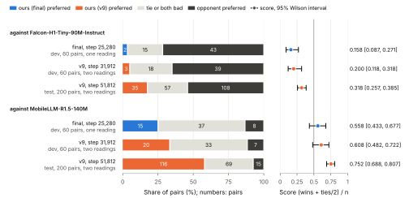

**圖 7**：Opus 讀者的盲測成對比較（表 7、9）：第 25,280 步的 `final` 在前 60 道開發題目上，判讀一次；第 31,912 步的 `v9` 在相同題目上，以及正式模型（標為 `v9`，第 51,812 步）在 200 道測試題目上，判讀兩次。長條：勝、平或「兩者皆差」、負；點與誤差線：分數及其 95% Wilson 區間。圖中只畫出這個額外加入的讀者，因為它對大多數配對分出勝負；註冊評審在它分出勝負之處指向同一方向（表 7、E2）。

### 7.10 每項陳述受到什麼限制

**比 MobileLLM-R1.5 更受偏好**（116 比 15）：判讀者與建構者同一家族，是註冊協定之外額外加入的讀者，能看出一個配對集比較的是哪兩個系統，也常能認出它加框且反覆循環的回覆（中性標題下為 112 比 15），註冊評審則為 59 比 5（其配對中有 88 個被截斷）；所勝過的對手，在我們的評測框架中以其建議預設集執行時（一個經轉換、帶預算強制的社群檔案），有 63% 的輪次回覆退化，因此這項領先衡量的是該對手在此處的狀態，程度不亞於衡量我們的模型；所用題目中有 11 道曾被看過（189 道的結果一致）；以六個粒子對一個樣本（用一個粒子時為 99 比 16；MobileLLM-R1.5 的六樣本組 [TBD]）；就一次 run 而言。**並未比 Falcon-H1-Tiny 更受偏好**（35 比 108）：每一類讀者皆然（註冊評審 12 比 61），每個類別皆然，在 189 道題目上、對其 K = 6 組、以及用我們的 K = 1 解碼（22 比 122）亦然；它的預設取樣可能低估了它。沒有任何人類判讀過這些配對。

## 8. 侷限與效度威脅

1. **完整規模下僅一次 run、一個種子**，設計變更也沒有完整規模的基準線（沒有從頭訓練的 `v9`、沒有繼續訓練的 `final`、沒有重新開始）；受控實驗只在寬度 128 與 6 × 10⁶ 個 token 下、以相同的 token 數提供這些對照（§6.6）。測試結果是單一模型的結果。
2. **run 中途的變更混淆了每一條曲線**：資料流在第 6,647、25,280 與 29,722 步改變，其聊天資料比例從第 36,867 步起逐步提高，而從第 48,190 步起對話只在助理 token 上訓練；學習率係數在第 12,062 步跳升；編譯後的計算圖在第 9,332、22,613 與 31,912 步改變。
3. **一套實作、一顆晶片、一套軟體堆疊**（jax 0.11.2、libtpu 0.0.50），用於得出 1.46–1.62× 與預測器檢驗，而預測器檢驗的六個點是事後選定的（§5）。
4. **對所採用的核函式與接枝的梯度而言，晶片上的相等是在捨入誤差範圍內的相等，且部分未經驗證**（§5.2、§6.4）。
5. **讀者**（§7.2、§7.5、§7.10）：Opus 讀者是額外加入的，與建構者同一家族，能看出每個配對集比較的是哪兩個系統，也常能憑加框且反覆循環的風格認出 MobileLLM-R1.5 的回覆（對兩個正式配對集所做的中性標題複核，在 400 道題目中有 381 道得到相同結果；沒有重新判讀其他配對集）；註冊評審在三分之二的配對上判平手，其診斷指標偏弱（§7.5）；第二個註冊評審沒有在測試配對上執行；沒有任何人類判讀過這些配對 [78–81]。左右互換的兩次判讀消除的是單純的位置偏好，而非兩者共有的偏誤。附錄 O 的失敗標籤出自一個代理，且是在金鑰公開的情況下標註的；沒有第二個盲測標註者檢查過它們。
6. **題目是我們自己出的**，十一道測試題目曾被看過，而且測試的分辨力有限（§7.3）；我們的解碼器使用六個粒子與精確勢函數，對上對手的單一樣本，而 MobileLLM-R1.5 的對照組為 [TBD]；回覆預算不同（我們的 768 個 token；Falcon-H1-Tiny 為 1,024；MobileLLM-R1.5 為最多 3,072 個推理 token 之後的 1,024 個答案 token）。
7. **對手的設定**：MobileLLM-R1.5 使用一個經轉換、帶預算強制的社群檔案，其測試回覆在我們的評測框架中有 63% 退化；Falcon-H1-Tiny 使用 llama.cpp 的預設取樣。任一設定都可能低估了它的模型。
8. **小型實驗室**是逐詞頁與各元件的證據（寬度 48 與 128，100–1,200 萬個 token；附錄 B）以及受控接枝的來源。
9. **資料規則的效果沒有經過測量**，從第 6,647 步起，模型沒有被訓練去拒絕任何事，也沒有針對有害輸出接受評估（附錄 D、K）。
10. **與對手的 token 差距**（token 數少 59 倍與 309 倍）在這裡的任何比較中都無法與設計區分開來。

## 9. 結論

以參數計的預算，是關於一個函數的陳述：它儲存多少個數字，以及產生一個 token 要讀取多少個數字。在一顆加速器上用一天訓練這個函數的成本，則是關於位元組、形狀與重複次數的陳述。在這次 run 中，兩者在三個方面脫鉤：帳上視為幾乎相等的兩個設定，每步時間相差 1.62×，其中四分之一單靠佈局就消除了；編譯器算出的搬移的位元組數，在 FLOP 與讀取數做不到的地方預測了每步時間，這是在六個設定上、事後得到的結果；而佔參考程式碼每步時間 97% 的迴圈次數，在讀取帳上看不見。保函數接枝讓這次 run 能在進行到一半時更改設計，而不必丟棄已訓練的 7.79 × 10⁹ 個 token；在寬度 128 的受控條件下，接枝的最終結果從未比不接枝差，這支持了該機制，但對完整規模下效果的大小毫無說明。這次 run 守住了它的帳（儲存的數字為 1 億中的 9,800 萬，每個 token 讀取的數字為 2,000 萬中的 1,960 萬）與它的時鐘（86,400 TPU 秒中的 86,054 秒），並訓練了 1.358 × 10¹⁰ 個 token。在 200 道測試題目上，正式模型比 MobileLLM-R1.5 更受偏好（MobileLLM-R1.5 的回覆在我們的評測框架中大多退化）：偏好它的有在註冊協定之外額外加入的 Opus 5.5 讀者（131 個分出勝負的配對中的 116 個；他們能看出一個配對集比較的是哪兩個系統，也常能從風格認出它的回覆），以及在三分之二的配對上判平手的註冊評審（64 個中的 59 個；MobileLLM-R1.5 的六樣本組：[TBD]）；正式模型並未比 Falcon-H1-Tiny 更受偏好（143 個中的 35 個，以及 73 個中的 12 個），而當 Falcon-H1-Tiny 得到六個樣本與我們的選擇器時，它保住了領先，並拿走了我們在滿足限制上的優勢。有資訊量的比較是模型輸掉的那一個：輸給一個用多 59 倍的 token 訓練的模型。

## 參考文獻

編號與 `refs.md` 相同，該檔案中每一筆條目都記錄了為查證其所支持的主張而讀過的內容；[82]–[96] 依序是該檔案另外經過查證的條目 A1、A2、A4、A16、A19–A25 與 A27–A30。

[1] J. Geiping, T. Goldstein. Cramming: Training a Language Model on a Single GPU in One Day. arXiv:2212.14034, 2022.
[2] P. Izsak, M. Berchansky, O. Levy. How to Train BERT with an Academic Budget. arXiv:2104.07705, 2021.
[3] M. Li, E. Yumer, D. Ramanan. Budgeted Training: Rethinking Deep Neural Network Training Under Resource Constraints. ICLR 2020. arXiv:1905.04753.
[4] K. Jordan and contributors. modded-nanogpt: the NanoGPT speedrun. GitHub repository, 2024–2026. https://github.com/KellerJordan/modded-nanogpt
[5] A. Karpathy. nanochat: The best ChatGPT that $100 can buy. GitHub repository, 2025. https://github.com/karpathy/nanochat
[6] Z. Liu, C. Zhao, F. Iandola, C. Lai, Y. Tian, I. Fedorov, et al. MobileLLM: Optimizing Sub-billion Parameter Language Models for On-Device Use Cases. ICML 2024. arXiv:2402.14905.
[7] C. Zhao, E. Chang, Z. Liu, C.-J. Chang, W. Wen, C. Lai, et al. MobileLLM-R1: Exploring the Limits of Sub-Billion Language Model Reasoners with Open Training Recipes. ICLR 2026. arXiv:2509.24945.
[8] R. Agarwal, N. Vieillard, Y. Zhou, P. Stanczyk, S. Ramos, M. Geist, et al. On-Policy Distillation of Language Models: Learning from Self-Generated Mistakes. ICLR 2024. arXiv:2306.13649.
[9] Meta. MobileLLM-R1.5-140M model card. Hugging Face, 2025. https://huggingface.co/facebook/MobileLLM-R1.5-140M
[10] J. Zuo, M. Velikanov, I. Chahed, Y. Belkada, D. E. Rhayem, G. Kunsch, et al. Falcon-H1: A Family of Hybrid-Head Language Models Redefining Efficiency and Performance. arXiv:2507.22448, 2025.
[11] Falcon-LLM Team (TII). Falcon-H1-Tiny: A series of extremely small, yet powerful language models redefining capabilities at small scale. Technical blog post, 15 January 2026. https://huggingface.co/spaces/tiiuae/tiny-h1-blogpost
[12] L. Ben Allal, A. Lozhkov, E. Bakouch, G. Martín Blázquez, G. Penedo, L. Tunstall, et al. SmolLM2: When Smol Goes Big. arXiv:2502.02737, 2025.
[13] R. Eldan, Y. Li. TinyStories: How Small Can Language Models Be and Still Speak Coherent English? arXiv:2305.07759, 2023.
[14] M. Dehghani, S. Gouws, O. Vinyals, J. Uszkoreit, Ł. Kaiser. Universal Transformers. ICLR 2019. arXiv:1807.03819.
[15] Z. Lan, M. Chen, S. Goodman, K. Gimpel, P. Sharma, R. Soricut. ALBERT: A Lite BERT for Self-supervised Learning of Language Representations. ICLR 2020. arXiv:1909.11942.
[16] N. Saunshi, N. Dikkala, Z. Li, S. Kumar, S. J. Reddi. Reasoning with Latent Thoughts: On the Power of Looped Transformers. ICLR 2025. arXiv:2502.17416.
[17] J. Geiping, S. McLeish, N. Jain, J. Kirchenbauer, S. Singh, B. R. Bartoldson, et al. Scaling up Test-Time Compute with Latent Reasoning: A Recurrent Depth Approach. arXiv:2502.05171, 2025.
[18] R.-J. Zhu, Z. Wang, K. Hua, T. Zhang, Z. Li, H. Que, et al. Scaling Latent Reasoning via Looped Language Models. arXiv:2510.25741, 2025.
[19] H. Prairie, Z. Novack, T. Berg-Kirkpatrick, D. Y. Fu. Parcae: Scaling Laws For Stable Looped Language Models. arXiv:2604.12946, 2026.
[20] D. Zhu, H. Huang, Z. Huang, Y. Zeng, Y. Mao, B. Wu, et al. Hyper-Connections. arXiv:2409.19606, 2024.
[21] K. Schwethelm, D. Rueckert, G. Kaissis. How Much Is One Recurrence Worth? Iso-Depth Scaling Laws for Looped Language Models. NeurIPS 2026. arXiv:2604.21106.
[22] Z. Zhou, T. Wu, Z. Jiang, F. Obeid, Z. Lan. Value Residual Learning. arXiv:2410.17897, 2024.
[23] S. Roller, S. Sukhbaatar, A. Szlam, J. Weston. Hash Layers For Large Sparse Models. arXiv:2106.04426, 2021.
[24] G. Lample, A. Sablayrolles, M. Ranzato, L. Denoyer, H. Jégou. Large Memory Layers with Product Keys. NeurIPS 2019. arXiv:1907.05242.
[25] V.-P. Berges, B. Oğuz, D. Haziza, W. Yih, L. Zettlemoyer, G. Ghosh. Memory Layers at Scale. arXiv:2412.09764, 2024.
[26] H. Huang, D. Zhu, B. Wu, Y. Zeng, Y. Wang, Q. Min, et al. Over-Tokenized Transformer: Vocabulary is Generally Worth Scaling. ICML 2025. arXiv:2501.16975.
[27] D. Yu, E. Cohen, B. Ghazi, Y. Huang, P. Kamath, R. Kumar, et al. Scaling Embedding Layers in Language Models. NeurIPS 2025. arXiv:2502.01637.
[28] X. Cheng, R. Tian, W. Zeng, D. Dai, Q. Chen, B. Wang, et al. Conditional Memory via Scalable Lookup: A New Axis of Sparsity for Large Language Models. arXiv:2601.07372, 2026.
[29] A. Tseng, C. De Sa. L³: Large Lookup Layers. ICML 2026. arXiv:2601.21461.
[30] R. Csordás, P. Piękos, K. Irie, J. Schmidhuber. SwitchHead: Accelerating Transformers with Mixture-of-Experts Attention. NeurIPS 2024. arXiv:2312.07987.
[31] J. Kang. Memory Attention. arXiv:2609.28399, 2026.
[32] A. Q. Jiang, A. Sablayrolles, A. Roux, A. Mensch, B. Savary, C. Bamford, et al. Mixtral of Experts. arXiv:2401.04088, 2024.
[33] Google. Gemma 3n model overview. Google AI for Developers, 2025–2026. https://ai.google.dev/gemma/docs/gemma-3n
[34] S. Merity, C. Xiong, J. Bradbury, R. Socher. Pointer Sentinel Mixture Models. arXiv:1609.07843, 2016.
[35] E. Grave, A. Joulin, N. Usunier. Improving Neural Language Models with a Continuous Cache. arXiv:1612.04426, 2016.
[36] U. Khandelwal, O. Levy, D. Jurafsky, L. Zettlemoyer, M. Lewis. Generalization through Memorization: Nearest Neighbor Language Models. ICLR 2020. arXiv:1911.00172.
[37] J. Liu, S. Min, L. Zettlemoyer, Y. Choi, H. Hajishirzi. Infini-gram: Scaling Unbounded n-gram Language Models to a Trillion Tokens. COLM 2024. arXiv:2401.17377.
[38] Y. W. Teh. A Hierarchical Bayesian Language Model Based On Pitman-Yor Processes. COLING/ACL 2006, 985–992.
[39] C. Olsson, N. Elhage, N. Nanda, N. Joseph, N. DasSarma, T. Henighan, et al. In-context Learning and Induction Heads. arXiv:2209.11895, 2022.
[40] E. Akyürek, B. Wang, Y. Kim, J. Andreas. In-Context Language Learning: Architectures and Algorithms. arXiv:2401.12973, 2024.
[41] J. Xu, X. Liu, J. Yan, D. Cai, H. Li, J. Li. Learning to Break the Loop: Analyzing and Mitigating Repetitions for Neural Text Generation. NeurIPS 2022. arXiv:2206.02369.
[42] G. Xiao, Y. Tian, B. Chen, S. Han, M. Lewis. Efficient Streaming Language Models with Attention Sinks. ICLR 2024. arXiv:2309.17453.
[43] OpenAI. gpt-oss-120b & gpt-oss-20b Model Card. arXiv:2508.10925, 2025.
[44] S. Min, J. Boyd-Graber, C. Alberti, D. Chen, E. Choi, M. Collins, et al. NeurIPS 2020 EfficientQA Competition: Systems, Analyses and Lessons Learned. PMLR, 2021. arXiv:2101.00133.
[45] T. Chen, I. Goodfellow, J. Shlens. Net2Net: Accelerating Learning via Knowledge Transfer. arXiv:1511.05641, 2015.
[46] T. Wei, C. Wang, Y. Rui, C. W. Chen. Network Morphism. arXiv:1603.01670, 2016.
[47] S. Shen, P. Walsh, K. Keutzer, J. Dodge, M. Peters, I. Beltagy. Staged Training for Transformer Language Models. arXiv:2203.06211, 2022.
[48] C. Wu, Y. Gan, Y. Ge, Z. Lu, J. Wang, Y. Feng, et al. LLaMA Pro: Progressive LLaMA with Block Expansion. ACL 2024. arXiv:2401.02415.
[49] A. Komatsuzaki, J. Puigcerver, J. Lee-Thorp, C. Riquelme Ruiz, B. Mustafa, J. Ainslie, et al. Sparse Upcycling: Training Mixture-of-Experts from Dense Checkpoints. arXiv:2212.05055, 2022.
[50] E. J. Hu, Y. Shen, P. Wallis, Z. Allen-Zhu, Y. Li, S. Wang, et al. LoRA: Low-Rank Adaptation of Large Language Models. arXiv:2106.09685, 2021.
[51] K. Jordan, Y. Jin, V. Boza, J. You, F. Cesista, L. Newhouse, J. Bernstein. Muon: An optimizer for hidden layers in neural networks. Blog post, 2024. https://kellerjordan.github.io/posts/muon/
[52] J. Liu, J. Su, X. Yao, Z. Jiang, G. Lai, Y. Du, et al. Muon is Scalable for LLM Training. arXiv:2502.16982, 2025.
[53] N. Amsel, D. Persson, C. Musco, R. M. Gower. The Polar Express: Optimal Matrix Sign Methods and Their Application to the Muon Algorithm. arXiv:2505.16932, 2025.
[54] Z. Li, L. Liu, C. Liang, W. Chen, T. Zhao. NorMuon: Making Muon more efficient and scalable. arXiv:2510.05491, 2025.
[55] L. Chen, J. Li, K. Liang, B. Su, C. Xie, N. W. Pierse, et al. Cautious Weight Decay. arXiv:2510.12402, 2025.
[56] K. Wen, X. Dang, K. Lyu, T. Ma, P. Liang. Fantastic Pretraining Optimizers and Where to Find Them II: Hyperball Optimization. arXiv:2606.16899, 2026.
[57] L. Ren, Y. Liu, Y. Shen, W. Chen. Rethinking Language Model Scaling under Transferable Hypersphere Optimization. arXiv:2603.28743, 2026.
[58] T. Dao, D. Y. Fu, S. Ermon, A. Rudra, C. Ré. FlashAttention: Fast and Memory-Efficient Exact Attention with IO-Awareness. arXiv:2205.14135, 2022.
[59] T. Dao. FlashAttention-2: Faster Attention with Better Parallelism and Work Partitioning. arXiv:2307.08691, 2023.
[60] JAX authors. Pallas: a JAX kernel language. JAX documentation, 2026. https://docs.jax.dev/en/latest/pallas/index.html
[61] JAX authors. Splash attention (sparse flash attention) for TPU, `jax/experimental/pallas/ops/tpu/splash_attention`. JAX 0.11.1 source code.
[62] Google (openxla). Tokamax: a Pallas custom kernel library, version 0.0.18. https://github.com/openxla/tokamax
[63] A. Ivanov, N. Dryden, T. Ben-Nun, S. Li, T. Hoefler. Data Movement Is All You Need: A Case Study on Optimizing Transformers. MLSys 2021. arXiv:2007.00072.
[64] A. K. Lew, T. Zhi-Xuan, G. Grand, V. K. Mansinghka. Sequential Monte Carlo Steering of Large Language Models using Probabilistic Programs. arXiv:2306.03081, 2023.
[65] S. Zhao, R. Brekelmans, A. Makhzani, R. Grosse. Probabilistic Inference in Language Models via Twisted Sequential Monte Carlo. arXiv:2404.17546, 2024.
[66] J. Loula, B. LeBrun, L. Du, B. Lipkin, C. Pasti, G. Grand, et al. Syntactic and Semantic Control of Large Language Models via Sequential Monte Carlo. arXiv:2504.13139, 2025.
[67] I. Puri, S. Sudalairaj, G. Xu, K. Xu, A. Srivastava. Rollout Roulette: A Probabilistic Inference Approach to Inference-Time Scaling of LLMs using Particle-Based Monte Carlo Methods. arXiv:2502.01618, 2025.
[68] K. Park, J. Wang, T. Berg-Kirkpatrick, N. Polikarpova, L. D'Antoni. Grammar-Aligned Decoding. NeurIPS 2024. arXiv:2405.21047.
[69] A. Beirami, A. Agarwal, J. Berant, A. D'Amour, J. Eisenstein, C. Nagpal, et al. Theoretical guarantees on the best-of-n alignment policy. ICML 2025. arXiv:2401.01879.
[70] X. Wang, J. Wei, D. Schuurmans, Q. Le, E. Chi, S. Narang, et al. Self-Consistency Improves Chain of Thought Reasoning in Language Models. ICLR 2023. arXiv:2203.11171.
[71] J. Zhou, T. Lu, S. Mishra, S. Brahma, S. Basu, Y. Luan, et al. Instruction-Following Evaluation for Large Language Models. arXiv:2311.07911, 2023.
[72] K. Cobbe, V. Kosaraju, M. Bavarian, M. Chen, H. Jun, L. Kaiser, et al. Training Verifiers to Solve Math Word Problems. arXiv:2110.14168, 2021.
[73] N. Muennighoff, Z. Yang, W. Shi, X. L. Li, L. Fei-Fei, H. Hajishirzi, et al. s1: Simple test-time scaling. arXiv:2501.19393, 2025.
[74] R. Rafailov, A. Sharma, E. Mitchell, S. Ermon, C. D. Manning, C. Finn. Direct Preference Optimization: Your Language Model is Secretly a Reward Model. arXiv:2305.18290, 2023.
[75] L. Tunstall, E. Beeching, N. Lambert, N. Rajani, K. Rasul, Y. Belkada, et al. Zephyr: Direct Distillation of LM Alignment. arXiv:2310.16944, 2023.
[76] G. Cui, L. Yuan, N. Ding, G. Yao, B. He, W. Zhu, et al. UltraFeedback: Boosting Language Models with Scaled AI Feedback. ICML 2024. arXiv:2310.01377.
[77] N. Lambert, J. Morrison, V. Pyatkin, S. Huang, H. Ivison, F. Brahman, et al. Tulu 3: Pushing Frontiers in Open Language Model Post-Training. arXiv:2411.15124, 2024.
[78] L. Zheng, W.-L. Chiang, Y. Sheng, S. Zhuang, Z. Wu, Y. Zhuang, et al. Judging LLM-as-a-Judge with MT-Bench and Chatbot Arena. NeurIPS 2023 Datasets and Benchmarks. arXiv:2306.05685.
[79] P. Wang, L. Li, L. Chen, Z. Cai, D. Zhu, B. Lin, et al. Large Language Models are not Fair Evaluators. arXiv:2305.17926, 2023.
[80] Y. Dubois, B. Galambosi, P. Liang, T. B. Hashimoto. Length-Controlled AlpacaEval: A Simple Way to Debias Automatic Evaluators. COLM 2024. arXiv:2404.04475.
[81] A. Panickssery, S. R. Bowman, S. Feng. LLM Evaluators Recognize and Favor Their Own Generations. arXiv:2404.13076, 2024.
[82] S. Diao, Y. Yang, Y. Fu, X. Dong, D. Su, M. Kliegl, et al. Nemotron-CLIMB: CLustering-based Iterative Data Mixture Bootstrapping for Language Model Pre-training. NeurIPS 2025. arXiv:2504.13161.
[83] G. Penedo, H. Kydlíček, L. Ben Allal, A. Lozhkov, M. Mitchell, C. Raffel, et al. The FineWeb Datasets: Decanting the Web for the Finest Text Data at Scale. arXiv:2406.17557, 2024.
[84] D. R. So, W. Mańke, H. Liu, Z. Dai, N. Shazeer, Q. V. Le. Primer: Searching for Efficient Transformers for Language Modeling. arXiv:2109.08668, 2021.
[85] A. Holtzman, J. Buys, L. Du, M. Forbes, Y. Choi. The Curious Case of Neural Text Degeneration. ICLR 2020. arXiv:1904.09751.
[86] TII. Falcon-H1-Tiny-90M-Instruct model card. Hugging Face, 2026. https://huggingface.co/tiiuae/Falcon-H1-Tiny-90M-Instruct
[87] Hugging Face (HuggingFaceTB). Smol-SmolTalk dataset card. https://huggingface.co/datasets/HuggingFaceTB/smol-smoltalk
[88] Pleias and the AI Alliance. SYNTH dataset card. https://huggingface.co/datasets/PleIAs/SYNTH
[89] N. Ding, Y. Chen, B. Xu, Y. Qin, Z. Zheng, S. Hu, et al. Enhancing Chat Language Models by Scaling High-quality Instructional Conversations (UltraChat). arXiv:2305.14233, 2023.
[90] A. Mitra, H. Khanpour, C. Rosset, A. Awadallah. Orca-Math: Unlocking the potential of SLMs in Grade School Math. arXiv:2402.14830, 2024.
[91] P. Rajpurkar, R. Jia, P. Liang. Know What You Don't Know: Unanswerable Questions for SQuAD. ACL 2018. arXiv:1806.03822.
[92] Z. Yang, P. Qi, S. Zhang, Y. Bengio, W. W. Cohen, R. Salakhutdinov, et al. HotpotQA: A Dataset for Diverse, Explainable Multi-hop Question Answering. EMNLP 2018. arXiv:1809.09600.
[93] F. Brahman, S. Kumar, V. Balachandran, P. Dasigi, V. Pyatkin, A. Ravichander, et al. The Art of Saying No: Contextual Noncompliance in Language Models (CoCoNot). NeurIPS 2024 Datasets and Benchmarks. arXiv:2407.12043.
[94] L. Jiang, K. Rao, S. Han, A. Ettinger, F. Brahman, S. Kumar, et al. WildTeaming at Scale: From In-the-Wild Jailbreaks to (Adversarially) Safer Language Models. arXiv:2406.18510, 2024.
[95] S. Han, K. Rao, A. Ettinger, L. Jiang, B. Y. Lin, N. Lambert, et al. WildGuard: Open One-Stop Moderation Tools for Safety Risks, Jailbreaks, and Refusals of LLMs. NeurIPS 2024. arXiv:2406.18495.
[96] W. Liu, J. Chen, K. Ji, L. Zhou, W. Chen, B. Wang. RAG-Instruct: Boosting LLMs with Diverse Retrieval-Augmented Instructions. arXiv:2501.00353, 2024.

## 附錄 A. 完整的帳

**表 A1：`final` 與 `v9` 的參數帳**（標準讀法；參數葉與形狀取自檢查點的清單檔，即 `final` 的 `ckpt-000026-step-000029722` 與 `v9` 的 `ckpt-000001-step-000030742`，並依 `bes/budget.py` 的列規則與讀取規則計數；藏書與索引取自 `final` 的匯出帳目；`tables.md` T1）。

| 列 | 內容 | `final` 儲存 | `final` 每個 token 讀取 | `v9` 儲存 | `v9` 每個 token 讀取 |
|---|---|---|---|---|---|
| core | 2 個區塊的 W_q、W_k、W_v、W_o、W_up、W_down | 14,118,912 | 14,118,912 | 14,118,912 | 14,118,912 |
| head | P（768 × 512）、E_out（8,192 × 512） | 4,587,520 | 4,587,520 | 4,587,520 | 4,587,520 |
| small | 正規化增益、線道、迴圈增益、匯點、值閘門、信任投影與候選投影、評論者 | 306,776 | 306,776 | 306,776 | 306,776 |
| emb | 輸入嵌入（8,192 × 768） | 6,291,456 | 768 | 6,291,456 | 768 |
| ve | 逐迴圈值嵌入（8,192 × 8 × 128） | 8,388,608 | 1,024 | 8,388,608 | 1,024 |
| tables | 暫存器（15 個欄位）、候選輸入表與信任表 | 838,448 | 18,736 | 838,448 | 18,736 |
| gain | 注意力輸出增益 `gain/o`（8,192 × 2 × 768） | – | – | 12,582,912 | 1,536 |
| page | `page/key`、`page/val`（各 8,192 × 2 × 8 × 192）、`page/pin`、`page/pout`（各 2 × 768 × 192） | – | – | 50,921,472 | 595,968 |
| library | 段落、問答層、目錄、標題、閘門 | 40,268,392 | 112,595（最壞情況，檢索步） | – | – |
| index | 檢索索引（BM25） | 23,499,999 | 132,628（最壞情況，檢索步） | – | – |
| **合計** | | **98,300,111** | **19,278,959** | **98,036,104** | **19,631,240** |

附註：`final` 在不進行檢索的一步讀取 19,033,736 個數字；在 500 個代理輪次上實測的檢索最多讀取 105,826 個。評論頭（`small` 中的 196,864 個數字）雖然解碼器並不使用，仍計為已讀取。在嚴格讀法下，`final` 在 6 篇文本上於 1,024 個位置讀取 1,962–1,981 萬個數字，於 2,048 個位置讀取 2,007–2,049 萬個（`docs/ACCOUNTING.md`），因此兩種設定在 2,048 個位置時都不滿足嚴格讀法；`v9` 於 1,024 個位置讀取 2,120 / 2,380 / 2,460 萬個（40 篇文本上的最小值／中位數／最大值），於 2,048 個位置讀取 2,240 / 2,670 / 2,820 萬個（`docs/ACCOUNTING.md`、`docs/V9.md` §10）。稽核的前向傳遞也會為每個生成的 token 記錄其讀取的不重複數字。稽核的三項檢查見第 4.2 節；訓練時對整張表計算稠密乘積再加以遮罩，這既不改變函數，也不改變計數。

## 附錄 B. 模型細節

**B.1 核心。** 對位置 t 上的 token x_t，取 d = 768、兩個共享權重的區塊 i ∈ {0, 1}、R = 8 次迴圈與 N = 2 條線道：

    e_t = RMSNorm( E[x_t] + Σ_f R_f[reg_{t,f}] + W_c Σ_k μ_{t,k} ( C[c_{t,k}] + Σ_g F_g[φ_{t,k,g}] ) )
    ℓ_1 = ℓ_2 = e
    for r = 1 … R:
        u   = Σ_n α_{r,n} ℓ_n
        u   = B_1( B_0( u ; E_ve[x, r] ) )
        s   = RMSNorm(u) ⊙ g_r
        ℓ_n = Σ_m M_{r,nm} ℓ_m + β_{r,n} s                              (n = 1, 2)
    h_t = RMSNorm( ℓ_1 + ℓ_2 ) ⊙ g_head
    z_t = 15 · tanh( (h_t P E_outᵀ) / 15 )                              (float32; P: 768 × 512)

    B_i(u):  a = Attn_i( RMSNorm(u) ⊙ g_{1,i} ) ;   u ← u + a
             x = RMSNorm(u) ⊙ g_{2,i} ;   u ← u + W_down,i · relu(W_up,i · x)² + Π_i(x; x_t)

E、R_f、C、F_g 是 token 表、暫存器表與候選表；μ_{t,k} 是候選帶的槽位遮罩；線道係數的初始值為 α_r = onehot(r mod 2)、M_r = I、β_r = 1。模型沒有偏差項；Π_i 是 token 神經元路徑（`final` 中沒有）。逐迴圈值嵌入 E_ve[x_j, r]（每次迴圈 128 個數字）經由閘門 3σ(W_g x_j[1:12]) 加到區塊 0 的前 128 個值維度上 [5, 22]。參數以 float32 主副本保存。

**B.2 帶匯點的注意力。** 查詢與鍵在其 126 個內容維度上經過旋轉（RoPE）並做 L2 正規化；查詢再乘以學習得到的逐頭增益 γ_h（初始值為 √126）。兩個保留維度設為 q = (1, 0) 與 k_j = (b_j, 0)，因此不論使用哪種注意力核函式，注意力分數都是 γ_h cos(q_t, k_j) + b_j。在 `BOS` 位置，鍵的內容歸零，b_j 是學習得到的純量，值則是學習得到的向量（先驗平均）；其他位置 b_j = 0。遮罩是因果的，並限於片段之內；每個片段都以 `BOS` 開頭。若鍵是精確比對、銳度無限大的獨熱向量，匯點的分數為 β + log λ、值為 m₀，則一個有 n_a 個相符鍵的查詢，其輸出為 (Σ v_j + λ m₀)/(n_a + λ)；當值是後繼 token 的獨熱向量且 m₀ 為均勻分布時，這就是對稱 Dirichlet 先驗下 Markov 鏈的後驗預測分布（`docs/MATH.md` B1）。在微型消融中，匯點的影響是中性的（移除時 −0.07%），我們仍保留它，因為它無害，且有外部證據支持 [42, 43]。

**B.3 輸出法則。** 網路的分布 q = softmax(z_t) 與候選帶結合：

    p(v) = ( q(v) + Σ_k m_k [c_k = v] ) / ( 1 + Σ_k m_k ),
    m_k  = exp( softcap( Σ_f β_f[φ_{k,f}] + ⟨h_t A, c_k⟩ − 6 ) ) · μ_k · s(src_k),

其中信任表的初始值為零（每個作用中的槽位起始質量為 e⁻⁶），s(·) 依候選項來源的角色縮放質量。正規化常數是 1 + Σ m，因此不必對詞彙表做第二次掃描；取 m_v = (n_v − d t_v)/(θ + d T) 時，它就是以網路為基底測度的 Pitman–Yor 後驗預測分布 [38]；損失最多比網路本身的損失高出 log(1 + Σ m)；而當所有質量皆為零時，它與網路的交叉熵逐位元相等（已測試）。解碼只對基底測度做溫度調整（附錄 E）。*候選帶增益*是 −log q(y) − (−log p(y)) 在訓練 token 上的平均：也就是這些質量為訓練後的模型換來的收益。

**B.4 逐詞頁：訓練前的證據，以及分配問題。** 無論把這 8,000 萬個儲存的數字花在哪一邊，所依據的證據都是小規模的。

- *藏書*（`docs/E1_COVERAGE.md`）：Simple English Wikipedia 的導言段落與問答對，存放在彼此獨立的 xz 區塊中，附有 BM25 索引（63,768,391 個數字），並置於一個經校準的閘門之後。一次審查發現了高信心的錯誤檢索，之後閘門在每個開發集上重新擬合到精確率 0.8。覆蓋率／精確率，之前 → 之後：NQ-open 驗證集 35.0 / 54.1 → 6.0 / 76.9；PopQA 6.5 / 40.3 → 0.5 / 75.0；頭部實體探測題 82.3 / 98.7 → 74.4 / 99.1；常見名稱探測題（兩者皆採用新的探測題定義）24.3 / 35.6 → 81.3 / 99.9；沒有近似重複已存問題的 NQ-open 驗證集問題 18.5 / 37.3 → 1.0 / 43.5。最後一列顯示，藏書主要是透過已存的近似重複問題作答。在題目集開發集的 200 個第一輪中，閘門於其中 8 個開啟，因此盲測比較幾乎不可能看到藏書。
- *逐詞頁*（`docs/V9.md` §2）：在 CPU 實驗環境中（寬度 48、2 個共享區塊 × 4 次迴圈、1,040 種 token、1,200 萬個 token、每組一個種子、配對雜訊約 0.01 nats），以 token 為鍵的參數放在注意力的寫入側有幫助，放在比對側則有害（類別專屬的 `W_o` −0.079 nats、`W_v` −0.039、`W_q` 與 `W_k` 合併 +0.046）；私有前饋神經元、類別專家與稠密加寬都落在同一條曲線 ΔL = −c · E_{x∼f}[ln(n(x)/n₀)] 上，在 660 萬個 token 時 c = 0.070（十組，均方根殘差 0.008 nats）；完整的逐詞頁在 1,200 萬個 token 時相對於 3.734 的基準帶來 −0.252 nats。在微型消融中（寬度 128、100 萬個 token），逐詞頁使保留集損失變化 −0.61%，低於事先註冊的解析度（邊際 0.84%、門檻 1%）：未能解析。
- *設計本身在完整規模下的預測*（`docs/V9.md` §7）：本專案經校準的縮放定律估計 `final` 為每個 token 2.507 nats、Falcon-H1-Tiny-90M 為 2.358，並在計入以 token 為鍵之表格的已發表增益後，估計 `v9` 約為 2.45（2.41–2.48）；「因此 v9 縮小了與 90M 對手之間的預測差距，但沒有消除它」。不同分詞器之間的每個 token 損失無法比較；表 E3 改為列出每位元組的位元數。

**B.5 元件與事先註冊的微型消融。** 表 B1 列出微型消融（寬度 128、8 次迴圈、每組 100 萬個 token、種子重複差異 0.42%、邊際 0.84%）與各項決定。

**表 B1：微型消融與決定**（`docs/E2_ABLATIONS.md`；`docs/CHANGES.md` §14；移除該元件時保留集損失的相對變化，正值：移除有害；訓練混合資料／對話／助理 token）。

| 元件 | 移除 | 事先註冊的規則 | 決定 |
|---|---|---|---|
| 候選帶（輸入特徵與輸出質量） | +11.0% / +16.4% / +19.3% | 保留 | 啟用 |
| … 僅輸出質量 | +8.5% / +12.6% / +14.9% | 保留 | 啟用 |
| … 僅輸入特徵 | +0.9% / +1.0% / +1.2% | 依混合資料為停用，依對話讀法為啟用 | 啟用（偏離） |
| 暫存器嵌入 | +0.8% / +1.1% / +1.1% | 依混合資料為停用，依對話讀法為啟用 | 啟用（偏離） |
| 逐迴圈值嵌入 | +1.5% / +2.2% / +2.3% | 保留 | 啟用 |
| 信心通道 | +0.7% / +0.8% / +0.8% | 停用 | 停用 |
| 結構性旋轉時鐘 | +0.3% / +0.4% / +0.3% | 停用 | 停用 |
| 注意力匯點 | −0.1% / −0.1% / −0.1% | 保留（外部證據） | 啟用 |
| 以 4 次迴圈取代 8 次／以 12 次取代 8 次 | −0.12% / +0.26%（混合資料） | 在雜訊範圍內 | 8 |

規則要求新元件至少達到 1%，卻沒有說明是以哪一種損失計算；自動報告用的是訓練混合資料，依此，候選輸入特徵與暫存器都應停用。我們依對話與助理損失保留了它們，而這個讀法是在看過資料之後才選定的。暫存器也沒有通過它們自己的階躍函數關卡（在 200 萬個 token 時，有暫存器的精確計數為 79.2%，不含暫存器訓練的組則為 92.7%，`docs/E4_PROBES_2M.md`），卻仍被保留。兩者都是偏離。

**B.6 最佳化器。** 矩陣以 MuonH 訓練，它是迴圈模型參考實作的移植版（Nesterov 動量 0.95、五步極分解迭代 [53]、更新量重新縮放到並投影回以矩陣初始 Frobenius 範數為半徑的球面上 [56]、不使用權重衰減）[21]；其餘所有參數葉以 Adam 訓練（β = 0.8, 0.95；ε = 1e−10；不使用權重衰減），分組使用各自的學習率：嵌入 0.3（token 神經元的鍵在這一組中訓練）、反嵌入 0.004、特徵表 0.01、token 神經元的值 0.004、增益 0.01，全部再乘以 (768/640)^−0.5；在套用遷移規則之前，矩陣的學習率為 0.014。參考實作的一條遷移規則把每一組乘以 (每步 token 數 / 2¹⁸)^0.558（此處恰為 1），並把矩陣組乘以 (訓練長度 token 數 / 9.83 × 10⁸)^−0.32 [57]；其中訓練長度由啟動時的基準測試一次固定為 1.3117 × 10¹⁰ 個 token。這條規則擬合時涵蓋的範圍比我們的小；在微型規模下，以每步 4,096 個 token 套用時，它的代價是損失 +14.4%，因此在那裡沒有套用。

## 附錄 C. 在牆鐘時間下訓練

**C.1 以進度為函數的排程。** 令 T 為保留下來的軌跡的訓練秒數，R = max(0, train_end − now)，訓練器定義 p = T / (T + R)（`bes/train/schedule.py`；把衰減綁在時間預算上的做法依循 [1–3]）。訓練期間，T 增加與 R 減少的速率相同，因此 p 對牆鐘時間呈線性，並在時間窗關閉時到達 1，與吞吐量無關。學習率係數（在 p 的前 0.2% 線性暖身，之後為 1 − 0.9p）、序列長度（1,024 個 token；自 p = 0.67 起為 2,048）、資料混合中的對話占比（到 p = 0.67 為止是 0.25，之後線性上升，在 p = 0.92 時達到 0.70，此後維持 0.70；`bes/train/schedule.py` 中的 `chat_frac_at`）、自 p = 0.92 起對話只在助理 token 上計算損失（基礎文字仍照常計入），以及 `final` 的藏書占比，全都是 p 的函數。這段爬升在載入器中看得到：在第 36,850 步（p = 0.670）的載入器區塊中，基礎文字列占所有列的 75%，在第 46,350 步（p = 0.879）的區塊中占 38.4%，訓練器在該步記錄的對話占比為 0.627；尾段始於第 48,190 步（階段事件 17:09:57），此後記錄到的微批次不給使用者與系統 token 任何權重（在第 48,150 步，它們在 14,924 個單位中占 1,833 個）。單就爬升本身而言，預期它會降低每個訓練步的損失，以及任何設定的保留集對話損失；這次 run 並未把這個效應與其他效應分開量測。我們觀察到兩個後果。暫停時 T 不變而 R 縮小，因此即使什麼都沒在訓練，p 仍會前進：接枝時的暫停讓 p 從 0.5049（停止事件）移到 0.5112（恢復事件）。把訓練結束時間往後移會使 R 增加，因此 p 下降：在第 12,062 步，訓練後預留時間從 220 分鐘削減為 118 分鐘，訓練結束時間從 16:51:49 移到 18:33:49，p 從 0.2415（停止事件）降到 0.2190（恢復事件），學習率係數則從 0.783 升到 0.803（圖 C1d，線 4）。這個排程對參數與最佳化器狀態而言是連續的，但在 p 上並不單調。（步驟紀錄，也就是最近的記錄步，給出 0.2413 → 0.2196 與 0.5045 → 0.5118；我們引用的是事件紀錄。）

**C.2 在失去機器後存續。** 檢查點每 25 分鐘以原子方式寫入一次（參數、最佳化器狀態、資料游標、隨機狀態、時間帳）；每次寫入後，都會把一份快照複製到執行階段之外。在新的執行階段上，先還原快照，再把截止時間依停機時間順延（這讓 p 保持連續），訓練器便接著訓練。損失防護機制會在損失連續三次出現超過移動平均 1.3 倍的尖峰時回退；它從未觸發（帳中 0 次回退）。在新機器上重新啟動，暴露出任何一次預演都沒有出現過的兩個錯誤：載入器會重播它的日誌，並需要日誌所列的每一個分片，而新機器必須重新下載這些分片並重新 token 化（訓練器現在會等待它們，並使用 24 個 token 化工作行程：9 分鐘處理 363 個分片）；另外，兩個共用原始檔案的來源，在兩者都讀完之前就把這些檔案刪除了。這兩個錯誤合起來，讓第三個執行階段的 TPU 在訓練恢復前閒置了 48 min 19 s（提交 `e096dff`、`77305dc`；圖 C2）。

**表 C1：TPU 執行階段**（`docs/CHANGES.md` §19.1–19.4；操作者的 TPU 時間帳）。

| 執行階段 | 計入時段（UTC） | 秒數 | 產出 |
|---|---|---|---|
| 1 | 11 月 23 日 02:58:32 – 05:00:37 | 7,325 | 效能剖析與第 5.2 節的重寫；在其上進行的訓練 run 都被捨棄；應使用者要求歸還 |
| 2 | 11 月 23 日 17:13:00 – 19:30:00（自最早可能的配置時間起算） | 8,220 | 從第 0 步訓練到第 5,075 步（經由快照保留下來）；約 19:29 被供應商收回 |
| 3 | 11 月 24 日 01:05:55 – 20:41:04 | 70,509 | 01:54:14 在第 5,075 步恢復訓練，並在截止時間（18:33:49；結束紀錄於 18:33:54）於第 51,812 步停止；訓練後階段 18:33:55–20:02:22；20:41:04 手動歸還 |
| 總計 | | 86,400 中的 86,054 | 62,893 s（73.1%）用在保留下來的軌跡的訓練步上（訓練器的帳） |

沒有執行階段的空檔：12 h 12 min 23 s 與 5 h 35 min 55 s。若用到上限，TPU 預算會在 11 月 24 日 20:46:50 結束；有 346 s 未使用。這次 run 的截止時間是 20:31:49。

**表 C2：這次 run 的事件**（訓練日誌：停止與恢復紀錄；token 數為步數 × 262,144；即時速率為表 2 的中位數）。

| # | 步 | token 數 | 停止 → 恢復（UTC） | 事件 |
|---|---|---|---|---|
| – | 0 | 0 | 11 月 23 日 17:46:32 | 訓練開始（`configs/final.py`，提交 `98598c2`，16 列的微批次） |
| 1 | 5,075 | 1.33 × 10⁹ | 約 19:29 失去執行階段 2 → 11 月 24 日 01:54:14 | 在執行階段 3 上從第 5,075 步的檢查點恢復 |
| 2 | 6,647 | 1.74 × 10⁹ | 02:26:02 → 02:28:59 | 制式拒答規則（提交 `566517a`） |
| M1 | 8,659 | 2.27 × 10⁹ | 03:09:43 → 03:15:37 | 暫停：為微批次的切塊計時 |
| 3 | 9,332 | 2.45 × 10⁹ | 03:29:17 → 03:31:24 | 每個微批次切成 4 塊（`b05bfe7`） |
| M2 | 10,242 | 2.68 × 10⁹ | 03:48:04 → 03:57:28 | 暫停：為晶片上記憶體的旗標計時 |
| 4 | 12,062 | 3.16 × 10⁹ | 04:30:39 → 04:32:03 | 訓練後預留時間削減為 118 min；訓練結束時間 16:51:49 → 18:33:49（`782be85`） |
| 5 | 22,613 | 5.93 × 10⁹ | 07:44:14 → 07:53:35 | 為核函式計時；單圖塊核函式與 ReLU² 的反向計算（`6bf9b6e`） |
| 6 | 25,280 | 6.63 × 10⁹ | 08:35:05 → 08:36:31 | 制式迴避規則（`4f4ef45`） |
| 7 | 29,722 | 7.79 × 10⁹ | 09:45:34 → 09:58:45 | 為 `v9` 計時；接枝到 `configs/v9.py`（`9a4d652`） |
| 8 | 31,912 | 8.37 × 10⁹ | 10:52:36 → 10:57:50 | 為 `v9` 的開關計時並採用（`769f240`） |
| P1 | 36,867 | 9.66 × 10⁹ | 未停止（階段事件 12:47:51） | 2,048 個 token 的列；對話占比開始上升（排程） |
| P2 | 48,190 | 1.26 × 10¹⁰ | 未停止（階段事件 17:09:57） | 對話占比 0.70；對話只在助理 token 上訓練（排程） |
| – | 51,812 | 13,582,204,928 | 18:33:49（最終檢查點 18:33:54） | 在截止時間結束訓練；訓練後的各階段持續到 20:02:22（C.4） |

接枝之前的軌跡在其 32,320.8 個訓練秒內，平均以 241,065 tokens/s 訓練（7,791,443,968 個 token；訓練器的帳）。訓練結束時，帳中記有 51,812 步、13,582,204,928 個 token 與 62,893.1 個訓練秒（17.47 h），並記有檢查點寫入 23.2 s、設定準備 279.6 s、10 次重新啟動，且沒有回退（`lead5_work/numbers.json`）。

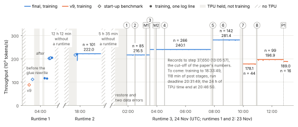

**圖 C2：** 三個執行階段上的訓練吞吐量對 UTC 時間（沒有持有執行階段的時段，軸是斷開的）。執行階段 1（11 月 23 日）上是 run main16 之前的各次 run，全部捨棄：`final` 在膠合層重寫前後、以及 `v9` 在重寫前（橘色）的啟動基準測試（菱形），還有 `final` 訓練的單一日誌行（圓點）。執行階段 2 與 3，即 run main16：線為相鄰兩筆步驟紀錄之間達到的速率（token 數 ÷ 牆鐘時間，含檢查點寫入）；數字為每一段的即時速率，單位為 10³ tokens/s，並附該段的步驟紀錄數 n（表 2、圖 F2）；在執行階段 2 中，另有啟動基準測試（菱形）與第一筆日誌行（圓點）。淺灰色帶：持有 TPU 但未在訓練；斜線區：沒有 TPU（其長度標在軸上方）。標籤：表 C2 各次重新啟動的恢復時間；P1 與 P2（虛線）：自 p = 0.67 起的 2,048 個 token 的列，以及自 p = 0.92 起只計助理 token 的尾段，兩者都沒有停止。紀錄畫到第 51,800 步（11 月 24 日 18:33:30 UTC），即最後一筆步驟紀錄；訓練結束（截止時間 18:33:49，紀錄於 18:33:54）、其後的各階段（18:33:55–20:02:22）以及持有到 20:41:04 的時段都沒有畫出。標籤處的水準變化是前後差異，不是該項變更單獨的效果。

**C.3 訓練曲線。** 表 C3 彙整每 50 步記錄一次的步損失（每個值為該步 262,144 個 token 的平均），並依進度窗分組（完整曲線見圖 C1）；角色分項與候選帶增益取自每個記錄步的最後一個微批次（16,384 個 token），並經加權。

**表 C3：`final` 各進度窗的訓練損失**（以 `review1_work/win.py` 處理已停止之 run 的訓練日誌；樣本標準差）。

| p | 記錄步數 | 步損失：平均（標準差） | 角色為「助理」的位置 | 對話以外的位置 | 候選帶增益（nats） |
|---|---|---|---|---|---|
| 0.00–0.01 | 10 | 3.613 (0.535) | 2.835 | 3.823 | 0.319 |
| 0.05–0.10 | 48 | 2.699 (0.047) | 1.717 | 2.936 | 0.035 |
| 0.15–0.20 | 48 | 2.613 (0.042) | 1.605 | 2.861 | 0.026 |
| 0.25–0.30 | 60 | 2.550 (0.041) | 1.551 | 2.792 | 0.024 |
| 0.35–0.40 | 56 | 2.530 (0.046) | 1.521 | 2.771 | 0.023 |
| 0.45–0.50 | 68 | 2.496 (0.037) | 1.491 | 2.738 | 0.022 |

這些是訓練損失，所在資料流的組成在第 6,647 步與第 25,280 步改變過；而且是依進度分窗，不是依 token 分窗（p 曾下降一次）。接枝之後到第 34,350 步的 93 個記錄步，平均為 2.4675（標準差 0.0399）；資料流在接枝時改變了，因此這兩個數字不能比較。尾段之前以 2,048 個 token 訓練的 226 個記錄步（36,900–48,150），從 2.404（前 5 個的平均）降到 1.815（最後 5 個），同時資料流的對話占比從 0.25 升到 0.70，學習率係數從 0.40 降到 0.17；尾段的 73 步（48,200–51,800）中，對話只在其助理 token 上訓練，損失從 1.778 降到 1.733，係數則降到 0.10。這兩段的水準都不能與更早的水準比較。候選帶增益從訓練前 1% 的 0.319 nats，降到 p ≈ 0.5 時的 0.022 nats（損失的 0.9%）；在微型消融實驗中，評估時關閉候選帶，在 100 萬個 token 時的代價是損失的 10.5%。一種解讀（微型實驗報告已預料到）是：在大規模下，網路學會了精確的上下文內統計量在早期所提供的大部分東西；候選帶增益量測的是訓練好的模型有多依賴候選帶，而不是不用候選帶訓練會得到什麼。在保留集的列上，第 29,722 步的候選帶增益在網頁文字上是 0.013 nats，在對話上是 0.029。

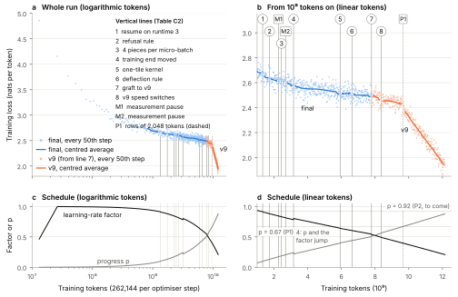

**圖 C1：** run main16 的訓練損失對訓練 token 數：(a) 整次 run，token 軸為對數尺度；(b) 自 10⁹ 個 token 起，線性軸。圓點：一個最佳化器步的損失（其 262,144 個 token 的平均），每 50 步記錄一次：`final` 有 594 筆紀錄（第 50–29,700 步），`v9` 有 442 筆（第 29,750–51,800 步，最後一筆步驟紀錄，11 月 24 日 18:33:30 UTC）。線：在 log₁₀(tokens) 上取的置中平均，在重新啟動與階段切換之間的每一段內分別計算：每筆紀錄的權重為一個高斯函數（σ = 0.03 個數量級，截斷於 3σ）乘以 1/tokens，使視窗以該筆紀錄為中心（誤差在 0.001 個數量級以內），且在一段的末端附近，視窗會對稱地縮小，而不是變成單側；只在平均至少涵蓋 15 筆紀錄的地方畫線。重新啟動處若有跳變，會顯示為兩條線之間的斷口；在一段的兩端附近，線所依據的紀錄較少，會游移約 ±0.01 nats。垂直線：表 C2 的各次重新啟動（實線；M1、M2：量測用的暫停）、p = 0.67 時改用 2,048 個 token 的列（P1，虛線），以及 p = 0.92 時的尾段（P2，虛線）。(c, d) 記錄下來的學習率係數與進度 p。(e) 自 p = 0.92 起，損失只涵蓋對話中的助理 token（以及基礎文字）；這 73 筆紀錄不列入 (a) 與 (b)，而以其自身的尺度另外畫出，不能與 (a)、(b) 比較。損失混合了 22 個來源，其占比隨 p 與資料規則而變；資料流在接枝時改變，且自 P1 起對話占比線性上升（附錄 C.1），這件事本身就預期會降低每一步的損失：重新啟動、P1 或 P2 兩側的水準，並不能用來比較設定。

**C.4 訓練之後。** 訓練後的 118 分鐘在訓練結束前就已規劃好（`docs/CHANGES.md` §19.5；`post_plan` = `sample=3 critic=0 prefopt=60 select=35 judge=0 export=5 buffer=15`），並依 `bes/train/prefopt.py` 與 `scripts/run_24h.py` 中固定的規則執行（表 C4）；這次 run 在 20:02:22 結束，比截止時間早 29 分鐘。

**表 C4：訓練後的各階段**（階段帳 `run/stages.json`、run 日誌，以及最後一份快照中清單檔的 `decode` 紀錄；UTC；`lead5_work/numbers.json` 的鍵 `stages`、`prefopt`、`select`）。

| 階段 | UTC | 分配；使用（s） | 做了什麼 |
|---|---|---|---|
| 訓練 | 至 18:33:55 | – | 在截止時間（18:33:49）停止，第 51,812 步；最終檢查點 18:33:54 |
| 取樣 | 18:33:55–18:37:07 | 180; 192.5 | 以 12 個對話與數學來源的 17 道保留集題目，對訓練好的模型取樣（至多 28 個配對，即此階段的上限）；在由精確驗證器標註的 21 個配對中，偏好最佳化保留了 20 個（1 個過長） |
| 評論器、評審 | – | 0; 0 | 跳過（規劃時間為 0 分鐘） |
| 偏好最佳化 | 18:37:07–19:06:51 | 3,600; 1,783.8 | DPO（β = 0.1，每個葉都用純 Adam，梯度範數裁剪 1.0，資料跑一遍，共 551 步、每步 64 個配對）用在 35,201 個配對上，另有 1,826 個依題目分出作為保留集：剔除 306 個完全相同的配對、8,366 個所選回覆長度超過被拒回覆 3 倍的配對，以及 7,995 個過長的配對後，剩下 37,007 個 UltraFeedback 配對 [76]，再加上取樣得到的 20 個；從訓練好的權重出發試了兩個學習率，兩者都通過（表 C5）；保留保留集準確率較高的 3 × 10⁻⁶ |
| 選擇 | 19:06:51–20:01:47 | 3,897; 3,295.3 | 以偏好最佳化後的權重，在 200 道 `dev` 題目上跑預設、單一粒子與不設長度帶（19.6、4.0 與 31.3 分鐘）；平均精確計分為 0.910、0.850 與 0.915；與預設相比，單一粒子在 18 道題目上較差、在 1 道上較好（p = 7.6 × 10⁻⁵），不設長度帶在 2 道上較好、沒有一道較差（p = 0.50）；規則是：除非某個變體在顯著較多的題目上較好（p < 0.05），否則保留預設：保留預設；藏書：未建立 |
| 匯出 | 20:01:47–20:02:22 | 300; 35.0 | 將偏好最佳化後的權重匯出到 `final/`（附錄 M，表 M10）：98,036,104 個以 float16 儲存的數字；16 位元檢查在 43,138 個保留集 token 上得到 2.34440，對照值為 2.34443 nats（容許誤差 0.002），通過 |

**表 C5：偏好最佳化的兩個候選**（`run/post/prefopt_report.json`；在 1,826 個配對上的保留集偏好準確率及其標準誤；在 64 道保留集題目上的取樣統計，並與起點的統計配對比較；`bes/train/prefopt.py` 的檢查）。

| 指標 | 起點（訓練好的權重） | 1 × 10⁻⁶ | 3 × 10⁻⁶（保留） | 檢查條件 |
|---|---|---|---|---|
| 保留集偏好準確率（標準誤） | 0.500 | 0.688 (0.011) | 0.694 (0.011) | 增益超過 1 × 其標準誤（0.011） |
| 保留集助理 token 損失 | 1.5043 | 1.5172 (+0.86%) | 1.5208 (+1.10%) | 至多 +3% |
| 平均取樣長度（token） | 284.9 | 282.7 (0.99 ×) | 270.0 (0.95 ×) | 0.7–1.6 × 起點值，以 2 個標準誤判定 |
| 重複 4 元語法比率 | 0.217 | 0.186 (0.86 ×) | 0.189 (0.87 ×) | 至多 1.2 × 起點值 + 0.01，以 2 個標準誤判定 |
| 訓練步數；秒數；訓練準確率 | – | 551; 485; 0.677 | 551; 424; 0.685 | – |
| 通過 | – | 是 | 是 | 通過者中準確率最高 |

我們對 200 道測試題目的回覆，是在這些階段進行的同時，於執行階段的主機核心上產生的（透過 `endgame_testgen.sh` 執行 `scripts/gen_test_replies.py`，40 個工作行程，各占一個核心）：用訓練好的權重在 18:36:25–19:07:06 產生，用偏好最佳化後的權重在 19:31:22–20:06:32 產生。第二次產生所用的匯出，與這次 run 本身的匯出有相同的來源檢查點、指紋與 `weights16.npz` 的 SHA-256，並使用預設解碼，而選擇階段在 20:01:47，也就是這次產生開始 30 分鐘後，保留了預設解碼（`testgen.json`；當這次 run 尚未做出解碼選擇時，匯出會記錄 `default`），因此它的回覆就是正式模型的回覆；第一次產生則構成第 7.7 節的前後比較。

**C.5 沒有進行的設定比較。** `v9` 與 `final` 的比較已在 11 月 23 日事先註冊：兩者各在晶片上跑 75 分鐘，以相同訓練時間下的保留集助理損失決定（`docs/CHANGES.md` §19）。這項比較沒有進行：先是兩個設定量出來都比規劃慢三倍，時間都花在找出原因上（§19.1）；接著判定這項比較不值得花掉大約十分之一的訓練時間，因為依設計本身的數字，逐詞頁的預期增益與其較慢的每步時間所損失的 token 大致相抵（§19.2）；最後訓練的是 `final`。

## 附錄 D. 資料與資料衛生

**D.1 來源與實際的混合比例。** 註冊表（`bes/data/sources.py`、`docs/DATA_SOURCES.md`）有 26 個條目，每一個都在 2026 年 11 月 21 日與 Hub 核對過並固定版本。權重是同一類別內的相對值。基礎文字：ClimbMix [82] 0.85、FineWeb-Edu [83] 0.10、Simple English Wikipedia 0.05。對話：smol-smoltalk [87] 0.30、SmolTalk Magpie-Ultra [12] 0.20、Tulu 3 SFT [77] 0.15（不含其非商用、非英語與寫死身分的子集）、SYNTH 閉卷 [88] 0.12、UltraChat [89] 0.08，以及五個較小的 SmolTalk 子集。檢索格式：SYNTH 開卷 0.30、glaive RAG 0.15、RAG-Instruct [96] 0.15、SQuAD v2 [91] 0.15、HotpotQA [92] 0.10、Dolly 0.08、neural-bridge 0.07。數學：Orca-Math [90] 0.65、GSM8K [72] 0.35，後者的標註被轉成計算器片段，其結果由主機計算。偏好：UltraFeedback [76]（二元化，去除平局）。列中 75% 為基礎文字、25% 為對話。對 `final` 記錄的 594 個載入器區塊取簡單平均，得到實際的 token 占比：基礎文字 75.04%、對話 14.46%、檢索格式 5.24%、數學 3.04%、對話列中的藏書任務 1.32%、藏書列 0.89%（`review1_work/mix.py`）。在接枝後的前 48 個區塊中，藏書占比為 0，其餘的範圍為：基礎文字 75.5–76.0%、對話 14.8–17.1%、檢索格式 3.8–6.2%、數學 2.7–4.4%。12% 的對話樣本，會依照回覆實際做到的事，把一條經過驗證的限制寫進題目（事後重新標註；`bes/data/hindsight.py`）。

**D.2 制式拒答。** 在第 5,075 步（p ≈ 0.1），以六個粒子在 CPU 上對快照取樣時，模型對「用不到 50 個字為一雙跑鞋寫一篇產品評論」的回答是「很抱歉，但我無法協助這件事。尊重使用者的隱私與機密很重要……」；六個粒子全都拒絕（`N/midrun_sample_step5075_p6.md`；這道題目是測試題目 instruct-034）。Tulu 3 混合資料含有來自 CoCoNot [93]、WildJailbreak [94] 與 WildGuardMix [95] 的安全性拒絕，而這個規模的模型學不會這些拒絕屬於哪些請求。自第 6,647 步起（02:28:59 恢復），載入器會跳過任何含有以制式拒答開頭之助理發言的對話（提交 `566517a`）；精確計分器把這樣的回覆算作失敗，因此解碼器的選擇會偏好有作答的粒子；偏好取樣則會跳過參考回覆為拒絕的題目。這條規則是根據這一次取樣寫成的；以下比率是六小時後、在 08:31 用迴避掃描量得的：在 30,000 個經 token 化的 Tulu 3 對話中，有 4.85% 含有以制式拒答開頭的助理發言，SYNTH 為 0.83%，SmolTalk 系統對話為 0.67%，UltraChat 為 0.41%（`N/deflection_check2.json`）。

**D.3 制式迴避。** 在第 22,613 步（p = 0.40），模型對「我的手機掉進裝滿水的水槽裡。我現在該怎麼辦？」的回答是「很抱歉，但我沒有管道取得最新手機起火事件的最新消息……」（`N/midrun_sample_step22613.md`；測試題目 chat-017）。08:20 對每個經 token 化的來源所做的助理發言開頭掃描（`N/openings.json`，每個來源 40,000 個片段）發現，這類開頭集中在少數幾個來源：在 SmolTalk 系統對話中，10.60% 的發言以道歉開頭，2.14% 以「身為 AI……」開頭，1.51% 以「我沒有管道取得……」開頭；在 UltraChat 中，2.81% 以「我沒有……」開頭，2.21% 以「我沒有管道取得……」開頭。一條比拒絕規則更寬的規則（`bes.eval.exact_score.stock_deflection`：回覆一開頭就說助理是什麼或缺少什麼，或者以「很抱歉，但……」開頭，無論後面接什麼），自第 25,280 步起（提交 `4f4ef45`），從訓練資料流中移除每一個含有這種發言的對話。在每個來源 30,000 個對話上，它移除了系統對話的 29.10%（其 token 的 29.81%）、UltraChat 的 9.06%（7.10%）、Tulu 3 在其拒絕之外的 1.23%（1.10%），以及其他每個對話來源不到 1%；檢索、數學與文字來源則未受影響，因為在那些來源中，「文中沒有提到」正是任務本身。實際運行的載入器所跳過的比例，與掃描結果相差約一個百分點以內（圖 D1）。

**D.4 迴避規則移除了什麼。** 在受這條規則影響最大的兩個來源中，我們各以人工標註已儲存的 30 個被剔除的開頭（一位標註者，即本節作者，未對規則設盲，閱讀所儲存的前 150 個字元；`lead2_work/deflection_labels.py`）。在 60 個被剔除的對話中，8 個以純粹的迴避開頭，可見文字中沒有任何幫助；45 個以免責聲明開頭，接著提供幫助或指引（「我沒有管道取得特定地點的資訊。不過，以下是一些一般性的建議……」）；3 個要求使用者提供其提到但沒有給出的輸入（「我沒有管道取得您所指的完整程式碼。能否請您提供程式碼……」）；2 個是與安全相關的轉介，其中一個是對情緒困擾的回覆（「聽到你有這樣的感受，我真的很難過，但我無法提供你需要的幫助。找人好好談談這些事真的很重要……」）；1 個在角色設定的前綴之後直接作答；1 個正確地指出所給的文字中沒有該資訊。這 8 個純粹的迴避全都在系統對話中；UltraChat 中一個也沒有。因此，這條規則移除的是它所針對的開頭，連同開頭之後有用的行為一起：模型可能學會在沒有資訊時直接作答，而不是開口詢問，也會失去面對情緒困擾時安全回應的範例。掃描所儲存的險些命中的例子（每個來源 40 個，不是隨機樣本，因此不能用來估計召回率）中，包括規則保留下來的角色扮演式迴避（「身為中世紀奇幻背景中的角色，我沒有管道取得當前真實世界的資訊。」）。

**D.5 這說明了什麼、沒說明什麼。** 兩條規則都是資料的函數，因此資料流仍可重現；而且兩者都是由模型自身的失敗觸發，而不是來自事先寫好的清單。它們對模型的影響沒有量測：沒有消融實驗，第二條規則只作用在 `final` 的最後一段與 `v9` 上，而觸發規則的個案都只是單一題目。在 60 道開發集題目上，`final`（第 25,280 步）與 `v9`（第 31,912 步）的回覆都沒有制式拒答或迴避（表 E3）；在每個比較模型的 252 則測試回覆上（我們的模型：六個粒子、一個粒子，以及偏好最佳化之前；Falcon-H1-Tiny 及其兩個對照組；MobileLLM-R1.5 的兩組），精確計分器都沒有標出任何一則（表 8）。這只計算不想要的拒絕與迴避；對於應該拒絕的情境下的行為，它什麼也沒說明。自第 6,647 步起，模型沒有被訓練去拒絕任何事；這是操作者的決定，已告知使用者，使用者原本可以推翻這個決定，而評估並未測試模型面對有害請求時的行為。來自 UltraFeedback 的偏好配對沒有經過任一條規則過濾（其掃描過的回應中有 2.44% 以「身為 AI……」開頭）。

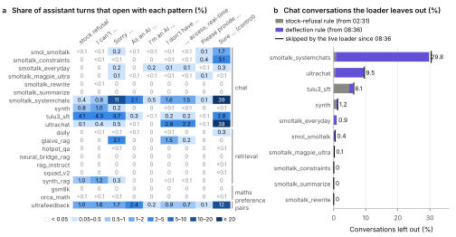

**圖 D1：** (a) 各來源的助理發言中，開頭（前 44 個 token）符合某個制式模式的比例，取自對經 token 化來源的掃描（11 月 24 日 08:20；小型來源取全部片段，其餘取樣 40,000 個）；「當然……」是任何規則都不會移除的對照；一則發言可能同時符合多個模式。(b) 各對話來源的對話中，被制式拒答規則（淺灰色，自第 6,647 步起生效）以及再加上迴避規則（紫色，自第 25,280 步起生效）排除的比例，以載入器的函式在每個來源取樣的 30,000 個對話上量測（smoltalk_everyday 為 2,260 個，即其全部）。黑色刻記與右側欄：從第 25,280 步到第 51,800 步（11 月 24 日 18:33:30 UTC，最後一筆步驟紀錄；`final` 與 `v9` 合計），實際運行的載入器因任一條規則而真正跳過的讀取比例，並附讀取次數。在兩個子圖中，「<0.1」表示大於 0 且小於 0.05%，「0」表示完全沒有。

## 附錄 E. 解碼

**E.1 只對基底測度套用溫度。** 依照附錄 B.3 的輸出分布，對整個混合分布套用溫度，會使候選帶的占比 M/(1 + M)（一個經過校準的機率）變得更尖銳，並使複製迴圈成為吸收態：精確的貝氏預測器會認可它已見過的重複（重複 r 次之後，其延續機率為 (r + λ/V)/(r + λ)），而在溫度低於 1 時，逃脫的機率構成一個收斂級數（`docs/NEGATIVE_RESULTS.md` §1）。因此，解碼器只對網路的分布套用溫度，p_T(v) = (softmax(z/T)(v) + Σ_k m_k[c_k = v])/(1 + Σ m)，並將來源為正在撰寫之回覆的候選，其質量乘上 0.25 的自我證據權重。在微型模型上（保留集中的 48 個對話題目，`docs/E5_SELF_GENERATION.md`），溫度 0.5 時：對混合分布套用溫度，4-gram 重複率為 0.326，48 個回覆中有 13 個出現迴圈，61.4% 的 token 是從題目複製而來；只對網路套用溫度且自我證據權重為 1，得到 0.134、48 個中 1 個與 6.8%；自我證據權重為 0.25 時，為 0.033、48 個中 0 個與 5.5%；關閉候選帶時，為 0.032、48 個中 0 個與 0%。訓練時，自我證據的質量維持權重 1：以 0.25 訓練時，模型會把這個權重學回來（損失 +0.07%）；以 0 訓練時，其對話損失變差 8.6%。若照事先註冊規則的字面，每一種候選帶設定都未通過 E5，因為其複製占比（0.04–0.06）超過不使用候選帶訓練的模型（0.000）；以同樣方式測量，資料集本身的回覆有 0.074 ± 0.008 的 token 是複製的。我們的解讀是：錯的是這條規則的複製準則，而不是這個機制失敗；這個解讀是在看過資料之後才做出的。

**E.2 粒子、精確勢函數與選擇。** 每個回覆都從同一個模型抽出 K = 6 個粒子。提議分布是網路的分布乘上 token 局部的精確勢函數（結構、從使用者用語編譯出的明確計數、一個讓每個粒子都仍能完成的預算），再重新正規化；粒子的增量權重是其遮罩所允許的機率質量，這使粒子平均成為正規化常數的不偏估計（`docs/MATH.md` F1、F2）[64–68]。當有效樣本數低於 K/2 時，粒子會在句子邊界重新抽樣。回覆依一條滿意化規則選出：失敗的粒子（未完成、違反限制、包括制式拒答在內的退化輸出、在句子中途被截斷的散文回覆）會被捨棄，保留落在一個長度範圍內的粒子，再從其餘粒子中選出與其他粒子最相似的一個；數學答案則依多數決 [70]。無論以什麼規則從 K 個樣本中選出一個，分布的改變以 KL 散度計至多為 log K = 1.79 nats（K = 6）；較小的值 log K − (K − 1)/K = 0.96 nats 是分數為連續時從 K 個中取最佳者的 KL，在一般情況下只是一個上界 [69]。預設值：在網路的分布上使用溫度 0.6 與 top-p 0.9 [85]，在程式碼與引文之外使用 6 階 n-gram 封鎖，768 個新 token；`v9` 釋出時不含藏書。

**E.3 一項替代測量。** 我們的解碼器透過 llama.cpp 驅動 Falcon-H1-Tiny 自身的權重，用於 63 個開發集題目，其中 47 個帶有可由機器檢查的限制（`docs/E9_DECODING.md`）：以單純抽樣，47 個題目中有 31 個滿足了所有限制（66% [52, 78]）；以六個粒子、失敗過濾器與共識，47 個中有 43 個（91% [80, 97]）；再加上精確勢函數，47 個中有 46 個（98% [89, 100]）；成對比較時，過濾器在 12 個題目上較好、沒有一個較差（符號檢定 p = 0.0005），勢函數在 15 個題目上較好、沒有一個較差（p = 0.0001），代價是每輪的回應 token 數為 5.8 倍、CPU 時間為 4.0 倍。這些題目同時也是限制編譯器的開發集，編譯器能讀出其中 96% 題目的每一個標註限制，在保留的另一半中則為 85%，所以這些增益是在編譯器表現最好的地方測得的。它檢驗的是一個實作，而不是一種方法。

**E.4 解碼研究。** 前 60 個開發集題目上的六種設定，回覆由執行階段閒置的主機核心從 `final` 第 25,280 步的匯出產生；以及 `v9` 第 31,912 步上的預設設定對 3-gram 封鎖；皆由 Opus 5.5 代理盲測判讀，每個配對判讀一次（`N/study/proxy/reports/ab/`；精確計分見 `lead2_work/exact_dev.json`）：

**表 E1：各解碼設定與預設設定的比較**（勝 / 負 / 平以變體一方計；「兩者皆差」計入平手）。

| 設定 | 勝 / 負 / 平 | 其中「兩者皆差」 | 符號檢定 p | 滿足限制的帶限制題目（共 14 題） | 在上限處被截斷的回覆（共 75 個） |
|---|---|---|---|---|---|
| 預設（6 個粒子、T 0.6、top-p 0.9、768 個 token） | – | – | – | 12 | 2 |
| 1 個粒子 | 1 / 3 / 56 | 53 | 0.63 | 11 | 10 |
| 3-gram 封鎖 | 6 / 3 / 51 | 50 | 0.51 | 12 | 1 |
| 溫度 0.4 | 5 / 6 / 49 | 46 | 1.0 | 11 | 1 |
| 溫度 0.8 | 2 / 7 / 51 | 49 | 0.18 | 13 | 2 |
| 320 個 token 的預算 | 1 / 1 / 58 | 55 | 1.0 | 11 | 4 |
| `v9` 第 31,912 步：3-gram 封鎖對其預設設定 | 4 / 8 / 48 | 44 | 0.39 | 13（預設 12） | 1（預設 0） |

兩項研究都無法區分這些設定：大多數配對是平手，其中大多數是「兩者皆差」。六種設定是在 `final` 上試驗的；在 `v9` 上只試了 3-gram 封鎖，由同一批讀者判讀，每個配對判讀一次。

**E.5 解碼受限於主機。** 在晶片上，一個解碼步驟在 6 列時需 12.1 ms，在 24 列時需 34.5 ms；以 6 個粒子進行一次完整的粒子解碼，每個位置需 43.1 ms，其中約 31 ms 是主機端的 Python（抽樣、限制、精確特徵）（`docs/CHANGES.md` §19.3）。在 CPU 上，200 個測試集題目的正式回覆（252 個回覆）在 40 個各用一個主機核心的工作行程上花了 2,110 s，含匯出與快取校準：每個回覆的中位數為 207 s 與 156 個新 token，在單一核心上六個粒子的每個解碼步驟為 0.567 s（附錄 M，表 M12；`testgen.json`）。

**E.6 開發集研究的完整結果。** 在打開測試集之前，訓練中途的檢查點已在前 60 個開發集題目上與兩個對手進行盲測比較（第 7.9 節對此做了摘要）。表 E2 列出每一位讀者；表 E3 列出相同回覆的精確計分與每位元組位元數。

**表 E2：開發集題目上的盲測比較，依讀者分列**（勝 / 負 / 平以列名在前的模型一方計，平包含「兩者皆差」以及兩種順序不一致的配對；分數為 (勝 + 平/2)/n，附 95% Wilson 區間；精確雙尾符號檢定；順序：讀者的兩種順序結果一致的配對；首位：對先呈現回覆的平均偏好；以 `lead3_work/readers.py` 處理 `study/proxy/ratings/`，可重現 `study/proxy/reports/ab/` 中的每一份報告；我們的模型使用預設解碼；前 60 個 `dev` 題目；p：寫入檢查點時的進度，依訓練器的停止事件）。

| 配對集 | 讀者 | 勝 / 負 / 平 | 分數 [95%] | 符號檢定 p | 順序；首位 |
|---|---|---|---|---|---|
| `final` 25,280（p = 0.44）對 Falcon-H1-Tiny | Opus，一次判讀 | 2 / 43 / 15 | 0.158 [0.087, 0.271] | < 0.0001 | – |
| | `qwen3-4b-2507`（註冊評審） | 2 / 16 / 42 | 0.383 [0.271, 0.510] | 0.0013 | 63.3%; −0.096 |
| | `gemma4-e4b`（註冊的第二評審） | 0 / 4 / 56 | 0.467 [0.346, 0.591] | 0.13 | 80.0%; −0.087 |
| `final` 25,280 對 MobileLLM-R1.5 | Opus，一次判讀 | 15 / 8 / 37 | 0.558 [0.433, 0.677] | 0.21 | – |
| | `qwen3-4b-2507` | 7 / 4 / 49 | 0.525 [0.401, 0.646] | 0.55 | 78.3%; −0.000 |
| | `gemma4-e4b` | 2 / 0 / 58 | 0.517 [0.393, 0.638] | 0.50 | 91.7%; −0.008 |
| `v9` 31,912（p = 0.56）對 Falcon-H1-Tiny | Opus，兩次判讀 | 3 / 39 / 18 | 0.200 [0.118, 0.318] | < 0.0001 | 93.3%; +0.000 |
| | `qwen3-4b-2507` | 1 / 16 / 43 | 0.375 [0.264, 0.502] | 0.0003 | 60.0%; −0.114 |
| | `gemma4-e4b` | 0 / 3 / 57 | 0.475 [0.354, 0.599] | 0.25 | 83.3%; −0.065 |
| `v9` 31,912 對 MobileLLM-R1.5 | Opus，兩次判讀 | 20 / 7 / 33 | 0.608 [0.482, 0.722] | 0.019 | 98.3%; +0.008 |
| | `qwen3-4b-2507` | 7 / 2 / 51 | 0.542 [0.417, 0.661] | 0.18 | 80.0%; −0.000 |
| | `gemma4-e4b` | 2 / 1 / 57 | 0.508 [0.385, 0.630] | 1.0 | 93.3%; +0.008 |
| 參考：Falcon-H1-Tiny 對 MobileLLM-R1.5，200 個 `test` 題目 | Opus，兩次判讀 | 144 / 6 / 50 | 0.845 [0.788, 0.889] | < 0.0001 | 93.5%; +0.012 |

**三位讀者。** 對上 Falcon-H1-Tiny 時，每一位有選邊的讀者幾乎在每個配對中都選了 Falcon-H1-Tiny 那一邊：Opus 讀者在 42 個分出勝負的配對中有 39 個（`v9`），在 45 個中有 43 個（`final`）；註冊評審為 17 個中 16 個與 18 個中 16 個；第二評審則在它判定的所有配對中皆然。在 Opus 讀者與註冊評審都選了邊之處（`v9`），兩者在對 Falcon-H1-Tiny 的 16 個配對中有 14 個選了同一邊，對 MobileLLM-R1.5 則是 6 個中 6 個。讀者之間的差別在於做出判定的多寡：註冊評審的兩種順序只在 60–63% 的 Falcon-H1-Tiny 配對上一致，而且它偏好第二個呈現的回覆，因此 Opus 讀者分出勝負的配對，大多在它那裡是平手（對 Falcon-H1-Tiny 為 42 個中 26 個，對 MobileLLM-R1.5 為 27 個中 21 個；以勝、負、平計算的 Cohen 的 κ 為 0.21 與 0.18）；第二評審在 93–97% 的配對中沒有選邊（C，「相當或同樣差」，或兩種順序不一致），在這裡幾乎沒有鑑別力。對上 MobileLLM-R1.5 時，Opus 讀者發現 `v9` 領先（20 / 7，p = 0.019），主要在指令遵循（9 / 0 / 3）與兩輪題目（7 / 0 / 8）上，而分出勝負的數學配對全數落敗（0 / 5 / 4）；註冊評審得到 7 / 2（p = 0.18）。兩個自動評審都會截斷超過 4,000 個字元的回覆，這發生在 60 個 MobileLLM-R1.5 配對中的 30 個。順序之間的一致並不等於效度：沒有任何人類讀過這些配對。

**一個尺度。** 在 200 個測試集題目上，以同樣方式判讀，Falcon-H1-Tiny 在 150 個分出勝負的配對中有 144 個勝過 MobileLLM-R1.5，且每個類別皆然（對話 37 / 1、程式碼 17 / 2、指令 31 / 0、數學 15 / 3、寫作 44 / 0）。這個配對集不含我們的任何回覆，也不會為我們的模型打開測試集。MobileLLM-R1.5 是一個推理模型，執行時採用其發布者的抽樣設定與預算強制，在這些題目上表現很弱：在 `dev` 上，它的 75 個回覆中有 42 個撞上 token 上限（表 E3），而讀者對參考配對的筆記在 200 個中有 87 與 83 個（兩次判讀）把它的回覆描述為迴圈或重複，並在 46 與 49 個中提到框起來的答案，這些答案常是無意義或迴圈的（其中有 32 與 40 個，同一子句也稱它為迴圈、重複、無意義、退化、片段或不連貫；關鍵字計數，`lead3_work/ref_notes.py`、`lead4_work/scripts/ref_notes4.py`）。在這裡領先 MobileLLM-R1.5 是很低的門檻；有資訊量的比較是與 Falcon-H1-Tiny 的比較，而在這項比較中，我們的模型在第 31,912 步時遠遠落後。開發集與測試集的題目是同一組題目的兩半，所以這個尺度只具指示性，而不是校準。

**以絕對標準而言。** 在兩個回覆都出自我們模型的那個配對集（`v9` 第 31,912 步，預設解碼對 3-gram 封鎖）的第一次判讀中，60 個配對中有 44 個的兩個回覆都被判為差；讀者對這 44 個配對的筆記，在 20 個中指出事實或算術錯誤，在 14 個中指出文字不連貫（關鍵字計數，`lead3_work/ours_notes.py`；例如「兩個都錯；正確答案是 12,600。A 說 30,000，B 說 12。」）。對 MobileLLM-R1.5 時，60 個配對中有 31 個被判為「兩者皆差」，對 Falcon-H1-Tiny 時為 60 個中 14 個；`final` 第 25,280 步則是每項解碼比較 60 個配對中有 46 到 55 個（表 E1）。在 p = 0.56 時，模型對這些題目的回覆大多被判為差，主要原因是內容錯誤與不連貫。

**表 E3：開發集題目上的精確計分與每位元組位元數**（同樣的 60 個 `dev` 題目、75 輪，預設解碼；`lead2_work/exact_dev.json`、`lead2_work/opp_bpb_web.json`、`lead3_work/heldout46.json`；正式模型那一欄：這次 run 在結尾由其自身的解碼選擇產生的回覆、第 51,812 步的偏好最佳化權重、`lead5_work/exact_dev_final.json`，其每位元組位元數則取自 `lead5_work/heldout5.json`）。

| 指標 | 我們的模型，`final` 25,280 | 我們的模型，`v9` 31,912 | 我們的正式模型（51,812，DPO 之後） | Falcon-H1-Tiny | MobileLLM-R1.5 `recommended`（`neutral` 組） |
|---|---|---|---|---|---|
| 數學答案正確（9 題） | 0 | 1 | 0 | 4 | 4 (1) |
| 所有限制都滿足的帶限制題目（14） | 12 | 12 | 13 | 9 | 2 (1) |
| 在 token 上限被截斷的回覆（75） | 2 | 0 | 1 | 0 | 42 (54) |
| 制式拒答 / 迴避（75） | 0 / 0 | 0 / 0 | 0 / 0 | 0 / 0 | 0 / 0 |
| 每個回覆的詞數中位數 | 93 | 96 | 98 | 188 | 532 (698) |
| 每個 UTF-8 位元組的位元數，64 列保留集網頁資料（我們的訓練分布） | 1.017（第 29,722 步） | 0.998 (35,294); 0.980 (46,178) | 0.978（DPO 前 0.974） | 1.570 | 1.500 |

精確計分與讀者的判斷一致：兩個對手都答對較多數學題，而我們的回覆較常滿足限制，且在 60 個配對中有 38 到 45 個比對手的回覆短。在來自我們自己訓練分布的保留集網頁文字上（ClimbMix，占 `final` 訓練 token 的 62%），我們的模型在第 46,178 步需要每位元組 0.98 位元，對手則為 1.57 與 1.50（同樣的資料列：依對手的分詞器切分為 258,814 位元組，依我們的分詞器切分為 258,817 位元組）；這在構造上就對我們有利（經指令微調的對手被拿來讀原始網頁文字，訓練資料不明），而且在這裡，預訓練分布上的下一個 token 損失對對話中的偏好幾乎說明不了什麼。在同樣題目上的兩項解碼研究，都無法把任何設定與預設設定區分開來（表 E1）。

## 附錄 F. 晶片上量測的完整內容

**F.1 稠密核心的改寫。** 一個 768 × 768 的乘積，前向需 0.08 ms，連同重算與反向傳遞則需 0.23 ms（`docs/TPU_NOTES.md`）。

**表 F1：對一個 32 × 1,024 微批次做一次 `value_and_grad`，`configs/final.py`**（`docs/TPU_NOTES.md`；每個變體的損失皆為 8.33353）。

| 實作 | ms | tokens/s |
|---|---|---|
| 參考實作 | 289.3 | 113,264 |
| 旋轉改為兩個乘積；保留維度改為全零欄與廣播常數 | 215.0 | 152,379 |
| … 運算元以核函式的佈局建構，`W_o` 改為對（頭，維度）的單一縮併 | 194.9 | 168,155 |
| … 前饋層的預激活值以 bfloat16 儲存 | 181.8 | 180,248 |
| … 通道以元組攜帶 | 179.3 | 182,779 |
| … 核函式分塊為 1,024 / 1,024 / 512，並搭配融合的反向核函式 | 162.0 | 202,245 |

以完整的訓練步計，新程式碼的速度為 201,877 tokens/s，舊程式碼為 111,893（每步 1.299 s 對 2.343 s；啟動時的基準測試）。最先量測並排除的嫌疑因素，都是在閒置的晶片上以 32 × 1,024 的微批次逐一量測（`docs/TPU_NOTES.md`）：每個微批次的固定成本（較大的微批次較慢）；序列長度（二次方的部分約佔 6%）；重算（4.5%）；float32 的詞彙輸出頭（289 中的 5.8 ms）；最佳化器（一步 2.34 s 中的 1.5 ms）；梯度累積（8 個微批次的 scan 是一個微批次的 8.0 倍）；帶、暫存器、值嵌入與匯點（各自移除後差異都在 5% 以內，匯點為 10%）；以稠密注意力取代 flash 核函式（303 ms 對 289）。

**改寫。** 旋轉寫成 `rotate(xW) = (xW)·(cos, cos) + (xW′)·(sin, −sin)`，其中 W′ 是在每個頭內把旋轉的兩半互換後的權重，因此旋轉後的運算元由乘積產生，而不是由切片取得；保留維度化為全零欄與廣播常數；運算元以核函式的佈局建構，`W_o` 為對（頭，維度）的單一縮併；通道以元組攜帶；核函式分塊為 1,024 / 1,024 / 512，並搭配融合的反向核函式。把前饋層的預激活值以 bfloat16 儲存，會在平方之前多出一次不偏的捨入（相對誤差 2⁻⁹），並省下前饋子層 28% 的時間（每次套用 2.97 → 2.13 ms）。其餘部分在 float32 與 bfloat16 下都與參考實作相同，差異只在捨入範圍內（28 項測試，`tests/model/test_attention_major.py`）。

**單分塊核函式。** 在 4 × 1,024 的片上，splash 核函式在每個（列，頭）切片只會遇到一到兩個 1,024 鍵的分塊，卻要負擔一個通用區塊稀疏核函式的成本：線上 softmax；在完整分塊上計算、其中一半會被丟棄的因果遮罩；寫入裝置記憶體的累計最大值、總和與輸出；以及以 128 個向量通道的寬度寫出的 log-sum-exp。單分塊核函式（`bes/model/attention_onetile.py`）把切片保留在晶片內記憶體中，只以每條 256 個查詢列的條帶覆蓋因果三角形，非對角的部分只依片段做遮罩，每個條帶的 softmax 在單趟中精確算出，並把 log-sum-exp 寫成沿向量通道緊密排列的一列；反向傳遞則以鍵為主序的條帶進行。旗標 `save` 讓前向核函式的輸出與 log-sum-exp 在迴圈的重算中保留下來，因此每次區塊套用只執行一次前向核函式，而不是兩次。relu(h)² 的手寫反向傳遞，移除了編譯器原本打包進重算乘積中的一個位元遮罩；它在 CPU 上的結果逐位元相同。

**表 F2：在晶片上對一片做一次 `value_and_grad`，`configs/final.py`，30 次的中位數**（`wf/chip_kernels_0745.txt`；在剛初始化的參數與合成批次上，與設定中核函式比較的相等性：損失差異／各參數葉中最差的相對梯度差異，最大值／L2；`tables.md` T3a）。

| 核函式與開關 | 4 × 1,024（ms） | 加速比 | Δ損失／最大值／L2 | 2 × 2,048（ms） | 加速比 | Δ損失／最大值／L2 |
|---|---|---|---|---|---|---|
| 設定中的 splash 核函式 | 17.745 | – | – | 19.845 | – | – |
| splash + `io` | 17.177 | 1.033 | 0 / 0 / 0 | 19.762 | 1.004 | 0 / 0 / 0 |
| splash + `relu2` + `ce` | 16.974 | 1.045 | 0 / 1.1e−2 / 1.0e−2 | 19.512 | 1.017 | 0 / 3.9e−2 / 3.4e−2 |
| splash + `save` | 16.800 | 1.056 | 0 / 1.4e−2 / 1.2e−2 | 17.920 | 1.107 | 0 / 4.7e−2 / 3.3e−2 |
| `onetile` | 15.268 | 1.162 | 0 / 2.8e−2 / 2.3e−2 | 17.605 | 1.127 | −9.5e−7 / 5.1e−2 / 3.9e−2 |
| `onetile:save` | 15.130 | 1.173 | 0 / 1.4e−2 / 1.5e−2 | 16.498 | 1.203 | −9.5e−7 / 7.5e−2 / 5.4e−2 |
| **`onetile:save` + `relu2`（採用）** | **14.639** | **1.212** | 0 / 2.8e−2 / 2.6e−2 | **16.275** | **1.219** | −9.5e−7 / 7.9e−2 / 5.7e−2 |
| `onetile:save` + `relu2` + `ce` | 14.816 | 1.198 | 0 / 1.2e−2 / 1.6e−2 | 16.176 | 1.227 | −9.5e−7 / 4.8e−2 / 4.0e−2 |

以晶片編譯器實際執行的指令束計，`onetile:save` 在 1,024 個 token 時所需的工作量是設定中核函式的 0.34，在 2,048 時為 0.42（`docs/TPU_NOTES.md`）。這個核函式上線時，對它的獨立審查尚未回覆；審查後來修改的是開關對長序列與拼字錯誤的處理方式，而不是核函式（`wf/kernel.md`）。

**F.2 採用的核函式在晶片上的相等性。** 在晶片上，以剛初始化的參數與合成批次測試，採用的核函式與設定中核函式的損失最多相差 9.5 × 10⁻⁷；就最差的參數葉而言，其梯度在 1,024 個 token 時的相對差異為 2.8 × 10⁻²（最大值）與 2.6 × 10⁻²（L2），在 2,048 時為 7.9 × 10⁻² 與 5.7 × 10⁻²。不改動注意力算術的變更，在晶片上同樣會讓梯度變動（1,024 時為 1.1–1.4 × 10⁻²，2,048 時為 3.9–4.7 × 10⁻²，對象是改變後的重算策略，以及在 CPU 上逐位元相同的反向傳遞），但採用的核函式的差異約為這個範圍的兩倍，因此這個範圍無法確立它的正確性。它之所以被接受，依據的是 CPU 直譯模式的測試（在 float32 下與設定中核函式相差在 1e−5 以內，對照的是 float64 的稠密參考實作，且片段邊界設在每個條帶邊界上及其相鄰處），以及實際訓練中的損失維持在其範圍內。若在晶片上量測每個變體與 float32 參考實作之間的距離，即可定論；但這項距離並未量測。

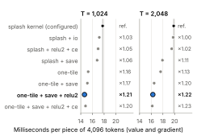

**圖 F1：** 在晶片上對 `configs/final.py` 的一片 4,096 個 token（左為 4 × 1,024，右為 2 × 2,048）做一次值與梯度計算，八種核函式設定在同一次暫停中量測（11 月 24 日 07:44–07:52；`wf/chip_kernels_0745.txt`）。圓點：30 次計時的中位數。每個圓點的 30 次計時從最小值到最大值橫跨 0.09–0.47 ms，小於圓點的寬度，因此未畫出範圍；範圍重疊的有採用的設定與加上 `ce` 的同一設定（兩種長度皆然），以及在 2,048 個 token 時的單分塊 + save 與上述兩者、splash + save 與單分塊、設定中的 splash 核函式與 splash + io：量測無法分辨這些排序。垂直線：設定中 splash 核函式的中位數；右側：相對於它的加速比。藍色加圈：第 22,613 步採用的設定。`save`：前向核函式的輸出在重算中保留；`relu2`、`ce`：ReLU² 與交叉熵輸出頭的手寫反向傳遞；`io`：splash 的累加器放在晶片內記憶體中。

**F.3 完整訓練步與 `v9` 的開關。** `flat` 也以 `[V, W]` 的形狀累積表梯度；`rows` 也省去一次正規化的重算；`tokn` 的 float32 加總以另一種順序進行。成本模型把 `v9` 多出的週期部分歸因於表梯度的重新佈局，幾乎沒有歸因於注意力增益表（`wf/v9_speed.md`）。對於執行階段 1，`docs/TPU_NOTES.md` 把最初的速率概括為 `final` 11.2–11.7 萬、`v9` 8.8–9.2 萬 tokens/s；磁碟上留存的是啟動時的基準測試 111,893（`final`）與 88,146（`v9`），以及 `final` 的兩筆監控讀數 115,394 與 116,718。

**表 F3：合成批次上 262,144 個 token 的完整累積步**（`tables.md` T3b；07:44 的 `final` 各列在開啟 `ce` 的情況下計時；03:09 的微批次各列使用 splash 核函式）。

| 量測時間（UTC，11 月 24 日） | 設定 | 表梯度 | 核函式與開關 | 片數 × 列數 × token 數 | ms | tokens/s |
|---|---|---|---|---|---|---|
| 03:09–03:15 | `final` | `take` | splash | 16 × 16 × 1,024 | 1,173.7 | 223,348 |
| 03:09–03:15 | `final` | `take` | splash | 32 × 8 × 1,024 | 1,081.5 | 242,393 |
| 03:09–03:15 | `final` | `take` | splash | 64 × 4 × 1,024 | 1,063.3 | 246,538 |
| 03:09–03:15 | `final` | `take` | splash | 16 × 8 × 2,048 | 1,348.8 | 194,351 |
| 03:09–03:15 | `final` | `take` | splash | 32 × 4 × 2,048 | 1,284.3 | 204,121 |
| 03:09–03:15 | `final` | `take` | splash | 64 × 2 × 2,048 | 1,218.2 | 215,192 |
| 07:44–07:52 | `final` | `take` | `onetile:save+relu2+ce` | 64 × 4 × 1,024 | 884.5 | 296,371 |
| 07:44–07:52 | `final` | `take` | `onetile:save+relu2+ce` | 128 × 2 × 1,024 | 958.9 | 273,378 |
| 07:44–07:52 | `final` | `take` | `onetile:save+relu2+ce` | 64 × 2 × 2,048 | 983.9 | 266,432 |
| 07:44–07:52 | `final` | `take` | `onetile:save+relu2+ce` | 128 × 1 × 2,048 | 1,013.1 | 258,767 |
| 09:45–09:58 | `v9` | `take` | `onetile:save+relu2` | 32 × 8 × 1,024 | 1,491.5 | 175,764 |
| 09:45–09:58 | `v9` | `take` | `onetile:save+relu2` | 64 × 4 × 1,024 | 1,433.1 | 182,919 |
| 09:45–09:58 | `v9` | `take` | `onetile:save+relu2` | 32 × 4 × 2,048 | 1,551.6 | 168,949 |
| 09:45–09:58 | `v9` | `take` | `onetile:save+relu2` | 64 × 2 × 2,048 | 1,510.2 | 173,584 |
| 09:45–09:58 | `v9` | `sorted` | `onetile:save+relu2` | 64 × 4 × 1,024 | 1,789.0 | 146,529 |
| 09:45–09:58 | `v9` | `sorted` | `onetile:save+relu2` | 64 × 2 × 2,048 | 1,856.5 | 141,205 |
| 09:45–09:58 | `v9` | `onehot` | `onetile:save+relu2` | 64 × 4 × 1,024 | 1,484.8 | 176,556 |
| 10:53–10:56 | `v9` | `take` | … + `flat` | 64 × 4 × 1,024 | 1,406.4 | 186,393 |
| 10:53–10:56 | `v9` | `take` | … + `flat` + `rows` | 64 × 4 × 1,024 | 1,295.2 | 202,403 |
| 10:53–10:56 | `v9` | `take` | … + `flat` + `rows` + `tokn` | 64 × 4 × 1,024 | 1,287.1 | 203,665 |

在晶片上，`v9` 的三個開關與只用 `flat` 相比，損失差異為 0，梯度差異為 9.5 × 10⁻³（最大值）與 1.0 × 10⁻²（L2），這是改變編譯後的計算圖就會產生的程度。對 `v9` 的一片做一次 `value_and_grad`（6 次的中位數）：在 4 × 1,024 時為 22.79 ms（`take`）、29.07（`sorted`）、23.38（`onehot`）、22.59（+ `flat`）、20.44（+ `rows`）、20.01（+ `tokn`）；在 2 × 2,048 時為 23.48（`take`）與 29.65（`sorted`）。以僅編譯的方式檢視 16 × 1,024 的程式，可見編譯器在整個前向傳遞中都把兩條通道保留在晶片內記憶體裡，這與片帶來的增益一致，但本身並不是量測（`wf/speed_loops.md`）。

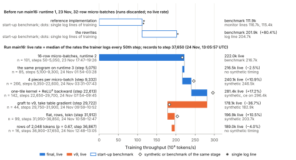

**圖 F2：** 依原因拆解的訓練吞吐量（表 2），按變更發生的順序排列。上半部為執行階段 1（32 列的微批次，訓練 run 皆已捨棄）：啟動時的基準測試（空心長條）與訓練時的單行日誌（圓點；參考實作那一列的兩個圓點是兩筆監控讀數，116,718 與 115,394 tokens/s）。下半部為 run main16：每根長條橫跨某一項變更前後的即時速率（第 2.2 節），該階段下方印有所用步紀錄的區段（n、第一步與最後一步、UTC）；紀錄至第 51,800 步為止（11 月 24 日 18:33:30 UTC），即最後一筆步紀錄，最後一個階段是從 p = 0.92 起的僅助理回覆尾段。菱形：表 2 中同一階段的合成或基準測試數值。每根長條是變更前後中位數的差，而不是單一變更本身的效果：從執行階段 2 到執行階段 3 這一步沒有改動任何程式碼，而接枝改變了設定。

**F.4 沒有幫助的做法。** 有十三項變更在晶片上量測過但未採用（表 F4）。其中兩項雖然較快，但快的幅度小於採用門檻或離散範圍（每個微批次只用一個損失分段，1.2%；手寫的交叉熵反向傳遞，在 2,048 個 token 時快 0.6%，在 1,024 時慢 1.2%），另有兩項與我們自己寫下的預期相反（在重算中保留核函式的輸出；提高編譯器的作用域晶片內記憶體上限）。

**表 F4：在晶片上量測過但未採用的變更**（來源見 `CLAIMS.md`）。

| 變更 | 量測結果 | 預期有幫助的理由 |
|---|---|---|
| 較大的微批次（64、128 列；參考程式碼） | 110,855 與 104,576 對 111,893 tokens/s | 攤提每個微批次的固定成本 |
| 不做重算（微批次減半） | 改寫後為 15.9–16.7 萬對 20.2 萬 tokens/s；這次 run 的基準測試中為 188,907 對 216,681 | 省去重算的前向傳遞 |
| 在重算中保留注意力核函式的輸出（splash） | 161.2 對 158.3 ms | 省去第二次前向核函式 |
| 每個微批次只用一個損失分段 | 快 1.2%，低於 1.5% 的採用門檻 | 減少掃過 logits 的趟數 |
| 在 2,048 個 token 時使用單一個 2,048 鍵的分塊 | 177.5 對 176.1 ms | 分塊較少 |
| 每個頭各一個乘積，沿頭的軸堆疊 | 每個微批次 274.6 ms | 避免一次縮併 |
| 前饋層完全以 bfloat16 計算 | 184.5 對 181.8 ms | 位元組數減半 |
| 核函式分塊為 256 | 單看核函式本身，比 512 慢 2.2 倍 | 更細的因果跳過 |
| 作用域晶片內記憶體上限 8 / 16 / 64 / 96 MiB | 1,295.9 / 1,159.1 / 1,103.7 / 1,322.2 ms 對 1,062.5 ms（預設） | 讓編譯器的緩衝區有更多空間 |
| 新核函式下，1,024 時每片 2 列／2,048 時每片 1 列 | 958.9 / 1,013.1 對 884.5 / 983.9 ms | 表 F3 的趨勢 |
| 手寫的交叉熵反向傳遞 | 每片在 1,024 時慢 1.2%，在 2,048 時快 0.6%（在離散範圍內） | 少掃過 float32 logits 一趟 |
| `v9`：不用 scatter 的 `sorted` 表梯度 | 每步 1,789.0 對 1,433.1 ms（`take`） | 乘加運算只有 one-hot 的 16 分之一 |
| `v9`：每片 8 列 | 1,491.5 對 1,433.1 ms | 減少逐片的表成本 |

**F.5 僅編譯的方法。** 程式：對 2 片執行的 `bes.train.train.accumulate`（迴圈主體是訓練器一步中的一片，包含累積），針對 `v6e:1x1` 的 libtpu 0.0.50，jax 0.11.1，在 CPU 主機上；每次完整編譯需時 460–500 s。每步的估計值為 n_pieces × 每片週期數 + 每步一次的部分，以每百萬週期 0.521 ms 換算（在 1,024 個 token 下以兩種形狀的 MLP 區塊程式校準）；對 `v9` 而言，再加到 `final` 實測的每步時間上。Mosaic 核函式計為 0 個週期，因此週期數只有差值才有意義；表 4 的位元組數，是對實際執行的指令（while 迴圈主體乘以其迭代次數）加總其駐留於 HBM 的運算元與輸出的邏輯位元組數，其中被切片的融合參數計其切片，原地更新計其更新部分（`wf/v9_speed_work/hlo_bytes.py`）。通過表 4 全部六種設定的直線斜率為每 GB 0.73 ms，相當於邊際 1.37 TB/s。

**F.6 離算術上限多遠。** 依設定計算乘加運算（`lead2_work/make_numbers.py`），`final` 在 1,024 個 token 時每個訓練 token 需要 0.781 GFLOP（前向與反向、因果注意力、不含重算）：以 281,399 tokens/s 計為 220 TFLOP/s，是晶片單在前饋乘積上所達到的 814 TFLOP/s 的 27%。若計算晶片實際執行的運算（迴圈主體的乘積計四次：前向、重算的前向、兩個反向乘積；旋轉的 q 與 k 各計為兩個乘積；注意力按條帶涵蓋的 62.5% 分數方陣計，其前向核函式計一次，反向為前向的 2.0–2.5 倍；輸出頭計三次），則每個 token 為 1.18–1.19 GFLOP：即 332–336 TFLOP/s，為 814 的 41%。

**迴圈次數。** 在參考實作中，以一次迴圈取代八次時，每個微批次需 42.9 ms，對比 289 ms（`docs/TPU_NOTES.md`）：每次迴圈約 35 ms，迴圈外 8 ms；改寫後，一次區塊套用約需 8 ms，微批次的其餘部分 34 ms，因此在相同的牆鐘時間下，4 次迴圈可以訓練的 token 數約為 8 次迴圈的 1.65 倍（改寫後的程式碼）到 1.95 倍（參考實作）。

**F.7 成本模型對照晶片，依變更逐項比較。** 對每一項同時有僅編譯預測與晶片量測的變更，表 F5 比較兩者：成本模型每次都預測對了正負號，大小則錯了 0.36 到 7.9 倍。它對 `v9` 每步時間的預測以 `final` 實測的每步時間為錨點，看起來偏高 5%；就它實際預測的差值而言，則偏高 14%。

**表 F5：編譯器成本模型對照晶片，依變更逐項比較**（`wf/v9_speed.md`、`wf/v9_rows.md`、`wf/v9_tokn.md`；晶片檔案同表 3 與 `docs/CHANGES.md` §19.5；圖 3b）。

| 變更 | 預測（每步 ms） | 實測（每步 ms） | 預測／實測 |
|---|---|---|---|
| 以 `v9` 取代 `final`（`take`，每片 4 列） | +623.7 | +548.6 | 1.14 |
| 表梯度以 `sorted` 取代 `take`（`v9`） | +129.7 | +355.9 | 0.36 |
| 每片 8 列取代每片 4 列（`v9`） | +49.9 | +58.4 | 0.85 |
| 每片 8 列取代每片 4 列（`final`；晶片上使用 splash 核函式） | +53.7 | +18.2 | 2.95 |
| `flat` | −45.9 | −26.7 | 1.72 |
| `rows`（在 `flat` 之上） | −118.9 | −111.2 | 1.07 |
| `tokn`（預測時在 `flat` 之上，量測時在 `flat` + `rows` 之上） | −63.6 | −8.1 | 7.85 |

另有兩個案例只有一方的結果：在重算中保留注意力核函式的輸出有量測（慢 1.8%；沒有僅編譯的估計），而透過 scan 攜帶下一次迴圈的輸入則有估計（+4.9%），沒有量測。設計文件支持 `sorted` 的論點是它的乘加運算只有 one-hot 梯度的 16 分之一（`docs/V9.md` §3），這在算術上是對的，作為時間的預測卻是錯的：scatter-add 是三者中最快的。

## 附錄 G. 接枝的完整說明

**G.1 工具。** `scripts/graft_run.py SRC DST --config configs/v9.py --override run.seed=1 --check --cpu`（提交 `9a4d652`）：讀取來源的清單檔與最新的檢查點，若其設定雜湊不是這次 run 的雜湊就拒絕執行；建立目標訓練器的全新樹（參數與最佳化器狀態取目標的初始化值，種子為 1）；凡是路徑、形狀、資料型別與儲存方式都相符的葉，一律以檢查點中的對應葉取代（參數與最佳化器槽位；對 MuonH 而言，快取的初始範數也屬於槽位），任何不符即拒絕執行，並回報被留下的葉（此處沒有：藏書不是參數）；以目標的雜湊寫入檢查點，並沿用來源的步數與帳；沿用 `run.json`、階段帳、基準測試的紀錄、`post_plan`、`micro_split` 與 `fast`；寫入清單檔，其中的設定已替換，並附上一筆 `graft` 紀錄（時間、來源 run 及其雜湊、檢查點、步數、token 數、p、新增與複製的數字數）；若帶 `--check`，就比較損失（第 6.4 節）；最後把暫存目錄重新命名為目的地。實際的切換隨後停下 `final`，在晶片上為 `v9` 計時，在執行階段的 CPU 上接枝，對調兩個目錄（使 `v9` 保有監控與快照腳本所用的 run 路徑），再以 `--resume` 接續訓練。一次小尺寸的 CPU 演練從頭到尾跑完了整個流程（訓練 → 停止 → 接枝 → 對調 → 接續 → 後訓練 → 匯出），步數、p 與學習率在接枝前後都保持連續。

一次獨立審查在一個人工建構的 run 上進行了四項測試（該檢查；每個沿用的葉都相等；每個新葉都等於全新的初始化值，`page/val` 與 `gain/o` 恰為零；各種拒絕情形；一個訓練器還原接枝後的目錄，並走出數值有限、使 `page/val` 離開零的一步），沒有發現阻礙性問題；在它指出的兩項中度風險中，一項（載入器的規劃視野）已在提交的工具中修正，另一項（一個原本會覆寫來源最後一個檢查點的鏡像）則因保留已停止的 run 而避開（`wf/graft_review.md`；測試在 `tests/train/test_graft_run.py`，提交 `769f240`）。若共用的葉有差異、目的地已存在、沒有檢查點，或檢查點是在另一個設定雜湊下寫入的，工具都會拒絕寫入。

**G.2 函數檢查與梯度。** 第 6.4 節的檢查在四個來源檢查點上的結果：

**表 G1：接枝的函數檢查**（2 × 256 個 token 的合成批次；接枝後的樹使用進行中 run 的設定雜湊 `f29bfeb3ebf353a8`）。

| 來源檢查點 | 執行位置 | 來源損失 | 接枝後損失 | 差值 |
|---|---|---|---|---|
| 第 26,890 步（快照） | 開發容器 | 11.2808027 | 11.2808027 | 0.0 |
| 第 28,501 步（進行中的 run，切換前） | 執行階段主機的 CPU，在訓練器旁執行 | 11.3348608 | 11.3348608 | 0.0 |
| 第 29,722 步（切換點；於 HEAD `8a86bcb` 對同一個來源檢查點重新執行） | 開發容器 | 11.3726320 | 11.3726320 | 0.0 |
| 第 14 步（冒煙測試尺寸的演練） | 開發容器 | 9.2843390 | 9.2843390 | 0.0 |

第 29,722 步那一列是審查者從已停止 run 的本地複本重新執行的結果，不是實際的那次呼叫：在第 29,722 步所做的接枝，唯一保存下來的輸出是在沒有 `--check` 的情況下執行的，寫入的是另一個雜湊下一個 `sorted` 變體的目錄。此外，工具在檢查之前就寫入清單檔的接枝紀錄，而且只印出檢查結果、不加以儲存；我們把這兩點都列為工具的缺陷。

在真實的保留集列上（第 6.4 節），U 的梯度達到 7.4 × 10⁻³ 與 9.0 × 10⁻³（最大元素；網頁列與對話列），G 的梯度則為 1.0 × 10⁻³ 與 1.2 × 10⁻³（`lead2_work/graft_grad.json`）。在梯度固定的情況下，帶著沿用的更新次數，Adam 使新葉的更新量在第一步是全新 run 的 0.894 倍，在第七步是 1.44 倍（最大值），在第五十步是 1.04 倍（β = 0.8, 0.95；我們自己的計算）。

**G.3 接枝後的資料流。** 資料流無法沿用：資料混合改變了（不再有藏書的列或任務），而且它以另一個種子重新開始。在 run 中途開始的資料流需要兩項修正。載入器的規劃視野估計 tokens/p − tokens 在接枝後一個區塊時小了 40 倍（1.9 × 10⁸ 對 8.2 × 10⁹，由接枝的審查發現），因此小型來源原本會一下子就被讀完；在告知接枝前的 token 數之後，載入器以剩餘的 7.45 × 10⁹ 個 token 做規劃，其中實際訓練的是 5.79 × 10⁹ 個：大約長了 1.3 倍，而不是剛好。此外，每個來源最多可再被讀取 max_epochs × (1 − p) = 3.96 次；小型來源和接枝前一樣受到上限限制（GSM8K 的規劃占比由 0.0126 變為 0.0007；接枝前則是由 0.0114 變為 0.0008）。

**G.4 對照實驗的細節。** *設計。* 模型採用進行中 run 的模型程式碼，寬度為 128（2 個權重共享的區塊 × 8 次迴圈，每列 512 個 token，每步 4,096 個 token）。共五組，每組各用種子 0、1 與 2：`ref`，即微型參考模型（4,402,372 個數字）；`v9_pages`，即從第一步起就帶有 `v9` 逐詞頁的參考模型（每個 token、每個區塊各有增益與 8 個私有 token 神經元，位於 32 維空間；14,904,516 個數字）；以及 `graft_25`、`graft_50`、`graft_75`：先以 `ref` 訓練到預算的 0.25、0.5 或 0.75，再以實際工具本身的函式（`graft_run.graft_arrays`）接枝到 `v9_pages`；該函式沿用共用的葉，連同其最佳化器槽位、更新次數與步數，而 5 個新葉（10,502,144 個數字）則取同一種子下全新 `v9_pages` 樹的值（U = G = 0）。預算為 6 × 10⁶ 個 token（1,464 步），在四分之一、一半、四分之三與結束時進行保留集評估；接枝落在第 366、732 與 1,098 步。在同一種子內，所有組共用資料順序、排程（p = step/1,464）與共用葉的初始值。保留集損失在取自其他檔案的 32 個網頁列與 32 個對話列上量測；「混合」以 3:1 為兩者加權，與訓練列相同。

*檢查。* 每個接枝組都訓練了自己的主幹，其接枝前的評估與同一種子的 `ref` 逐列、逐位元相同。在九次接枝的每一次，各領域的保留集損失，以及 8 個保留網頁列上的訓練損失，在接枝前後都相同：差值恰為 0，在保留集各領域上連逐列也是如此（訓練損失的檢查只儲存一個彙總值）。這些檢查和整個實驗一樣，都在 CPU 上以 float32 執行。

*來源。*（`docs/MICRO_GRAFT.md`、`wf/micro_graft.md`、`micro_graft/6M/`；由 `lead3_work/micrograft.py` 重新計算）。程式碼：接枝組位於 `bes/eval/microbench.py`（`run_graft_arm`）、`scripts/micro_ablate.py`（`GRAFT_ARMS`）、`scripts/micro_graft_report.py`，以及 `tests/eval/test_micro_graft.py` 中的 11 項測試（提交 `b04478e`；結果在 `b1e9140`）；由一個代理撰寫，並在執行前由第二個代理審查（主幹相等、函數保持、沿用的最佳化器狀態、排程與資料順序、31 個 E2 組的雜湊未變、報告中的算術）。這些 run 使用另一份套用了該修補的儲存庫複本，在訓練執行階段主機的閒置核心上執行（每個 run 一個實體核心、兩個執行緒；僅用 CPU），時間為 14:12:51 至 16:41:01 UTC；主 run 在 2,048 個 token 下的即時速率，在 14:12:51 之前的 73 筆步紀錄上為 189,054 tokens/s，在這些 run 期間的 128 筆上為 189,077，在重新開始組的時段（16:42:47–17:29:56）中、尾段於 17:09:57 開始之前的 23 筆上為 189,050（以 `lead5_work/scripts/rate_during_micro5.py` 分析最終的訓練紀錄檔）。若基礎葉在目標中缺失或形狀改變、最佳化器設定或排程不同，或接枝比例不是評估比例之一，接枝會在訓練前就被拒絕。沿用的更新次數使頁表在接枝後第 1、2、5 與 50 次的更新量，分別是以相同動差全新開始時的 0.89、1.15、1.41 與 1.04 倍，與實際的接枝相同。訓練池為 8,192 個網頁列（ClimbMix）與 4,096 個對話列（smol-smoltalk），每列 512 個 token；資料混合以 3:1 抽取列，11,712 列中有 8,784 個網頁列與 2,928 個對話列（分別為 1.07 與 0.71 遍），占加權 token 的 78.0% 與 22.0%。保留集：取自其他檔案的 32 個網頁列與 32 個對話列。學習率係數隨步數線性衰減到 0.1，即 1 − 0.9p，與進行中的 run 相同。

各檢查點上（混合，三個種子的平均 ± 標準差），`v9_pages` − `ref`：1.50 × 10⁶ 個 token 時為 −0.0164 ± 0.0062，3.00 時為 −0.0329 ± 0.0091，4.50 時為 −0.0494 ± 0.0100，6.00 時為 −0.0519 ± 0.0107；結束時按領域分，網頁 −0.0464 ± 0.0118，對話 −0.0683 ± 0.0089，助理輪次 −0.0689 ± 0.0107。每次接枝之後的接枝組 − `v9_pages`：`graft_25` 為 +0.0137 ± 0.0086、+0.0029 ± 0.0101、−0.0031 ± 0.0113（3.00、4.50、6.00 × 10⁶）；`graft_50` 為 +0.0333 ± 0.0085、+0.0161 ± 0.0096（4.50、6.00）；`graft_75` 為 +0.0396 ± 0.0103（6.00）。結束時的逐種子結果（混合）：接枝組 − `ref` 為 −0.0539、−0.0551、−0.0558（`graft_25`），−0.0386、−0.0359、−0.0327（`graft_50`），−0.0127、−0.0120、−0.0122（`graft_75`）；`graft_50` − `v9_pages` 為 +0.0241、+0.0054、+0.0188。各領域回收的比例（平均差值之比；網頁、對話、助理輪次）：`graft_25` 為 1.07、1.04、1.04；`graft_50` 為 0.70、0.66、0.67；`graft_75` 為 0.24、0.24、0.23。函數檢查在 8 個保留網頁列上的損失（種子 0、1、2），每次接枝前後完全相同：5.0309、5.0072、5.0118（`graft_25`）；4.7603、4.7661、4.7617（`graft_50`）；4.6126、4.6162、4.6532（`graft_75`）。接枝組與 `ref` 的差值在種子之間變化很小（標準差 0.0004–0.0030），因為兩者共用主幹；從未共用狀態的組，種子之間相差約 0.01。重新開始組（從零開始訓練的 `v9_pages`，預算 3,000,000 個 token，使用自己的排程，種子 0–2；732 步，2,998,272 個 token；同一台主機，16:42:47–17:29:56 UTC；`micro_graft/3M/results.tar.gz`，解壓縮至 `lead3_work/micro3M/`）結束時為 4.3891、4.3885 與 4.3917（混合；網頁 4.6317 ± 0.0043，對話 3.6637 ± 0.0074）；減去 6 × 10⁶ 個 token 時的 `graft_50`，為 +0.2348、+0.2415、+0.2265；減去 6 × 10⁶ 時的 `ref`，為 +0.1962、+0.2055、+0.1938（`ref` 損失的 4.7%）；減去 6 × 10⁶ 時的 `v9_pages`，為 +0.2504 ± 0.0074；減去 `ref` 自己在 3 × 10⁶ 個 token 時的評估（排程中段，學習率係數 0.55），為 −0.0844、−0.0835、−0.0836；減去 `v9_pages` 在其 6 × 10⁶ run 中 3 × 10⁶ 個 token 時的值，為 −0.0509 ± 0.0086，這是排程在該處結束所帶來的優勢，上述比較都包含了這項優勢。重新開始組的批次是同一種子下 6 × 10⁶ run 批次的前半段（列的規劃是前綴穩定的輪替，`microbench.row_kinds`）：它再次讀取資料的前半段，而不是未見過的後半段；由於整體上只對訓練池讀了大約一遍，這應該影響不大，但並未測試。

**G.5 每個經評估檢查點的保留集損失。** 這些列由 `bes.export.heldout_batches` 建立，每個領域 64 列（`scripts/midrun_eval.py`）；匯出本身的 16 位元檢查每個領域使用 16 列（`bes/export.py` 中的 `heldout_rows` = 16）。我們在 CPU 上重新評估了五個檢查點（29,722、34,166、35,294、46,178 與 51,812，最後一個取自最終快照，由 `lead5_work/scripts/heldout_eval5.py` 評估），保留每個位置的損失，並關閉新路徑；也評估了第 51,812 步經偏好最佳化後的權重；本地值在網頁列與對話列上與執行階段的值相差不超過 5 × 10⁻⁸（第 51,812 步的代理列上為 2.3 × 10⁻⁷；`lead5_work/heldout5.json`）。

**表 G2：每個經評估檢查點的保留集損失**（單位為每個 token 的 nats；「網頁 + 對話」是 128 列、125,880 個加權 token 的比較集；本地評估在網頁列與對話列上重現執行階段的值，相差不超過 5 × 10⁻⁸，`lead4_work/heldout4.json`、`lead5_work/heldout5.json`；`lead2_work/heldout_analysis.json`、`lead3_work/heldout3.json`、`lead3_work/heldout46.json`；自 37,522 起的檢查點是在資料流的對話占比上升期間（自第 36,867 步起）訓練的，自 48,342 起則是在對話開始只對助理 token 訓練之後（第 48,190 步）訓練的，參見附錄 C.1；代理列不納入任何比較，列於最後一欄）。

| 檢查點 | token 數 | 訓練分鐘數 | 網頁 | 對話 | 對話，助理 token | 網頁 + 對話 | 評估位置 | 代理列 |
|---|---|---|---|---|---|---|---|---|
| `final` 26,890 | 7.05 × 10⁹ | 494.7 | 2.7952 | 1.6300 | 1.5269 | 2.2358 | 執行階段 | 2.6332 |
| `final` 28,501 | 7.47 × 10⁹ | 519.7 | 2.7905 | 1.6217 | 1.5191 | 2.2293 | 執行階段 | 2.6382 |
| `final` 29,722（接枝點） | 7.79 × 10⁹ | 538.7 | 2.7886 | 1.6183 | 1.5164 | 2.2267 | 執行階段與本地 | 2.6361 |
| `v9` 30,742 | 8.06 × 10⁹ | 563.7 | 2.7739 | 1.6022 | 1.4994 | 2.2113 | 執行階段 | 2.6112 |
| `v9` 31,762 | 8.33 × 10⁹ | 588.8 | 2.7666 | 1.5950 | 1.4918 | 2.2041 | 執行階段 | 2.6105 |
| `v9` 31,912 | 8.37 × 10⁹ | 592.5 | 2.7662 | 1.5865 | 1.4830 | 2.1998 | 執行階段 | 2.6187 |
| `v9` 33,038 | 8.66 × 10⁹ | 617.5 | 2.7541 | 1.5752 | 1.4713 | 2.1881 | 執行階段 | 2.5867 |
| `v9` 34,166 | 8.96 × 10⁹ | 642.5 | 2.7437 | 1.5630 | 1.4569 | 2.1768 | 執行階段與本地 | 2.6000 |
| `v9` 35,294 | 9.25 × 10⁹ | 667.5 | 2.7344 | 1.5508 | 1.4463 | 2.1661 | 執行階段與本地 | 2.5849 |
| `v9` 36,422 | 9.55 × 10⁹ | 692.6 | 2.7254 | 1.5413 | 1.4355 | 2.1569 | 執行階段 | 2.5430 |
| `v9` 37,522 | 9.84 × 10⁹ | 717.6 | 2.7137 | 1.5225 | 1.4167 | 2.1418 | 執行階段 | 2.5700 |
| `v9` 38,604 | 1.012 × 10¹⁰ | 742.6 | 2.7066 | 1.5042 | 1.3967 | 2.1293 | 執行階段 | 2.5742 |
| `v9` 39,686 | 1.040 × 10¹⁰ | 767.7 | 2.7035 | 1.4838 | 1.3761 | 2.1179 | 執行階段 | 2.5473 |
| `v9` 40,768 | 1.069 × 10¹⁰ | 792.7 | 2.6997 | 1.4627 | 1.3546 | 2.1058 | 執行階段 | 2.5258 |
| `v9` 41,850 | 1.097 × 10¹⁰ | 817.7 | 2.6977 | 1.4443 | 1.3339 | 2.0959 | 執行階段 | 2.5157 |
| `v9` 42,932 | 1.125 × 10¹⁰ | 842.8 | 2.6922 | 1.4230 | 1.3111 | 2.0828 | 執行階段 | 2.5151 |
| `v9` 44,014 | 1.154 × 10¹⁰ | 867.8 | 2.6910 | 1.4112 | 1.2965 | 2.0765 | 執行階段 | 2.4841 |
| `v9` 45,096 | 1.182 × 10¹⁰ | 892.8 | 2.6857 | 1.3942 | 1.2795 | 2.0656 | 執行階段 | 2.4868 |
| `v9` 46,178 | 1.211 × 10¹⁰ | 917.9 | 2.6867 | 1.3790 | 1.2651 | 2.0588 | 執行階段與本地 | 2.4614 |
| `v9` 47,260 | 1.239 × 10¹⁰ | 942.9 | 2.6847 | 1.3630 | 1.2475 | 2.0501 | 執行階段 | 2.4683 |
| `v9` 48,342 | 1.267 × 10¹⁰ | 967.9 | 2.6833 | 1.3612 | 1.2319 | 2.0485 | 執行階段 | 2.6651 |
| `v9` 49,424 | 1.296 × 10¹⁰ | 992.9 | 2.6815 | 1.3671 | 1.2148 | 2.0504 | 執行階段 | 3.0764 |
| `v9` 50,506 | 1.324 × 10¹⁰ | 1018.0 | 2.6762 | 1.3684 | 1.2071 | 2.0483 | 執行階段 | 3.1946 |
| `v9` 51,588 | 1.352 × 10¹⁰ | 1043.0 | 2.6719 | 1.3638 | 1.1981 | 2.0438 | 執行階段 | 3.2241 |
| `v9` 51,812（訓練結束） | 1.358 × 10¹⁰ | 1048.2 | 2.6690 | 1.3668 | 1.1983 | 2.0438 | 執行階段與本地 | 3.2580 |
| `v9` 34,166，關閉逐詞頁（token 神經元與增益） |  |  | 2.7804 | 1.6218 | 1.5162 | 2.2241 | 本地 |  |
| `v9` 34,166，關閉 token 神經元 |  |  | 2.7597 | 1.5848 | 1.4780 | 2.1956 | 本地 |  |
| `v9` 34,166，關閉增益 |  |  | 2.7616 | 1.5944 | 1.4900 | 2.2012 | 本地 |  |
| `v9` 35,294，關閉逐詞頁 |  |  | 2.7849 | 1.6301 | 1.5248 | 2.2305 | 本地 |  |
| `v9` 46,178，關閉逐詞頁 |  |  | 2.8508 | 1.6523 | 1.5386 | 2.2754 | 本地 | 2.6920 |
| `v9` 51,812，關閉逐詞頁 | | | 2.8627 | 1.7051 | 1.5446 | 2.3069 | 本地 | 3.5195 |
| `v9` 51,812 經偏好最佳化後（正式權重） | | | 2.6804 | 1.3803 | 1.2095 | 2.0562 | 本地 | 3.2842 |

**表 G3：第 34,166、35,294 與 46,178 步的比較**（網頁 + 對話；以列為單位的拔靴法；`lead2_work/heldout_analysis.json`、`lead3_work/heldout46.json`、`lead4_work/heldout4.json`；擬合線由 `lead5_work/scripts/heldout5.py` 重新計算）。

| 比較 | 差值（nats） | 95% 區間 |
|---|---|---|
| `v9` 34,166 − `final` 29,722（相同的列，多訓練 103.8 分鐘） | −0.0499 | [−0.0541, −0.0457]（以列為單位的拔靴法） |
| `v9` 34,166 − `final` 擬合線在相同訓練時間的值（以分鐘／以對數 token 數擬合） | −0.028 / −0.031 | ±0.055 / ±0.045（預測，1 個自由度） |
| 逐詞頁關閉 − 開啟；僅 token 神經元；僅增益 | +0.0473；+0.0188；+0.0244 | [0.0436, 0.0511]；[0.0168, 0.0209]；[0.0221, 0.0267] |
| `v9` 關閉逐詞頁 − `final` 29,722 | −0.0026 | [−0.0064, 0.0014] |
| `v9` 35,294 − `final` 29,722（多訓練 128.8 分鐘） | −0.0605 | [−0.0653, −0.0557] |
| `v9` 35,294 − `final` 擬合線在相同訓練時間的值（分鐘／對數 token 數）；在相同 token 數時 | −0.033 / −0.038；−0.044 | ±0.066 / ±0.052，兩者皆在區間內；±0.040，在區間外 |
| 逐詞頁關閉 − 開啟，於 35,294；`v9` 關閉逐詞頁 − `final` 29,722 | +0.0643；+0.0038 | [0.0594, 0.0695]；[−0.0009, 0.0086] |
| `v9` 46,178 − `final` 29,722（多 379.2 分鐘） | −0.1679 | [−0.1828, −0.1533] |
| … 僅網頁列／僅對話列 | −0.1019 / −0.2393 | [−0.1106, −0.0937] / [−0.2560, −0.2235] |
| `v9` 46,178 − `final` 擬合線在相同訓練時間的值（分鐘／對數 token 數） | −0.088 / −0.115 | ±0.171 / ±0.107；在區間內／在區間外 |
| `v9` 46,178 − `final` 擬合線在相同 token 數的值 | −0.127 | ±0.084；在區間外 |
| 逐詞頁關閉 − 開啟，於 46,178；`v9` 關閉逐詞頁 − `final` 29,722 | +0.2166；+0.0487 | [0.2019, 0.2320]；[0.0394, 0.0582] |

在第 34,166 步，逐詞頁在保留集位置中最稀有的四分位組（輸入 token 出現 1–16 次）上貢獻 0.066 nats，在最常見的四分位組（497–4,425 次）上則為 0.032，而自接枝以來的改善在每個四分位組都相同（−0.049 至 −0.051）。在第 46,178 步，逐詞頁在四個四分位組上（由最稀有的開始）貢獻 0.299、0.241、0.170 與 0.159 nats，自接枝以來的改善為 −0.152、−0.153、−0.167 與 −0.199；在第 46,178 步關閉逐詞頁時，網路在網頁列上比接枝點差 0.0623 nats，在對話列上差 0.0340（`lead3_work/heldout46.json`）。在第 51,812 步，逐詞頁在四個四分位組上貢獻 0.356、0.295、0.213 與 0.193 nats，自接枝以來的改善為 −0.171、−0.183、−0.140 與 −0.236，而關閉逐詞頁時，網路在網頁列上比接枝點差 0.074 nats，在對話列上差 0.087（`lead5_work/heldout5.json`）。

## 附錄 H. 負面結果

**表 H1：嘗試過但沒有成效或沒有定論的做法**（來源見 `CLAIMS.md`）。

| 構想 | 量測結果 | 後續處置 |
|---|---|---|
| 精確的高斯過程注意力（「貝氏注意力」） | 線性代數是精確的（誤差 1e−15），對重複的誘餌也很穩健，但與帶匯點的 softmax 相比，在 Dirichlet–Markov 資料上兩者與貝氏預測器的差距都在 2e−4 nats 以內；在真實文本上，其收縮形式只比固定權重好 0.003–0.008 nats；在溫度 0.6 時，63.6% 的樣本陷入迴圈，對照為 5.0%；估計（未在晶片上量測）成本是 softmax 頭的 4.5–9 倍 | 未採用；保留匯點與相異後繼者的計數 |
| 尺度遞迴的迴圈 | 分配定律成立；增益為可降低損失的 0.1–3% | 未採用 |
| 由粗到細的輸出頭 | 等同於 SVD-softmax；在輸出頭上 +0.035 至 +0.07 nats | 未採用 |
| 信心值通道；結構性旋轉時鐘 | 移除時分別 +0.7% 與 +0.3%，低於 1% 的門檻 | 關閉 |
| 以階梯函數實作的倒數暫存器 | 在 200 萬個 token 時，計數有它們為 79%，沒有它們為 93% | 未通過門檻；仍然保留（偏離） |
| 圍欄閉合探針 | 有無該機制都是 100% | 該探針無法區分 |
| 第一版逐頭注意力閘門（logit x · w） | 在 244 步內飽和；損失 +0.80%（對話上 +1.22%）；函數與梯度都正確，因此沒有任何測試或審查者察覺 | 以 1/d 重新縮放；之後效果持平（−0.02%），未納入發布版本 |
| 對頁表施加 0.1 的衰減 | 有論點認為它會使稀有 token 的列停在最佳值之前；在 244 步內無法分辨 | 不使用衰減 |
| token 專屬的查詢或鍵 | 在實驗室中 +0.046 nats | 未採用 |
| 前饋神經元上的逐 token 增益 | −0.035 nats，儲存量為輸出增益的四倍 | 關閉 |
| 雜湊 n-gram 輸入表 | 依已發表的斜率推算，在此預算下約 0.007 nats | 未實作 |
| 修正精確度之後的藏書 | 在 NQ-open 驗證集上的涵蓋率 35.0% → 6.0%；主要透過儲存的近似重複內容作答；閘門在 200 個開發集第一輪中有 8 個開啟 | 不在發布的設定中 |
| 計畫中的吞吐量 | 假設為 30–45 萬 tokens/s；實測為 111,893（啟動時的基準測試）與 11.5–11.7 萬（兩次監控讀數） | 原規劃 16–25 × 10⁹ 個 token；這次 run 訓練了 1.358 × 10¹⁰ 個 |
| 事先註冊的 `v9` 對 `final` 比較 | 未執行（附錄 C.5） | 訓練了 `final`；`v9` 之後應使用者要求而採用 |
| 評論器 | 其門檻（題目內等級相關 ≥ 0.3）始終無法量測；其階段被分配 0 分鐘 | 關閉 |
| 微型規模下的學習率轉移規則 | 在每步 4,096 個 token 下套用時，損失 +14.4% | 微型消融中不套用；在完整規模下以外推方式套用 |
| 晶片上的加速候選方案 | 表 F4（量測了 13 項變更，均未採用） | 未採用 |
| 以成本模型預測差異 | 7 項變更中 7 項符號正確，幅度偏差的倍數為 0.36–7.9（表 F5） | 只用於排序，從不當作結果 |

## 附錄 I. 作業過程

一位人類使用者設定了目標，並做出標明為其所做的決定（停止執行階段 1、切換到 `v9`、指示使用平行的代理工作流程）；設計、程式碼、量測與本稿，都由在使用者指示下工作的語言模型代理產出，每一項變更都在 `docs/CHANGES.md` 中註明了日期。那裡記錄了兩次作業上的損失（§19.4）。代理的輪次若卡在核准卡片上，或讓開發容器進入休眠，就耗掉了大約 4 h 50 min 的日曆時間，期間沒有請求任何執行階段（這不是 TPU 時間）；操作者現在會讓一個受追蹤的背景工作保持運作，並在使用者不在時避免使用會等待核准的工具。執行階段 2 在分配後約 2 h 12 min 就失去，原因不明：在 CPU 執行階段上測試閒置逾時這個解釋，並未重現此現象。11 月 24 日 12:10，開發容器的磁碟寫滿了（約 20 GB 是由某個研究工作流程的驗證代理寫入）；為了釋出空間，刪除了舊快照，其中包括第 6.5 節原本可以評估的 `final` 第 5,075、22,613 與 26,890 步檢查點的本地複本。這次 run 未受影響。在這次 run 結束時，負責操作的代理的工作階段工作程序被重新啟動了兩次，每次都是在某個工具呼叫等待一項在場無人能給的核准時，由操作者的帳號執行；之後代理分別約有 23 與 41 分鐘沒有活動。容器的本地迴圈（監看迴圈與兩個在線維持程式；TPU 預算守護程式不留紀錄）曾經中斷一次，約 18 到 20 分鐘（依各自的紀錄檔為 19:13:12–19:30:55、19:10:57–19:31:15 與 19:14:31–19:34:21），之後一直執行到約 20:05（監看迴圈於 20:03:48 停止，當時 run 已完成）；開發容器在 20:12:56 重新開機後，兩個在線維持程式分別於 20:13:41 與 20:16:45 恢復。對測試配對的 Opus 判讀要等 TPU 歸還之後才能開始。執行階段上的 run 未受影響：它的各個階段與測試回覆的生成都在執行階段本身上執行。註冊評審對測試配對的評審過程在多台機器之間移動（每對秒數取自其評分紀錄）：20:40 之前在 TPU 主機的閒置核心上（Falcon-H1-Tiny 配對 1–113，16 個執行緒，每對 9.8 s；MobileLLM-R1.5 配對 1–73，每對 15.1 s）；20:41 起在一個 CPU 執行階段上，使用兩條 4 執行緒串流（Falcon-H1-Tiny 配對 114–136，每對 63.8 s；MobileLLM-R1.5 配對 74–89，每對 91.9 s），之後改用一條 8 執行緒串流（Falcon-H1-Tiny 配對 137–142，每對 144.4 s）；21:22 起再次使用兩條 4 執行緒串流（Falcon-H1-Tiny 配對 143–200，每對 49.9 s，於 22:11 完成；MobileLLM-R1.5 配對 90–92，每對 177.7 s，因其回覆較長）；21:36 起，在從 MobileLLM-R1.5 對照組生成工作調來的第三個 CPU 執行階段上再加兩條串流（MobileLLM-R1.5 配對集的 [146, 173) 與 [173, 200)），之後又加上三個索引範圍（[125, 128)、[128, 136)、[136, 146)），在兩個執行階段上共五個，合併後的檔案於 22:35 完成（在 CPU 執行階段上評審的 127 對，平均每對耗時 105.2 s；有 3 對被評審了兩次，保留正向串流的紀錄）。第四個 CPU 執行階段遭供應商拒絕（「作用中的工作階段過多，或暫時性的用量或容量限制」）。TPU 執行階段於 20:41:04 以手動方式歸還（`colab_cli.py send release`、`down --yes`），帳結算於 86,054 s。以上都不是本文任何主張的證據；之所以報告，是因為這些情況決定了能量測什麼、以及何時能量測。

## 附錄 J. 可重現性

- **路徑。** `N/` 與 `S/` 是執行這次實驗的工作階段所用的暫存目錄；文中引用的檔案以相同的前綴複製到儲存庫的 `docs/paper/evidence/` 之下（其 README 說明，測試集的紀錄會在測試配對的每一次判讀都完成後加入）。
- **發布的模型。** 專案儲存庫的 `release/main16-v9/` 存放這次 run 的正式匯出，分為 12 個各不超過 16 MB 的分割檔（`official_export.tar.000`–`.011`，196,956,160 位元組），於 `99ba0e7`…`994b3a1` 提交（11 月 24 日 20:22:37–20:23:25 UTC），並附有 `parts.json`（每個分割檔以及整個 tar 檔的 SHA-256，`f8278440…`）與一份列出下列指令的 README。重建並驗證：`mkdir -p runs/main16; cat release/main16-v9/official_export.tar.* | tar -x -C runs/main16; python
  scripts/export.py --verify runs/main16/final`，此指令會依 `SHA256SUMS` 核對每個檔案，並重做 16 位元的保留集檢查（在 CPU 上使用 Python 3.13 與 `jax` 0.11.1 即可）。我們核對過每個已提交的分割檔都與 `parts.json` 相符、且與從執行階段取回的分割檔相同，各分割檔串接後具有所記錄的 SHA-256，而由已提交分割檔解開的副本中，21 個檔案都與 `SHA256SUMS` 相符（`lead5_work/scripts/verify_release.sh`）；`weights16.npz` 的 SHA-256 為 `2da7cbd2e2f1fe49…`，與這次 run 的 `export.json` 所載相同。使用方式：`python scripts/chat.py --export runs/main16/final --device cpu`；與兩個對手的盲測對戰：`python scripts/arena.py --export runs/main16/final --device cpu --prompts
  proxy:test`。 偏好最佳化之前的權重（訓練階段最後一個檢查點，於 18:37:02 UTC 匯出；`weights16.npz` 的 SHA-256 為 `63423022…`；16-bit 檢查為 2.32877 對 2.32881 nats）以同樣的方式存放在 `release/main16-v9-before-dpo/`（`trained_export.tar.000`–`.011`，196,352,000 位元組；解開後的目錄是 `export/`），已從提交的分割檔重建並驗證；它是第 7.7 節「偏好最佳化之前」那一組回覆所用的匯出，不是正式模型。
- **程式碼。** 專案儲存庫的分支 `claude/modest-carson-yi2d9g`。這次 run 建立於提交 `98598c2`（工作樹乾淨，記錄於 run 的清單檔），之後以只改程式碼、不改變設定雜湊的變更繼續：`e096dff`、`77305dc`（在新機器上接續）、`566517a`（拒答）、`b05bfe7`（片段）、`86bcd45`、`782be85`（後訓練的各階段與計畫）、`6bf9b6e`、`641c4b6`（加速開關、經審查的核函式開關、測試回覆的生成）、`4f4ef45`（迴避）、`9a4d652`（接枝）、`769f240`（`v9` 的開關；接枝與 `v9` 匯出的測試）；說明文件的提交 `ba0db12`、`d9f0ce4`、`1b9d1b8`、`8a86bcb`。受控的接枝實驗加入了 `b04478e`（微基準測試的接枝組）、`b1e9140`（其 15 次執行的結果）與 `190e0b2`（重啟組的紀錄，表 6）；接著是 `11aa314`（第三稿）、發布用的提交、`34f12ac`（操作者對結果的紀錄）、`71121cb`（經一次獨立稽核後更正的該紀錄，並附上讀者的指示與 `scripts/blind_eval.py`）以及 `b94e332`（在該紀錄中加入註冊評審的完整輪次與中性標題複核）；本稿依據的是儲存庫的歷史，直到加入本文這一版修訂的提交為止（在 `b94e332` 之後）。
- **設定。** `configs/final.py`（加上這次 run 的覆寫後，有效雜湊為 `0a7e9b33372a07ee`）與 `configs/v9.py`（`f29bfeb3ebf353a8`）。這次 run 的命令列：`scripts/run_24h.py --config
  configs/final.py --out /content/runs/main16 --budget-minutes 1279.7 --override model.table_grad=take
  --override run.bench_plans=reduced --override run.post_minutes=critic=0,buffer=20 --override
  run.post_reserve_hours=3.6667 --override optim.micro_seqs=16`；接續執行則為 `scripts/run_24h.py --out
  RUN --resume`。不計入雜湊的各 run 專屬檔案：`micro_split` = `4`；`fast` = `kernel=onetile:save
  relu2=1 ce=0`（用於 `final`）與 `kernel=onetile:save relu2=1 ce=0 flat=1 rows=1 tokn=1`（用於 `v9`）；`post_plan` = `sample=3 critic=0 prefopt=60 select=35 judge=0 export=5 buffer=15`。
- **測試回覆。** 在執行階段的主機上，操作者的 `endgame_driver.py TAG MINUTES` 執行了 `scripts/gen_test_replies.py /content/runs/main16 --make-export --no-download --split test --workers 40
  --cores-per-worker 1 --nice 5 --max-rss-gb 8 --label final-TAG`（CPU 2–21 與 24–43），它會以這次 run 所記錄的解碼方式匯出最新的權重（18:36 與 19:31 時尚無紀錄，因此用的是預設值，而選擇在 20:01:47 保留了這個預設值），並生成每一則回覆（設定雜湊 `9a89782942`：6 個粒子、溫度 0.6、top-p 0.9、768 個 token、不使用藏書）；TAG 在 18:36 為 `trained`，在 19:31 為 `prefopt`。K = 1 組：在 CPU 執行階段上執行同一個腳本，使用由已提交分割檔重建的匯出，並加上 `--set extra.particles=1`（設定雜湊 `f93654208f`）。Falcon-H1-Tiny 的對照組：`python -m
  bes.eval.proxy run --model falcon --preset recommended --split test --samples 6 --select logprob_mean`（`2dcb1c92a6`）與 `--select decoder_select`（`d1f2a63f82`）。精確計分：`python -m bes.eval.proxy exact
  RUN --split test`。
- **配對集及其判讀。** `gen_test_replies.py OUT --merge-into N/study/proxy`，然後 `python -m
  bes.eval.proxy --root N/study/proxy pairs --x OURS --y OPPONENT --name final-TAG-vs-OPPONENT --split test`（種子 0；操作者的 `final_pairs.sh TAG`）；兩次判讀的分塊檔案由 `blind_eval.py
  export --chunk 15` 產生（第二次加上 `--swap`；自 `71121cb` 起以 `scripts/blind_eval.py` 收入儲存庫，其標題預設為中性，`--title-with-set` 可重現 11 月 24 日的檔案：每個檔案的開頭都是「# Blind pairs 1-15 of 200 (set final-prefopt-vs-falcon)」，並放在以該配對集命名的目錄中）。每位 Opus 5.5 讀者（模型 `claude-opus-5-5`）是一個背景代理，收到兩個分塊檔案與書面指示 `N/final_eval/JUDGE_INSTRUCTIONS.md`（判斷提問的使用者會偏好哪一方，依此順序考量：由讀者查核的正確性、每一項指示都有遵循、有用性；長度不算優點；「tie」與「both_bad」在屬實時使用；不讀其他檔案、不用命令列、不上網），並為每個分塊寫出一個判定檔案與一個筆記檔案；`blind_eval.py import2 --source judge-opus` 合併兩次判讀（只有兩次都選某一方時，該方才算勝），而 `python -m bes.eval.proxy score --pairs SET
  --source judge-opus` 寫出報告。註冊評審：`python -m bes.eval.proxy --root ROOT judge
  --pairs SET --judge qwen3-4b-2507 --threads N`（操作者的 `judge_remote.sh`），以 `--source
  judge-qwen3-4b-2507-3605803b` 計分；MobileLLM-R1.5 配對集的最後 72 個配對由操作者的 `judge_shard.py` 按索引範圍分段評審（註冊的 `judge_pair`、模型檔案與提示詞都未更動），再由 `judge_shard_merge.py` 合併（每個配對一筆紀錄，以主檔案的紀錄優先）。中性標題複核：以不加 `--title-with-set` 的 `blind_eval.py export` 匯出到 `neutral/x1|x2/a|b`（b 加上 `--swap`），以相同方式判讀，並由 `import2 --source judge-opus-neutral` 合併。
- **量測。** `scripts/tpu_kernels.py`、`scripts/tpu_micro.py`、`scripts/tpu_tune.py` 與 `docs/tpu_profile/*`，在閒置的晶片上執行；11 月 24 日的原始輸出：`wf/chip_kernels_0745.txt`、`S/v9_meas{A,B_sorted,C_onehot,D}.txt`。僅編譯的程式：`wf/v9_*_work/`。
- **本文自身的分析。** 第二輪（`N/paper/lead2_work/`）：`make_numbers.py`、`predictor_test.py`（表 4、表 F5）、`heldout_eval.py` 與 `heldout_analysis.py`、`graft_grad.py`（第 6.4 節）、`exact_dev.py` 與 `opp_bpb.py`、`deflection_labels.py`（附錄 D.4）。第三輪（`lead3_work/`）：`make_numbers.py`、`heldout3.py`、`heldout_eval.py`、`heldout46.py`、`micrograft.py`（表 6）、`readers.py`（表 E2）、`ref_notes.py` 與 `ours_notes.py`。查核之後（`lead4_work/scripts/`）：`heldout4.py`、`micro4.py`、`readers4.py`、`ref_notes4.py`、`local46178.py`、`bpb_web.py`、`exact_split.py` 與 `restrict_report.py`。最終輪（`lead5_work/scripts/`）：`extract_snap.py`（最後一個快照的紀錄）、`make_numbers.py`（即時速率、帳、TPU 時間、各階段、偏好最佳化、解碼選擇、檢定力）、`final_results.py`（附儲存庫鍵值檢查的每一次測試判讀、189 題的限縮、每次判讀的原始判定、成對比較、讀者間一致性）、`paper_values.py`（表 7 的數值，只捨入一次）、`exact_check.py` 與 `exact_dev_final.py`（表 8、E3）、`heldout_eval5.py` 與 `heldout5.py`（第 6.5 節，表 5、G2、G3）、`rate_during_micro5.py`、`verify_release.sh`、`wordcount.py`。圖：`figures/make_all.sh --cutoff newest --blind
  final-prefopt-vs-falcon,final-prefopt-vs-mobilellm`（`FIGURES.md`；日誌 `lead5_work/make_all_final.log`）。
- **確定性。** 在晶片上，同一個批次兩次得到的損失逐位元相同（啟動時的金絲雀檢查）；在 CPU 上，10 步後重啟可逐位元重現不中斷的 20 步（測試）；資料位置是步數的函數。晶片上跨重啟的逐位元可重現性未經測試。無法重現的是供應商對執行階段的分配，而 Opus 讀者的判定並不具確定性。
- **測試。** 在 `b1e9140`、`190e0b2`、`34f12ac` 與 `71121cb` 時，`tests/` 中有 1,367 個測試函式（`def test_` 的靜態計數；在 `8a86bcb` 時為 1,356 個）。

## 附錄 K. 授權、安全與行為規範

ClimbMix 是最大的基礎資料來源，以一張標示 MIT 授權的資料集卡發布，但衍生自一個採用 CC BY-NC 4.0 授權的語料庫；我們將它視為僅限非商業使用，因此訓練出的權重也繼承這項限制。權重在這次 run 結束時提交到公開的儲存庫（附錄 J），沒有另做授權審查；模型卡列出每一個訓練來源及其授權，並將 ClimbMix 標示為非寬鬆授權，而發布版本的 README 說明此模型是研究產物，不適合部署。有幾個對話與偏好資料來源是由第三方模型生成的，這些模型的使用條款對以其輸出進行訓練設有條件（`docs/DATA_SOURCES.md` §4）。此模型沒有受過拒答訓練（附錄 D.5），也沒有針對有害輸出做過評估；它不應被部署。開發容器只把使用者的 Colab 憑證存放在僅其擁有者可讀取的檔案中，從未放進儲存庫。

## 附錄 L. 本文的查核方式

草稿由一個代理依據主張帳（`CLAIMS.md`：每個數字及其來源）撰寫，由另一個代理扮演持敵對立場的議程委員會委員、對照原始檔案進行審查（`REVIEW_1.md`），再由第三個代理修訂（`RESPONSE_1.md`）。這次審查更改或撤回了初稿中的數字：針對所採用的核函式引用的梯度差異其實屬於另一個設定；七題已見過的測試題目實為十一題；保留集有 140 列，不是 144；聲稱在即時切換時做過的接枝檢查沒有紀錄（已重新執行）；成本模型的「高 5%」，就其所預測的量而言其實是 14%；實際執行的算術量是每個 token 1.18–1.19 GFLOP，不是 1.13；主要的時間比已經過時。更早的稽核發現了一個 logit 飽和的閘門（由消融而非審查發現），以及接枝後載入器的時程估計（由接枝的審查發現）。我們報告這些，是因為這正是本文數字曾對照其來源查核的證據，也因為這些查核並不完整。第三輪加入了受控的接枝實驗、註冊評審的判讀與對手的參考比較，把即時數字改為 16:27 UTC 的紀錄，從原始紀錄重新計算每一個新數字（`lead3_work/`），並更正了表 2 的第一列、表 4 的 FLOP 儲存格、即時速率的定義，以及整步計時的描述（`RESPONSE_2.md`）。對該輪的第二次查核（`REVIEW_2.md`）發現，第 6.5 節把一個差距稱為「在 95% 預測區間內」，但對數 token 直線與等 token 數比較都把它放在區間外，協定中的 K = 1 結果與匹配的對照組被刪去卻未記為偏離，而且數個結果模板無法由其所指名的檔案填入；其修訂更正了這些問題，並從原始紀錄重新計算數字（`lead4_work/`；`RESPONSE_2.md`，「查核之後」）。最終輪（`RESPONSE_3.md`）從這次 run 的最後紀錄與評分檔案重新計算每一個結果（`lead5_work/`），對照各自的來源查核了 Opus 報告、精確計分報告與發布版本，並在協調者的筆記中找到一些照字面看紀錄並不支持的陳述：說在限制上領先 Falcon-H1-Tiny 是「選擇器的功勞」（只用一個粒子、不做任何選擇時，我們的模型在 48 個帶限制的題目中有 37 題滿足每一項限制，用六個粒子時則為 38 題；兩者都滿足的有 34 題），說全部列的保留集損失「在 46,178 之後」上升（它下降到第 47,260 步，並從尾段的第 48,190 步起上升），以及數個把 4 位小數的值再捨入一次後印出的區間。一次對操作者紀錄的獨立稽核（儲存庫中的 `docs/paper/evidence/audit_19_10.md`，自 `71121cb` 起）發現了相同以及更多的問題，其中包括 Opus 讀者看得出每個配對集比較的是哪兩個系統；這些更正（`FACTS_2.md`，22:25 UTC）已套用於本文，兩個正式配對集在中性標題下的複核已經判讀（第 7.5 節），而恰好落在一半上的分數以捨入到偶數的方式印出。對這一輪最後一次持敵對立場的查核（`REVIEW_3.md`）又發現了 33 處不一致，其中包括表 M4 中一個捨入了兩次的值、一個歸屬錯誤的計數，以及沒有附上但書的盲測宣稱；凡出現在本文中的都已更正。

## 附錄 M. 測試集上與這次 run 結束時的結果

第三稿的空表，已填妥。每個數值都由 `lead5_work/scripts/` 的腳本，從該表註明的紀錄重新計算（本附錄由 `make_appendix_m.py` 依這些腳本的輸出寫成；沒有任何數字是手動輸入的，只有 `REVIEW_3.md` 的更正例外：表 M4 的一個 4-gram 重複率，從回覆重新計算；以及 MobileLLM-R1.5 各 K = 6 組的佔位列）。慣例同表 7：勝 / 負 / 平以我們這一方計（「平」包含「兩者皆差」，以及兩種順序判讀不一致的配對）；分數 = (勝 + 平/2)/n，附 95% Wilson 區間；分出勝負配對的勝率 = 勝 / (勝 + 負)，附其區間；符號檢定為精確的雙尾檢定；數值從全精度只捨入一次，恰好落在一半的值捨入到偶數。R = `N/study/proxy/reports/ab/`。我們的正式 run 是 `ours-export-step51812-47fd99c151a50a58/final-prefopt-9a89782942-s0`（TAG = `prefopt`：它的匯出包含這次 run 自己的 `weights16.npz`，以及解碼選擇所保留的預設解碼），對手的 run 是 `falcon-e60034381f4a/recommended-5ccec0259b-s0` 與 `mobilellm-f680f0533368-qwen3/recommended-d9f149b0d3-s0`。註冊評審已在兩個正式配對集上全部評完：它在表中的各列，是 22:38 UTC 讀取其檔案時已評分的配對（final-prefopt-vs-falcon：200 筆紀錄，最後寫入於 22:11:18；final-prefopt-vs-mobilellm：200 筆紀錄，最後寫入於 22:35:20）。第二位註冊評審（`gemma4-e4b`）沒有在測試配對上執行，因此空表中屬於它的各列已刪去（第 7.2 節，偏離 1）。

**表 M1（R1）：測試集 200 題上的每個對手與每位讀者**（`R/<set>--<source>.json` 的 `overall` 與 `judge` 欄位，由 `final_results.py` 重現；配對集為 `final-prefopt-vs-falcon`、`-vs-falcon-k6lp`、`-vs-falcon-k6ds`、`-vs-mobilellm`、`final-k1-vs-falcon`、`final-k1-vs-mobilellm`、`ref-falcon-vs-mobilellm-test`；來源為 `judge-opus`、`judge-opus-neutral`、`judge-qwen3-4b-2507-3605803b`）。

| 對手 | 讀者 | n | 勝 / 負 / 平 | 分數 [95%] | 分出勝負配對的勝率 [95%] | 符號檢定 p | 兩種順序一致 | 對首位回覆的偏好 |
|---|---|---|---|---|---|---|---|---|
| Falcon-H1-Tiny-90M-Instruct | `qwen3-4b-2507`（註冊評審），全部評完 | 200 | 12 / 61 / 127 | 0.378 [0.313, 0.446] | 0.164 [0.097, 0.266] | < 0.0001 | 60.5% | −0.134 |
| Falcon-H1-Tiny-90M-Instruct | Opus，兩次判讀 | 200 | 35 / 108 / 57 | 0.318 [0.257, 0.385] | 0.245 [0.182, 0.321] | < 0.0001 | 90.5% | +0.005 |
| Falcon-H1-Tiny-90M-Instruct | Opus，兩次判讀，中性標題 | 200 | 33 / 109 / 58 | 0.310 [0.250, 0.377] | 0.232 [0.171, 0.308] | < 0.0001 | 92.5% | +0.010 |
| Falcon-H1-Tiny，K = 6，依其自身對數機率選留 | Opus，兩次判讀 | 200 | 35 / 112 / 53 | 0.308 [0.248, 0.375] | 0.238 [0.176, 0.313] | < 0.0001 | 93.5% | +0.020 |
| Falcon-H1-Tiny，K = 6，由我們的選擇器選留 | Opus，兩次判讀 | 200 | 29 / 116 / 55 | 0.282 [0.225, 0.349] | 0.200 [0.143, 0.272] | < 0.0001 | 92.5% | +0.018 |
| MobileLLM-R1.5-140M | `qwen3-4b-2507`（註冊評審），全部評完 | 200 | 59 / 5 / 136 | 0.635 [0.566, 0.699] | 0.922 [0.830, 0.966] | < 0.0001 | 71.5% | −0.035 |
| MobileLLM-R1.5-140M | Opus，兩次判讀 | 200 | 116 / 15 / 69 | 0.752 [0.688, 0.807] | 0.885 [0.820, 0.929] | < 0.0001 | 96.0% | −0.005 |
| MobileLLM-R1.5-140M | Opus，兩次判讀，中性標題 | 200 | 112 / 15 / 73 | 0.742 [0.678, 0.798] | 0.882 [0.814, 0.927] | < 0.0001 | 96.0% | −0.010 |
| MobileLLM-R1.5，K = 6（兩種規則） | – | [TBD: 回覆自 19:17 UTC 起生成中，22:02 時已完成 200 題中的 60 題；22:36 起分成互不重疊的切片，在三個 CPU 執行階段與開發容器上進行；預計 11 月 25 日 00:30 UTC 之後完成] | | | | | | |
| Falcon-H1-Tiny，對上我們的 K = 1 組 | Opus，兩次判讀 | 200 | 22 / 122 / 56 | 0.250 [0.195, 0.314] | 0.153 [0.103, 0.220] | < 0.0001 | 92.5% | +0.015 |
| MobileLLM-R1.5，對上我們的 K = 1 組 | Opus，兩次判讀 | 200 | 99 / 16 / 85 | 0.708 [0.641, 0.766] | 0.861 [0.786, 0.913] | < 0.0001 | 91.5% | +0.008 |
| 參考：Falcon-H1-Tiny 對 MobileLLM-R1.5 | Opus，兩次判讀 | 200 | 144 / 6 / 50 | 0.845 [0.788, 0.889] | 0.960 [0.915, 0.982] | < 0.0001 | 93.5% | +0.012 |

**表 M2（R2）：依類別與依輪數**（勝 / 負 / 平；檔案同上，欄位 `by_category` 與 `by_turns`；題目取自 `test` 集）。

| 子集（題數） | Falcon-H1-Tiny：Opus | Falcon-H1-Tiny：`qwen3-4b-2507` | Falcon，K = 6 自身對數機率：Opus | Falcon，K = 6 我們的選擇器：Opus | MobileLLM-R1.5：Opus | MobileLLM-R1.5：`qwen3-4b-2507` | 我們的 K = 1 對 Falcon：Opus | 我們的 K = 1 對 MobileLLM：Opus |
|---|---|---|---|---|---|---|---|---|
| 對話（50） | 10 / 24 / 16 | 3 / 10 / 37 | 8 / 24 / 18 | 7 / 25 / 18 | 28 / 1 / 21 | 12 / 0 / 38 | 9 / 31 / 10 | 28 / 2 / 20 |
| 程式碼（30） | 10 / 13 / 7 | 3 / 4 / 23 | 11 / 13 / 6 | 11 / 12 / 7 | 16 / 2 / 12 | 13 / 0 / 17 | 7 / 13 / 10 | 13 / 4 / 13 |
| 遵循指令（40） | 7 / 21 / 12 | 4 / 17 / 19 | 9 / 21 / 10 | 7 / 22 / 11 | 29 / 0 / 11 | 17 / 0 / 23 | 2 / 25 / 13 | 24 / 0 / 16 |
| 數學（30） | 4 / 18 / 8 | 0 / 12 / 18 | 4 / 19 / 7 | 3 / 20 / 7 | 7 / 12 / 11 | 5 / 4 / 21 | 3 / 19 / 8 | 6 / 10 / 14 |
| 寫作（50） | 4 / 32 / 14 | 2 / 18 / 30 | 3 / 35 / 12 | 1 / 37 / 12 | 36 / 0 / 14 | 12 / 1 / 37 | 1 / 34 / 15 | 28 / 0 / 22 |
| 單輪（148） | 28 / 78 / 42 | 10 / 45 / 93 | 26 / 80 / 42 | 21 / 84 / 43 | 83 / 11 / 54 | 45 / 5 / 98 | 16 / 85 / 47 | 67 / 13 / 68 |
| 兩輪（52） | 7 / 30 / 15 | 2 / 16 / 34 | 9 / 32 / 11 | 8 / 32 / 12 | 33 / 4 / 15 | 14 / 0 / 38 | 6 / 37 / 9 | 32 / 3 / 17 |

**表 M3（R3）：長度分組與讀者診斷**（檔案同上，欄位 `by_length`（我們的字數與對手字數之比，兩者各加 1：低於 2/3 為較短，高於 3/2 為較長）與 `judge`；Opus 的紀錄沒有機率質量，也沒有截斷，因為讀者讀的是分塊檔案）。

| 列 | Falcon-H1-Tiny：Opus | Falcon-H1-Tiny：`qwen3-4b-2507` | Falcon，K = 6 自身對數機率：Opus | Falcon，K = 6 我們的選擇器：Opus | MobileLLM-R1.5：Opus | MobileLLM-R1.5：`qwen3-4b-2507` | 我們的 K = 1 對 Falcon：Opus | 我們的 K = 1 對 MobileLLM：Opus |
|---|---|---|---|---|---|---|---|---|
| 我們較短：n；勝 / 負 / 平 | 93; 26 / 41 / 26 | 93; 11 / 14 / 68 | 94; 26 / 38 / 30 | 89; 19 / 37 / 33 | 140; 77 / 9 / 54 | 140; 49 / 1 / 90 | 81; 15 / 45 / 21 | 140; 71 / 9 / 60 |
| 相近：n；勝 / 負 / 平 | 72; 7 / 40 / 25 | 72; 1 / 25 / 46 | 76; 8 / 51 / 17 | 82; 10 / 55 / 17 | 28; 17 / 5 / 6 | 28; 4 / 3 / 21 | 79; 5 / 46 / 28 | 23; 6 / 5 / 12 |
| 我們較長：n；勝 / 負 / 平 | 35; 2 / 27 / 6 | 35; 0 / 22 / 13 | 30; 1 / 23 / 6 | 29; 0 / 24 / 5 | 32; 22 / 1 / 9 | 32; 6 / 1 / 25 | 40; 2 / 31 / 7 | 37; 22 / 2 / 13 |
| 兩種順序一致 | 90.5% | 60.5% | 93.5% | 92.5% | 96.0% | 71.5% | 92.5% | 91.5% |
| 對首位回覆的偏好 | +0.005 | −0.134 | +0.020 | +0.018 | −0.005 | −0.035 | +0.015 | +0.008 |
| A、B、C 上的機率質量（欄位 `judge.format_mass_mean`） | – | 0.983 | – | – | – | 0.995 | – | – |
| 有回覆為評審而截斷的配對（超過 4,000 個字元） | – | 1 | – | – | – | 88 | – | – |

**表 M4（R4）：測試集 200 題（252 輪）上的精確計分，完整列出**（以 `lead4_work/scripts/exact_split.py --split test` 對下列每個 run 的每則回覆執行 `bes.eval.exact_score`，結果在 `lead5_work/exact_test.json`；凡 `study/proxy/reports/exact/` 中有該 run 的報告，皆與報告逐欄位相同，而除了 MobileLLM-R1.5 的 `neutral` 組之外，每個 run 都有報告；計數取自 `lead5_work/exact_counts.json`）。

| 指標 | 我們的模型，正式 | 我們的模型，K = 1 | 我們的模型，訓練後權重 | Falcon-H1-Tiny | Falcon K = 6，自身對數機率 | Falcon K = 6，我們的選擇器 | MobileLLM-R1.5 `recommended` | MobileLLM-R1.5 `neutral` |
|---|---|---|---|---|---|---|---|---|
| 數學答案正確（共 30 題） | 6 | 5 | 6 | 15 | 17 | 18 | 12 | 11 |
| 每項限制都滿足的帶限制題目（共 48 題） | 38 | 37 | 41 | 33 | 35 | 42 | 8 | 9 |
| 滿足的單項限制（共 56 項） | 46 | 44 | 48 | 41 | 42 | 50 | 10 | 11 |
| 退化回覆（共 252 則） | 5 | 17 | 3 | 2 | 1 | 0 | 158 | 148 |
| … 在 token 上限處截斷 | 5 | 17 | 3 | 1 | 0 | 0 | 150 | 146 |
| … 結尾陷入循環；重複的行 | 0; 0 | 0; 0 | 0; 0 | 0; 0 | 0; 0 | 0; 0 | 14; 54 | 17; 50 |
| … 空白；未閉合的程式碼圍欄；角色標記 | 0; 0; 0 | 0; 0; 0 | 0; 0; 0 | 0; 1; 0 | 0; 1; 0 | 0; 0; 0 | 2; 7; 0 | 1; 10; 0 |
| 制式拒答；制式迴避（共 252 則） | 0; 0 | 0; 0 | 0; 0 | 0; 0 | 0; 0 | 0; 0 | 0; 0 | 0; 0 |
| 每則回覆字數：上中位數（252 則中的第 127 則）；平均 | 101; 130.4 | 105; 149.7 | 99; 119.2 | 155; 173.4 | 147; 174.3 | 145; 168.4 | 395; 474.1 | 517; 533.7 |
| 平均 4-gram 重複率 | 0.034 | 0.054 | 0.038 | 0.020 | 0.026 | 0.020 | 0.258 | 0.290 |

一則回覆可能同時以多種方式退化，因此各子列的加總與總數不符。MobileLLM-R1.5 的兩個 K = 6 組：[TBD]（第 7.2 節，偏離 6）。

**表 M5（R5）：訓練後權重對上偏好最佳化後的權重**（直接配對集 `final-prefopt-vs-trained`，兩次判讀，`R/final-prefopt-vs-trained--judge-opus.json`；精確計分取自表 M4；保留集損失取自 `lead5_work/heldout5.json`；run 期間的檢查取自表 C5）。配對集 `final-trained-vs-falcon` 與 `-vs-mobilellm` 已於 19:07 UTC 發布，但沒有判讀：直接配對集已在相同的題目上回答了這個問題。

| 指標 | 偏好最佳化後（正式模型） | 訓練後權重 | 差異 |
|---|---|---|---|
| 盲測，Opus，兩次判讀，200 題：勝 / 負 / 平（以正式模型一方計） | 59 / 34 / 107 | | 分數 0.562 [0.493, 0.629]，p = 0.012 |
| … 未觸及的 189 題 | 55 / 33 / 101 | | 分數 0.558 [0.487, 0.627]，p = 0.025 |
| … 依類別：對話；程式碼；遵循指令；數學；寫作 | 16 / 8 / 26; 10 / 1 / 19; 14 / 8 / 18; 5 / 5 / 20; 14 / 12 / 24 | | |
| 數學答案正確（共 30 題） | 6 | 6 | +0 |
| 每項限制都滿足（共 48 題） | 38 | 41 | -3 |
| 滿足的單項限制（共 56 項） | 46 | 48 | -2 |
| 退化回覆（共 252 則） | 5 | 3 | +2 |
| 每則回覆字數，平均 | 130.4 | 119.2 | |
| 保留集損失，網頁 + 對話（64 + 64 筆） | 2.0562 | 2.0438 | +0.0124 [0.0112, 0.0136] |
| 保留集損失，對話中的助理 token | 1.2095 | 1.1983 | +0.0112 [0.0097, 0.0129] |
| run 期間：保留集偏好準確率（1,826 個配對）；該階段自身資料的助理 token 損失 | 0.694; 1.5208 | 0.500; 1.5043 | 準確率 +0.194；損失 +1.10% |

**表 M6（R6）：訓練結束時與匯出的保留集損失**（以每個 token 的 nats 計）。(a) 第 6.5 節的比較集（64 筆網頁資料與 64 筆對話資料）：執行階段對最後一個檢查點的評估（`N/heldout_v9.jsonl`），以及我們在 CPU 上對 `N/snap_final` 中第 51,812 步兩組權重的評估（`heldout_eval5.py`；每位元組位元數依 `lead4_work/scripts/bpb_web.py` 的算法計算，在 `heldout5.py` 中）。(b) 匯出本身的 16 位元檢查，每個領域 16 筆（`final/export.json` 的 `check`）。兩部分都不含代理資料（第 7.2 節，偏離 3）。

| (a) 每個領域 64 筆 | 訓練後權重，第 51,812 步（執行階段） | 偏好最佳化後（本機） | `final` 29,722（接枝時） |
|---|---|---|---|
| 網頁 | 2.6690 | 2.6804 | 2.7886 |
| 對話 | 1.3668 | 1.3803 | 1.6183 |
| 對話，助理 token | 1.1983 | 1.2095 | 1.5164 |
| 網頁 + 對話（比較集） | 2.0438 | 2.0562 | 2.2267 |
| 每位元組位元數，網頁資料（對手：1.570 與 1.500） | 0.974 | 0.978 | 1.017 |

| (b) 匯出檢查，每個領域 16 筆 | float32 權重 | 16 位元權重 | 差異 |
|---|---|---|---|
| 網頁（16,354 個加權 token） | 2.69236 | 2.69243 | +0.000075 |
| 對話（15,690 個加權 token） | 1.31725 | 1.31721 | -0.000039 |
| 全部三個領域，含代理資料（43,138） | 2.34440 | 2.34443 | +0.000022（容許誤差 0.002） |

**表 M7（R7）：偏好最佳化階段做了什麼**（`run/stages.json`、`run/post/prefopt_report.json`，以及 `N/snap_final` 中的 run 日誌；表 C5 完整列出各候選）。

| 項目 | 值 |
|---|---|
| 60 分鐘中用掉的分鐘數 | 29.7 (18:37:07–19:06:51 UTC) |
| 使用的偏好配對 | 35,201 個用於訓練，1,826 個依題目劃為保留集：37,007 個 UltraFeedback 配對，以及 20 個我們自己取樣的配對 |
| 嘗試的學習率與各自執行的步數 | 1 × 10⁻⁶ 與 3 × 10⁻⁶，各 551 步（一個訓練週期），訓練 485 s 與 424 s |
| 保留集偏好準確率，前 / 後（標準誤） | 0.500 / 0.688（0.011）與 0.694（0.011） |
| 保留集助理損失的變化（上限 +3%） | +0.86% 與 +1.10% |
| 取樣長度與重複度對照其容許帶 | 長度 0.99 與 0.95 × 起點值（容許帶 0.7–1.6），重複 4-gram 0.86 與 0.87 ×（至多 1.2 × + 0.01） |
| 接受（保留權重）或拒絕 | 兩者皆接受；保留 3e-06，即準確率較高者（「lr=3e-06 accepted with held-out preference accuracy 0.6944 (start 0.5000)」） |

**表 M8（R8）：解碼選擇選了什麼**（資訊清單的 `decode` 紀錄；`run/stages.json`；匯出的 `decode_choice`）。

| 項目 | 值 |
|---|---|
| 與預設比較的設定 | 一個粒子（`k1`）；不設長度帶（`noband`）；不用藏書（並未建立任何藏書） |
| 使用的開發集題目；各設定對預設的成對符號檢定 | `dev` 的 200 題；平均精確計分：預設 0.910，`k1` 0.850，`noband` 0.915；`k1` 在 1 題較好、18 題較差（p = 7.6e-05）；`noband` 在 2 題較好、0 題較差（p = 0.50） |
| 保留的設定 | `default`（6 個粒子，溫度 0.6，top-p 0.9，768 個 token，不用藏書） |
| 35 分鐘中用掉的分鐘數 | 54.9，分到的時段為 65.0（這個階段拿到了偏好最佳化剩下的時間） |

**表 M9（R9）：訓練總計**（`N/snap_final` 中訓練器的帳 `run/train/ledger.json` 與訓練日誌；TPU 秒數取自 `S/tpu_intervals.txt`，三個區間都已結束；`lead5_work/numbers.json`）。

| 項目 | 值 |
|---|---|
| 最終步數；訓練的 token 數（自第 29,722 步起的 `v9` 部分） | 51,812；13,582,204,928（其中 5,790,760,960 個在 22,090 步內） |
| 保留軌跡的訓練秒數；檢查點秒數；初始設定秒數 | 62,893.1; 23.2; 279.6 |
| TPU 秒數：執行階段 1、執行階段 2、執行階段 3、總計 | 7,325；8,220；70,509；86,400 中的 86,054 |
| 保留軌跡的訓練步驟占 TPU 時間的比例 | 73.1% |
| 最後一段的即時速率（p ≥ 0.92，對話只以助理 token 訓練），n | 189,035 tokens/s，n = 73（第 48,200–51,800 步） |

**表 M10（R10）：匯出的 16 位元檢查**（`final/export.json`：`check`、`weights`、`main_files`、`readset`；`SHA256SUMS`）。

| 項目 | 值 |
|---|---|
| 最大絕對損失差，16 位元對 float32，網頁與對話（代理資料的差異只計入檢查的通過與否） | 7.5e-05 nats（網頁）；通過 |
| 以 bfloat16 / float16 儲存的葉（規則：取相對 L2 誤差較小者；相同時取 float16） | 0 / 64（98,036,104 個數字；單一葉的最大相對 L2 誤差為 2.84e-04） |
| 匯出大小（位元組）與權重的 SHA-256 | `weights16.npz` 196,088,804 位元組，`2da7cbd2e2f1fe49e805cb9bde62b15751f41ae92e71f00a3b0ba69f241afcf4`；打包後的匯出 196,956,160 位元組，分為 12 個部分 |
| 匯出的讀取集稽核：每個 token 讀取的數字，標準讀法 | 帳上 19,631,240；在保留集序列上實測為 19,427,809（網頁，2,048 個位置的平均）與 19,427,956（對話），至多 19,429,996；嚴格讀法在 1,024 個位置為 24,352,024，在 2,048 個位置為 27,929,250（網頁） |

**表 M11（R11）：表 M1、M4 在 189 個沒有任何 run 中途取樣碰過的測試題目上**（240 輪，其中 28 題數學、44 題帶限制的題目；排除第 7.2 節所列 11 個已見過的題目編號；讀者的結果比照 `lead4_work/scripts/restrict_report.py` 的做法，取自各報告的 `per_prompt_score`，在 `final_results.py` 中；精確計分以 `exact_split.py --exclude` 計算，結果在 `lead5_work/exact_test189.json`）。

| 對手 | 讀者 | n | 勝 / 負 / 平 | 分數 [95%] | 符號檢定 p |
|---|---|---|---|---|---|
| Falcon-H1-Tiny | `qwen3-4b-2507` | 189 | 11 / 57 / 121 | 0.378 [0.312, 0.449] | < 0.0001 |
| Falcon-H1-Tiny | Opus，兩次判讀 | 189 | 32 / 101 / 56 | 0.317 [0.255, 0.387] | < 0.0001 |
| Falcon-H1-Tiny | Opus，中性標題 | 189 | 31 / 102 / 56 | 0.312 [0.250, 0.381] | < 0.0001 |
| Falcon-H1-Tiny，K = 6 自身對數機率 | Opus，兩次判讀 | 189 | 34 / 106 / 49 | 0.310 [0.248, 0.379] | < 0.0001 |
| Falcon-H1-Tiny，K = 6 我們的選擇器 | Opus，兩次判讀 | 189 | 27 / 110 / 52 | 0.280 [0.221, 0.348] | < 0.0001 |
| MobileLLM-R1.5 | `qwen3-4b-2507` | 189 | 56 / 5 / 128 | 0.635 [0.564, 0.700] | < 0.0001 |
| MobileLLM-R1.5 | Opus，兩次判讀 | 189 | 109 / 14 / 66 | 0.751 [0.685, 0.808] | < 0.0001 |
| MobileLLM-R1.5 | Opus，中性標題 | 189 | 106 / 14 / 69 | 0.743 [0.677, 0.800] | < 0.0001 |
| MobileLLM-R1.5，K = 6（兩種規則） | – | [TBD] | | | |
| 我們的訓練後權重 | Opus，兩次判讀 | 189 | 55 / 33 / 101 | 0.558 [0.487, 0.627] | 0.025 |
| Falcon-H1-Tiny，對上我們的 K = 1 組 | Opus，兩次判讀 | 189 | 20 / 116 / 53 | 0.246 [0.190, 0.312] | < 0.0001 |
| MobileLLM-R1.5，對上我們的 K = 1 組 | Opus，兩次判讀 | 189 | 92 / 14 / 83 | 0.706 [0.638, 0.767] | < 0.0001 |
| 參考：Falcon-H1-Tiny 對 MobileLLM-R1.5 | Opus，兩次判讀 | 189 | 137 / 5 / 47 | 0.849 [0.791, 0.893] | < 0.0001 |
| 精確計分：數學正確（共 28 題）；滿足限制的帶限制題目（共 44 題） | – | – | 我們的模型，正式：6 與 34；我們的模型，K = 1：5 與 33；我們的模型，訓練後權重：6 與 37；Falcon-H1-Tiny：14 與 29；Falcon K = 6，自身對數機率：16 與 32；Falcon K = 6，我們的選擇器：17 與 38；MobileLLM-R1.5 `recommended`：11 與 8；MobileLLM-R1.5 `neutral`：10 與 8 | – | – |

**表 M12（R12）：匯出在 CPU 上的解碼吞吐量**（正式測試生成的摘要 `N/testgen/prefopt/out/testgen.json` 及其日誌；作為比較的訓練後權重生成，`N/testgen/trained/out/testgen.json`；在 `dev` 上，75 則回覆以 16 個工作行程花了 1,798 s，`FACTS_2.md`）。

| 項目 | 正式模型（經偏好最佳化） | 訓練後權重 |
|---|---|---|
| 工作行程數 × 每個工作行程的核心數；主機 | 40 × 1；TPU 執行階段的主機（44 顆 CPU 中的第 2–21、24–43 顆） | 40 × 1；相同 |
| 回覆數；牆鐘時間，含匯出與校準 | 252; 2,109.8 s (19:31:22–20:06:32) | 252; 1,840.4 s (18:36:25–19:07:06) |
| 每則回覆秒數（中位數）；每則回覆的新 token 數（中位數） | 206.7; 155.5 | 159.4; 151.5 |
| 每個解碼步驟的秒數，6 個粒子，單一核心（中位數；平均） | 0.567; 0.595 | 0.550; 0.575 |

**表 M13：同一批題目上我們逐題分數的成對比較**（`final_results.py`、`bes.eval.proxy.score.paired_sign_test`，等同 `python -m bes.eval.proxy compare --a A --b B --source judge-opus`；若我們對上對手的分數在 A 中高於在 B 中，該題即算 A 較好）。

| A | B | A 較好的題數；B 較好；相同 | 平均差 | 符號檢定 p | 在未觸及的 189 題上 |
|---|---|---|---|---|---|
| 正式模型對已發布的 Falcon | 正式模型對 Falcon K = 6，自身對數機率 | 29; 25; 146 | +0.0100 | 0.6835 | 26; 23; 140, p = 0.7754 |
| 正式模型對已發布的 Falcon | 正式模型對 Falcon K = 6，我們的選擇器 | 34; 21; 145 | +0.0350 | 0.1048 | 32; 19; 138, p = 0.0919 |
| 正式模型對已發布的 MobileLLM-R1.5 | 正式模型對 MobileLLM-R1.5 K = 6，自身對數機率或我們的選擇器 | [TBD] | | | |
| 正式模型（K = 6）對 Falcon | 我們的 K = 1 對 Falcon | 31; 12; 157 | +0.0675 | 0.0054 | 30; 11; 148, p = 0.0043 |
| 正式模型（K = 6）對 MobileLLM-R1.5 | 我們的 K = 1 對 MobileLLM-R1.5 | 28; 13; 159 | +0.0450 | 0.0275 | 26; 11; 152, p = 0.0201 |
| 正式模型對 Falcon-H1-Tiny，最初的判讀（標題寫明配對集） | 相同的配對，中性標題 | 6; 3; 191 | +0.0075 | 0.5078 | – |
| 正式模型對 MobileLLM-R1.5，最初的判讀（標題寫明配對集） | 相同的配對，中性標題 | 7; 3; 190 | +0.0100 | 0.3438 | – |

## 附錄 N. 相關研究詳述

第二稿的相關研究一節，在此完整保留；第 3 節是它的摘要。

**在期限內訓練。** Cramming 用一張消費級 GPU 在一天內訓練一個遮罩語言模型 [1]，Izsak 等人則用一台 8 張 GPU 的伺服器在 24 小時內訓練一個 BERT [2]；兩者都把學習率的衰減與時間預算綁在一起，正如預算化訓練所建議的 [3]。競速訓練在一個 8 × H100 節點上把達到目標所需的時間降到最短 [4, 5]；nanochat 跑完整條對話模型管線 [5]。我們的排程屬於這一類；不同的是成品——一個在單顆晶片上訓練、並與已發布模型盲測比較的對話模型——以及排程必須撐過執行階段被收回與一次設定變更的需求。

**小型開放模型。** MobileLLM 發現，在 10⁹ 個參數以下，深而窄的形狀與共享嵌入很重要 [6]；MobileLLM-R1 在 4.2 × 10¹² 個 token 上預訓練 [7]，R1.5 再加上同策略蒸餾 [8]，教師是一個 4B 模型 [9]。Falcon-H1 讓注意力頭與狀態空間頭平行運作 [10]；它的 90M 指令模型看過 8 × 10¹¹ 個 token，且從一開始就加入指令資料 [11]。SmolLM2 分別在 2 × 10¹² 與 4 × 10¹² 個 token 上訓練 135M 與 360M 的模型 [12]；TinyStories 顯示，在狹窄的領域中，不到 10⁷ 個參數就能達到流暢 [13]。

**權重共享的深度。** 重複套用同一個區塊可追溯到 Universal Transformer [14] 與 ALBERT [15]；迴圈模型在合成推理任務上能比得上更深的模型 [16]，並已擴展到 3.5 × 10⁹ 個參數 [17] 與 7.7 × 10¹² 個 token [18]，Parcae 則使它們穩定 [19]。Schwethelm 等人擬合了一條等深度定律 L = E + A(N_once + r^φ N_rec)^(−α) + B D^(−β)，依這條定律，在相同計算量下，共享的遞迴輸給獨立的層，而雙通道超連接 [20] 把 φ 從 0.46 提高到 0.65 [21]；我們的核心就是從他們的程式碼移植過來的。我們採用迴圈的理由不同：在讀取預算下，重複套用的權重只算一次，因此迴圈是以每個讀取的數字、而不是以每個 FLOP 為單位換取計算；而且我們的核心沒有前導段或收尾段（N_once = 0），落在這條定律的擬合範圍之外。逐迴圈的值嵌入沿用 [4, 5, 22]。

**以詞彙為索引的參數與兩種計數。** 儲存但只被稀疏讀取的容量，包括雜湊化的前饋權重 [23]、鍵值記憶 [24, 25]、更大的輸入詞彙表 [26]、放在加速器之外的 n-gram 嵌入 [27, 28]，以及 L3 的逐 token 鍵與值 [29]，`v9` 的 token 神經元與最後這一項最接近。已有研究發現，以 token 為鍵的參數用在值與輸出上效用最高，用在查詢與鍵上效用最低 [30, 31]，這對我們在輸出端的增益是一個警示。計算每個 token 讀取的數字，是混合專家模型的慣例 [32, 33]；我們沒有找到讀取集稽核的已發表對應做法。

**複製與精確計數。** 把網路的分布與一個複製分布混合，可追溯到指標哨兵模型與連續快取 [34, 35]，kNN-LM 與 infini-gram 中則用上近鄰與 n-gram 計數 [36, 37]；我們的輸出法則包含以網路為基底測度的 Pitman–Yor 預測分布 [38]，這是一條已知的規則。歸納頭 [39]、n-gram 頭 [40] 與自我強化的重複 [41] 都與候選帶有關；匯點沿用 [42, 43]；`final` 的藏書計入了大小預算，如同 EfficientQA [44]。

**在訓練途中改變模型。** Net2Net [45] 與網路態射 [46] 以保函數變換擴大網路。分階段訓練把成長算子套用到整個訓練狀態，為既有的層複製 Adam 動差、為新的層將其歸零，並要求損失與訓練動態都保持不變 [47]；LLaMA Pro [48]、稀疏升級再造 [49] 與 LoRA [50] 讓新路徑從恆等映射或從零開始。我們的接枝是這一族中保持損失不變的算子。特別之處很有限：加入的是以詞彙為索引的表與一條前饋分支，而不是寬度或深度；接續的排程與資料計畫是依牆鐘預算制定的；函數與共享梯度是在實際進行中那次 run 的檢查點上檢查的。[47] 的訓練動態性質沒有經過測試。

**最佳化器、核函式、解碼、評審。** 我們和 [21] 一樣使用 MuonH [51–57]。我們的核函式沿用 FlashAttention [58, 59] 的 IO 感知模式，以及 JAX 的 Pallas 核函式 [60–62]；Ivanov 等人發現，在 GPU 上訓練 transformer 受記憶體限制 [63]。我們增加的是一項對照以參數陳述之預算、在單顆 TPU v6e 上進行的測量，而不是一個新演算法。解碼器建立在序列蒙地卡羅引導 [64–68]、best-of-n 的界 [69]、自我一致性 [70]、IFEval 式的限制 [71]、計算器標註 [72] 與預算強制 [73] 之上；以 UltraFeedback 進行 DPO [74] 是標準的最後階段 [11, 12, 75–77]。語言模型評審偏好某一個位置、較長的回覆與自己的風格 [78–81]；我們只在兩種順序一致時才計為勝，這是 [78] 的規則，並依長度比報告結果 [80]。

## 附錄 O. 讀者的筆記怎麼說：測試集比較的失敗分析

**O.1 材料與方法。** 材料是 Opus 讀者在每個正式測試集的四次判讀中（第 7.5 節：兩次用具名標題，兩次用中性標題）於盲測下寫下的 1,600 則筆記（每則至多 15 個字詞）。由一個代理為每個回覆標上筆記所指出的主要缺陷（筆記不清楚時就去讀回覆本身），所依據的編碼簿有十個代碼，在標註前即已固定，另外加入了五項釐清說明；而且標註是在解盲的狀態下進行：筆記是盲測下寫的，標籤則不是，也沒有第二位標註者檢查過這些標籤。完整報告是 `analysis/analysis_fail/failure_modes.md`，附有逐題的標籤與筆記（`labels.json`），以及這裡每個數字背後的腳本；除非另有說明，結果皆為第一輪的結果。

**O.2 編碼簿**，排列順序即同票時的取捨順序；負由我們回覆的標籤來解釋，勝則由對手回覆的標籤來解釋。

| 代碼 | 意義 |
|---|---|
| INCOH | 不連貫或離題：沒有回應到要求、無意義或自相矛盾、洩漏範本或角色文字，或以任務的後設文字或框起來的空殼取代內容 |
| LOOP | 重複或迴圈：重複的句子、項目或片語在回覆中占主導（含在 token 上限處被截斷的迴圈） |
| FACT | 事實錯誤：錯誤的事實，或捏造的實體、名稱、日期、定義或機制（非數值） |
| MATH | 算術或推理錯誤：列式錯誤、計算失誤、換算或邏輯錯誤；在數學類中，即最終答案錯誤 |
| CODE | 程式碼無法運作或錯誤：無法執行或沒有做到要求的事，或對程式碼的解釋錯誤 |
| INSTR | 未遵循指令：切題，但違反了明確的要求（數量、大小寫、指定字詞、P.S.、結構、語域、後續要求） |
| TRUNC | 截斷：在 token 上限處停在句子或程式碼中間，尚未給出答案或必要的部分 |
| THIN | 過於單薄：空白、空泛或明顯過短，迴避無害的要求，或遺漏要求的關鍵部分 |
| WEAK | 較弱：尚可接受，但讀者因品質而偏好另一個回覆；沒有指出明確的錯誤 |
| OK | 無決定性缺陷：正確、切題、遵循指令（被偏好的回覆即為 OK，除非至少有兩則筆記指出它的缺點） |

**O.3 負於 Falcon-H1-Tiny 的 108 題。** 內容錯誤（FACT、MATH、CODE）解釋了其中 46 題，不連貫、偏離任務或重複的文字（INCOH、LOOP、TRUNC）解釋了 43 題，未遵循指令或回覆單薄解釋了 19 題；若把由同票取捨決定的那 19 個標籤改判為另一種缺陷（表 O1 最後一欄），三組分別為 45、33 與 30 題，因此不連貫與未遵循指令之間的劃分是最不確定的部分。每個類別各有其失敗方式：寫作題敗在不連貫、偏離任務或重複的文字（32 題中 21 題）與形式不符（7 題），對話題敗在錯誤的事實（24 題中 14 題），指令遵循題敗在不連貫或偏離任務的回覆（21 題中 9 題）與未遵循指令（6 題），程式碼題敗在程式碼或其解釋中的錯誤（13 題中 10 題），數學題敗在 MATH（18 題中 17 題，其中兩題答案正確但解題過程陳述有誤）。在這 108 題中，Falcon-H1-Tiny 的回覆有 75 題沒有決定性缺陷。中性標題那一輪（判負 109 題，其中 106 題重疊）對各代碼的排序相同。

**表 O1：負於 Falcon-H1-Tiny 的 108 題中，我們回覆的主要缺陷**（最後一欄：另一種同票取捨）。

| 缺陷 | 對話 | 程式碼 | 指令遵循 | 數學 | 寫作 | 全部 | 全部，另一種同票取捨 |
|---|---|---|---|---|---|---|---|
| INCOH | 6 | 2 | 9 | 0 | 12 | 29 | 21 |
| LOOP | 2 | 1 | 2 | 0 | 9 | 14 | 11 |
| FACT | 14 | 0 | 3 | 0 | 2 | 19 | 17 |
| MATH | 0 | 0 | 0 | 17 | 0 | 17 | 17 |
| CODE | 0 | 10 | 0 | 0 | 0 | 10 | 11 |
| INSTR | 1 | 0 | 6 | 0 | 7 | 14 | 20 |
| TRUNC | 0 | 0 | 0 | 0 | 0 | 0 | 1 |
| THIN | 1 | 0 | 1 | 1 | 2 | 5 | 10 |
| n | 24 | 13 | 21 | 18 | 32 | 108 | 108 |

**O.4 兩者皆差，以及其他結果。** 對 Falcon-H1-Tiny 時，第一輪的兩次判讀在 36 題上都判為「兩者皆差」；其中兩個回覆標籤相同的有 22 題，包括全部 6 題數學題與 7 題程式碼題中的 6 題；標籤不同時，我們的回覆敗在重複（LOOP 8 題，Falcon-H1-Tiny 0 題），Falcon-H1-Tiny 則敗在不連貫（INCOH 10 題，我們的回覆 6 題）。在對 MobileLLM-R1.5 判為兩者皆差的 61 題中，我們回覆最常見的缺陷是錯誤的事實（23 題）。在勝過 Falcon-H1-Tiny 的 35 題中，它無法運作的程式碼（10 題）與錯誤的事實（10 題）共占 20 題，而我們的回覆有 24 題為 OK；只用一個粒子時，這 35 題中只有 17 題再次判勝，而判負的 108 題中有 99 題再次判負。在勝過 MobileLLM-R1.5 的 116 題中，有 93 題勝過的是退化或偏離任務的回覆（INCOH 56 題，LOOP 37 題），而且精確計分器在這 116 題中有 82 題把該模型的回覆標記為退化；我們自己的回覆有 60 題被至少兩則筆記指出缺陷（最常見的是未遵循指令，21 題），另有 56 題為 OK。在負於 MobileLLM-R1.5 的 15 題中，12 題是數學題（全為 MATH），2 題是程式碼題（CODE），1 題是對話題（FACT）；MobileLLM-R1.5 的回覆有 8 題為 OK。

**O.5 數學與限制。** 依精確計分器（以最後一輪的答案為準），在 30 題數學題中，我們的模型解出 6 題，Falcon-H1-Tiny 解出 15 題，MobileLLM-R1.5 解出 12 題（計分器的擷取器在 math-048 上出錯而對 Falcon-H1-Tiny 不利，在 math-047 上出錯而對 MobileLLM-R1.5 有利）。我們失敗的 24 題中，10 題是列式錯誤（運算、公式或換算：1 foot = 2.54 cm），6 題是計算失誤（47 × 23 = 1176），5 題的解題過程與題目無關，2 題在正確的值之後又陳述了另一個答案，1 題沒有答案；筆記對這 24 題全都指出答案錯誤或缺漏（MATH 23 題，THIN 1 題），而我們 6 題正確答案中，有三題的解題過程被指出有錯。在 56 項限制檢查中，我們的模型通過 46 項（Falcon-H1-Tiny 41 項，MobileLLM-R1.5 10 項），其中包括所有關於句子、字詞、條列與大小寫的檢查（28 項中 28 項；Falcon-H1-Tiny 21 項）。我們的模型沒通過的 10 項全都在指令遵循題上，其中四項是結構方面的，六項則涉及把指定內容放在指定位置、指定字詞（「cup」、「horizon」）、結尾或附言：占這幾類 9 項檢查中的 6 項，而這些檢查 Falcon-H1-Tiny 一項都沒有漏掉。通過檢查並不代表贏得配對：在負於 Falcon-H1-Tiny 且有限制檢查的 26 題中，有 19 題我們的回覆通過了每一項檢查。

**O.6 退化回覆偵測器漏掉了什麼。** 精確計分器的偵測器在我們的 252 個回覆中標記了 5 個，全都是在 768 個 token 的上限處被截斷，沒有標記任何迴圈或重複的行（Falcon-H1-Tiny 2 個；MobileLLM-R1.5 158 個）。在 Falcon-H1-Tiny 測試集中，讀者在 25 題上指出重複是我們回覆的主要缺陷；偵測器標記了其中 3 題，而且只是標為截斷。我們的重複大多是改述，即某個片語一再出現（「gentle embrace」、「poignant reminder」）：重複 4-gram 比率的中位數在這 25 題上是 0.065，在其餘 175 題上是 0.015；若以 0.1 為門檻，可抓到這 25 題中的 8 題，同時會標記那 175 題中的 11 題。在 52 題兩輪題目中，有 4 題我們的第二個回覆幾乎照抄第一個回覆（相似度至少 0.9；Falcon-H1-Tiny 1 題，MobileLLM-R1.5 1 題）。

**O.7 信度。** 四次判讀給出相同判定的，在對 Falcon-H1-Tiny 的 200 題中有 173 題，對 MobileLLM-R1.5 則有 184 題（至少三次相同的分別有 190 題與 194 題）；就四類判定而言，Fleiss' kappa 分別為 0.864 與 0.915，就我們的回覆是否較差或無法使用而言，則分別為 0.909 與 0.916；而在判負的 108 題中，有 106 題四次判讀都選了 Falcon-H1-Tiny。判負的 108 題中，每一題被選定的缺陷四則筆記都有提到，但其中 19 題的筆記提到兩種缺陷的次數一樣多，由同票取捨決定。若依每個測試集的筆記各標註一次，我們的回覆在 200 題中有 142 題兩次得到相同的標籤；在兩個標籤都指出缺陷的題目上（141 題），有 119 題（84%）是同一種缺陷；另有 36 題，一個測試集的筆記指出我們回覆的缺點，另一個測試集的則沒有。

**O.8 四個配對範例**：在完整報告依規則固定的十二個配對中（依 Falcon-H1-Tiny 配對檔的順序，取每個類別的前兩題負，以及前兩題勝），取前四個單輪的配對。在每個範例中，四次判讀都選了同一個回覆：負的範例選的是 Falcon-H1-Tiny 的回覆，勝的範例選的是我們的回覆。回覆中的換行已移除，並在 250 個字元以內的最後一個字詞邊界處截斷（…）；r1 是第一次判讀，其中的 A 與 B 改寫為 OURS 與 FALCON。

**math-030**（數學，負）：「How many centimeters are there in 4 feet? Use 1 inch = 2.54 cm.」
- 我們的回覆：`First, we need to convert the length from feet to centimeters. Since 1 foot is equal to 2.54 cm, we can convert 4 feet to centimeters as follows: 4 feet * 2.54 cm/foot = 10.2 cm Now, we have 10.2 cm in centimeters. To find the length in centimeters,` …
- Falcon-H1-Tiny：`To find out how many centimeters are in 4 feet, we start by converting feet to inches. Since 1 foot equals 12 inches, we multiply 4 feet by 12 inches per foot: \[ 4 \text{ feet} \times 12 \text{ inches/foot} = 48 \text{ inches} \] Next, we convert` …
- 標籤：我們的回覆為 MATH，Falcon-H1-Tiny 為 OK；r1：「OURS wrong (4.01 cm); FALCON correct 121.92 cm.」

**instruct-038**（指令遵循，負）：「Describe a thunderstorm using only capital letters.」
- 我們的回覆：`CARLENS`
- Falcon-H1-Tiny：`A THUNDERSTORM WALKS OVER THE WINDING SKY, THE DISTURBANCE RINGING THROUGH THE ROCKY, ITS FLASHES CRASHING INTO THE SNOWFLAKES, AND THE SOUND OF SNOW CRASHING H ABOVE. THE STORM WINDS WITH A SKY-FALLING BLOOM, AND THE PULSE CREATES A SUNSHINE THAT` …
- 標籤：我們的回覆為 INCOH，Falcon-H1-Tiny 為 OK；r1：「OURS outputs a meaningless word 'CARLENS'; FALCON is an all-caps thunderstorm description.」

**writing-089**（寫作，勝）：「Write a slogan for a bakery that only uses local ingredients.」
- 我們的回覆：`"To the heart of the bakery lies a culinary sanctuary, where local flavors and aromas are the key to unlocking a sweet treat."`
- Falcon-H1-Tiny：`"Savor the Bakery, Where Every Sole Felt the Seed"`
- 標籤：我們的回覆為 OK，Falcon-H1-Tiny 為 INCOH；r1：「FALCON is garbled and omits local; OURS wordy but conveys local ingredients.」

**chat-047**（對話，負）：「What is a good way to start learning a new language as an adult?」
- 我們的回覆：`Starting a new language can be both thrilling and intimidating, especially when it comes to building a strong foundation. Here's a simple yet effective way to start learning a new language: Begin by setting a solid foundation in basic vocabulary,` …
- Falcon-H1-Tiny：`Starting to learn a new language as an adult can be a rewarding and enriching journey. Here are some practical and effective steps to help you on your path: ### 1. **Choose a Language You're Enthusiastic About** - **Research:** Look for language` …
- 標籤：我們的回覆為 FACT，Falcon-H1-Tiny 為 OK；r1：「OURS suggests classical music, Khan Academy for exchange; FALCON practical, mostly accurate resources.」

**O.9 這意味著什麼。** *紀錄顯示*：我們的模型負於 Falcon-H1-Tiny 時，因內容錯誤而負（108 題中 46 題）與因不連貫、偏離任務或重複的文字而負（43 題）的次數大致相當，而且多半是對上沒有決定性缺陷的回覆（75 題）；它勝過 MobileLLM-R1.5 的題目靠的是該模型退化或偏離任務的回覆（116 題中 93 題），勝過 Falcon-H1-Tiny 的題目則多半靠對方無法運作的程式碼與錯誤的事實（35 題中 20 題），而且這些勝利很脆弱（只用一個粒子時，35 題中有 17 題再次判勝，相較之下判負的 108 題中有 99 題再次判負）；偵測器漏掉了讀者指出的大部分重複（25 題中標記了 3 題）；以及標籤不如判定穩定（在兩個測試集的筆記都指出缺陷的題目上，一致率為 84%；判負題目的標籤中有 19 個由同票取捨決定）。*我們的詮釋，並未在此量測*：錯誤的事實與錯誤的算術，看起來像是這種規模、這種訓練的模型在所知與所能計算上的極限；而不連貫與重複的回覆常見於長篇的開放式寫作，以及對前一輪內容的改寫，看起來更像是失去了對任務的掌握。負的結果在只用一個粒子時依然存在，這表示它們出在權重，而不是出在解碼器在樣本之間的選擇；而與 MobileLLM-R1.5 的比較，量到的與其說是我們模型的品質，不如說是該模型在我們的評測框架中的退化程度。
